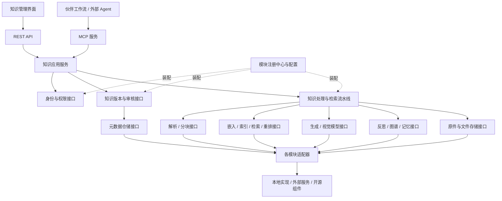

# AI Knowledge OS 模块化可替换架构设计 V1

版本：V1。归档日期：2026-10-11（北京时间）。状态：架构设计阶段。按照最新要求，先完善架构，再推进业务实现。

本文是总体方案。详细设计见 [架构设计索引](README.md)，包括模块边界、数据与契约、发布一致性、部署、迁移和验收。以下“支持”均为设计要求，实际支持情况以适配器验证结果为准。

## 1. 总体设计

采用 **自有平台核心＋标准模块接口＋适配器＋模块注册中心**。

知识管理界面、API 和 MCP 使用平台定义的业务契约。解析、检索、模型、存储、审核等能力通过接口接入，替换实现时保持上层调用稳定。

已经确定：**通过配置替换模块，允许重启服务；有状态模块必须支持迁移、验证和回退。**

初期采用模块化单体，解析器和外部知识引擎可以独立部署。模块边界同时提供进程内接口与远程协议映射，后续可逐个拆成服务。



初始技术选择保留 Go、Vue、PostgreSQL、Redis、本地文件存储和云模型。它们属于默认实现，产品领域接口不使用供应商专有类型。

WeKnora 作为首个复用与验证候选。源码已有解析、检索、文件与模型接口，但这些接口引用自身内部类型，平台需要适配层。[解析接口](https://github.com/Tencent/WeKnora/blob/v0.8.2/internal/types/interfaces/document_parser.go)、[检索接口](https://github.com/Tencent/WeKnora/blob/v0.8.2/internal/types/interfaces/retriever.go)、[模型接口](https://github.com/Tencent/WeKnora/blob/v0.8.2/internal/types/interfaces/model.go)

## 2. 模块划分与标准契约

下表中的接口是平台自行定义的契约。每个模块可有多个实现；适配器负责转换供应商请求、结果、错误和标识。

| 模块 | 标准接口与输入输出 | 替换边界 |
|---|---|---|
| 用户界面 | 调用 OpenAPI，展示平台数据模型 | 页面、组件库及前端框架可替换 |
| 身份认证 | authenticate → Principal | 密码登录、OIDC、企业身份服务 |
| 权限管理 | authorize → AccessScope | 内置角色策略、外部策略服务 |
| 数据接入 | ingest → DocumentDraft + Job | 上传、网页及企业数据连接器 |
| 文件存储 | put/get/delete → BlobRef | 本地目录、S3 兼容存储、云对象存储 |
| 文档解析 | parse → DocumentBlocks | DocReader、其他解析器、OCR 服务 |
| 知识分块 | split → EvidenceChunks | 标题、父子块、表格及行业分块策略 |
| 嵌入模型 | embed → Vectors + EmbeddingSpec | 模型供应商、维度及批处理实现 |
| 索引存储 | upsert/delete/build → IndexGeneration | 向量库、全文引擎及索引构建器 |
| 检索器 | search(Query, AccessScope) → Candidates | 向量、关键词、图谱等召回方式 |
| 融合与重排 | fuse/rerank → RankedEvidence | 融合算法和重排模型分别替换 |
| 生成模型 | generate(Evidence) → AnswerStream | 云模型、本地模型、协议适配器 |
| 审核与版本 | submit/approve/publish/withdraw | 审核流程实现和审批引擎 |
| 反思与反馈 | assess/refine/propose → ReflectionResult/Draft | 检查策略、查询改写、修改建议 |
| 长期记忆 | save/search/update/delete → MemoryRecord | 自有实现、外部记忆服务 |
| 知识图谱 | extract/query → Entities/Relations/Evidence | 图谱数据库和抽取策略 |
| 元数据仓储 | load/save/export/import + UnitOfWork | 数据库与数据访问实现 |
| 任务与事件 | enqueue/publish/consume | 本地执行器、Redis 队列、外部调度服务 |
| 评测与观测 | evaluate/record → Metrics/Report | 评测器、日志及观测平台 |
| API 与 MCP | 调用统一知识应用服务 | 传输协议和工具暴露方式 |

模块之间通过接口或事件通信。模块自己的数据访问封装在仓储接口中，其他模块通过服务契约访问。

**WeKnora 可以作为实现多个接口的复合适配器。**必须明确它支持哪些独立能力、过滤条件、数据导出与索引操作。仅能整体替换的部分标记为“复合能力”，不能算作已经实现了细粒度替换。

## 3. 数据归属与处理流程

### 统一数据模型

平台掌握以下权威数据：

- **Document / Revision：**稳定文档 ID、不可变内容版本、原件引用、内容校验值。
- **Block：**正文、表格、图片等标准内容块，以及页码、工作表、幻灯片或段落定位。
- **Publication：**审核记录、发布状态、当前有效版本和撤回记录。
- **AccessScope：**经过验证的主体、空间、知识库和访问范围。
- **PipelineProfile：**解析、分块、模型、检索策略及配置版本。
- **BackendBinding：**平台标识与供应商内部标识的映射。

向量、全文、图谱索引和缓存属于衍生数据，可以从权威内容重建。供应商 ID 保存在适配器映射中。

外部引用使用**平台文档 ID＋版本 ID＋内容位置**，避免更换检索引擎后引用失效。历史引用仍执行当前权限与撤回检查。

### 上传与发布

```text
接入 → 保存原件 → 创建草稿版本 → 解析 → 编辑与分块
                                      ↓
                                   人工审核
                                      ↓
                              准备正式索引版本
                                      ↓
                              切换有效发布版本
```

- 个人空间由所有者确认发布；企业空间由 Owner/Admin 审核。
- 已发布版本保持不可变，修改产生新草稿。
- 发布准备失败时，旧发布版本继续有效。
- Agent 的纠错和修改建议统一进入草稿。
- 解析和索引状态与审核状态分别记录。

重新解析必须明确版本行为。WeKnora 的接口说明包含删除已有内容后重解析的操作，平台适配器需要创建独立候选版本，保留原发布版本。[知识接口依据](https://github.com/Tencent/WeKnora/blob/v0.8.2/internal/types/interfaces/knowledge.go)

### 检索与问答

```text
身份验证 → 计算访问范围 → 绑定流水线配置
                         ↓
                 多路召回 → 融合 → 重排
                         ↓
                校验发布版本与来源权限
                         ↓
                  返回证据 / 生成回答
                         ↓
                证据不足时有限轮数反思
```

- 权限和发布范围必须进入检索条件，返回后再次校验。
- 不支持必要过滤能力的适配器不能用于正式检索。
- 查询向量与索引必须使用匹配的嵌入规格。
- 不同检索器声明分数含义；默认使用按排名融合，重排独立执行。
- 普通问答默认一次检索；反思最多额外两轮，总预算 30 秒。
- 身份、权限或发布状态检查失败时终止请求；可选图谱或记忆不可用时，可退回基础检索并记录降级状态。

WeKnora 的混合检索 API 已支持预计算查询向量和知识条目过滤，可作为适配验证入口。[检索 API](https://github.com/Tencent/WeKnora/blob/v0.8.2/website-docs/04-api/02-api-knowledge.md)

## 4. 注册、配置与替换机制

### 模块注册

每个实现提供模块清单，至少声明：

`模块标识、能力类型、实现版本、契约版本、配置要求、依赖、支持能力、健康检查、迁移能力`。

启动时完成配置校验、依赖检查、契约兼容性检查和健康检查。核心能力缺失时不接收业务请求；契约主版本不兼容时拒绝装配。

进程内模块通过接口注入；外部模块通过版本化 HTTP/JSON 接入，已有 gRPC 服务由适配器转换。首版采用受控适配器注册。

### 配置范围

- 身份、元数据库、审核、审计和任务实现由部署级配置控制。
- 解析、模型、检索和重排可在平台允许清单内按空间及知识库配置。
- 每个任务和请求绑定不可变配置版本，便于复现与追踪。
- 密钥使用凭据引用，模块清单与普通日志不保存密钥正文。

### 替换流程

统一流程为：

**校验新实现 → 备份或导出 → 迁移或重建 → 契约与效果验证 → 配置切换并重启 → 观察 → 保留回退窗口。**

| 替换对象 | 必要处理 |
|---|---|
| 生成或重排模型 | 验证协议、输出、引用、速度与费用 |
| 解析器 | 对样本重新解析；内容变化形成候选版本并审核 |
| 分块器 | 重建分块及索引，保持来源定位 |
| 嵌入模型 | 创建新索引代际，重新嵌入，验证后切换 |
| 检索引擎 | 导入标准内容或重建索引，验证过滤、召回及删除语义 |
| 文件存储 | 复制原件、校验内容，更新内部位置映射 |
| 元数据库 | 暂停写入、导出导入，校验版本、权限、审核记录及映射 |
| 权限或审核实现 | 对照验证授权结果、状态流转与审计记录 |
| 任务系统 | 暂停投递、处理或迁移积压任务，验证幂等与恢复 |

异步任务按“文档版本＋处理阶段＋流水线配置版本”去重。事件允许重复交付，消费者必须保证重复任务不会造成重复发布或覆盖新版本。

## 5. 前期交付与架构验收

先完成文档、调研、标准契约和架构评审，再逐步实现模块基础与业务模块。用户最新要求是先把架构设计好；当前优先交付可审查的设计和验证方案。

前期完成以下成果：

1. **组件能力矩阵：**逐项核对接口、过滤条件、数据出口、许可、维护情况及替换成本。
2. **契约设计：**统一数据模型、模块接口、错误语义、事件、配置及版本兼容规则。
3. **架构决策记录：**解释底座接入方式、模块边界、数据归属、迁移及回退选择。
4. **验证方案：**为解析、检索、模型、存储分别设计至少两种实现的替换试验；其他模块准备公共契约测试。
5. **伙伴接口文档：**REST 与 MCP 共用应用服务，保留检索、读取、带引用问答和反馈四项能力。

架构通过条件：

- 替换底层实现时，界面及伙伴工作流的正常调用保持兼容。
- 新实现通过同一套权限、发布、引用、故障及幂等测试。
- 数据可以导出、迁移、验证并回退。
- 索引重建后，可追溯原件、知识版本与来源位置。
- 模块能力不足、契约不兼容或配置错误会明确暴露。
- 替换前后使用同一评测集比较召回、准确性、延迟和成本。

后续开发保留原有目标：通用中文资料、空间与知识库权限、人工审核、反馈草稿，以及约定测试集 Recall@10 ≥90%。性能目标在固定硬件、模型、资料量和并发下验收。

具体实施进度与证据见 [实施状态](IMPLEMENTATION_STATUS.md)。只有通过真实测试的能力才标记为完成；接口定义、测试实现、生产适配器及真实性能分别记录。
