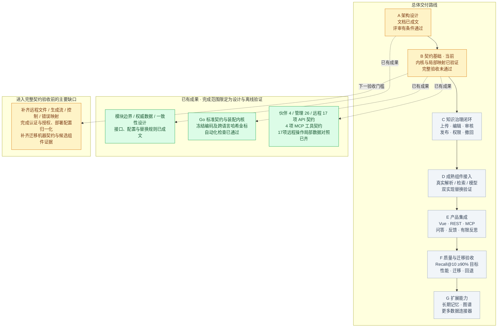

# AI Knowledge OS 总进度图

更新：2026-10-13。当前重点：先完善架构设计与契约验证。

**总体状态：架构评审有条件通过，契约基础部分完成；V1 契约冻结、业务闭环及完整运行验收尚未通过。**

图例：绿色＝标注范围内已完成；黄色＝部分完成；灰色＝待实施或待取得运行证据。本图按交付与验收阶段展示，不使用未经工作量拆分的完成百分比。

## 阶段状态与通过条件

| 阶段 | 当前状态 | 下一项可验收成果 |
|---|---|---|
| A 架构设计 | 设计已成文，评审有条件通过 | 收敛剩余契约、迁移和候选组件证据缺口 |
| B 契约基础 | 部分完成，目前所在阶段 | 完整字段与传输映射、正式部署装配、认证授权等契约验收通过 |
| C 知识治理闭环 | 待实施 | 原件、草稿、编辑、审核、发布、检索、撤回贯通；权限和并发故障验证通过 |
| D 成熟组件接入 | 已有调研与适配设计，真实运行待验证 | 解析、检索、模型、文件存储接入；两种实现替换对照有证据 |
| E 产品集成 | 已有接口设计，产品实现待开始 | 管理界面和 REST/MCP 运行服务，问答、反馈与有限反思贯通 |
| F 质量与迁移 | 已有验收方案，实测待开始 | 同一封存中文测试集 Recall@10 ≥90%；固定条件性能与迁移回退演练通过 |
| G 扩展能力 | 已有端口设计，实现待开始 | 记忆、图谱和连接器通过共同权限、来源与删除契约，并证明业务收益 |

阶段顺序表示交付和验收门槛；接口调研、组件实验可提前开展，但不能据此把后续阶段标为通过。

## 当前证据边界

- Go 包测试、静态检查及 Python 契约检查已通过；它们证明对应实现和离线契约，不证明真实服务已上线。
- [SSE接收辅助器](architecture/SSE_TRANSPORT.md)已通过8项场景，包括3项真实本地HTTP验证：分块、阻塞取消/关闭、deadline和模拟输出拒绝。done/error等到正常EOF并复核访问回调后才输出；真实授权、模型和后台停止仍未验证。
- [远程17操作](architecture/REMOTE_MAPPING_COVERAGE.md)局部数据对照已齐，包括[控制/取消](architecture/CONTROL_WIRE_MAPPING.md)、文件metadata、生成事件及复合search；15码安全错误投影已核验。仍待全量领域/值域、HTTP/multipart/SSE、模型/后端、供应商分类、当前授权/Grant、账本与真实取消/网络联调，D-03未关闭。
- 复合能力映射 D-01 与精确冻结编码 D-02 的设计缺口已收敛；D-03远程契约仍部分完成。D-04已有[保留策略](architecture/RETENTION_CONTRACT.md)、[构建锁](architecture/BUILD_LOCK.md)、[导出清单](architecture/EXPORT_CONTRACT.md)、[事务日志链](architecture/JOURNAL_PROTOCOL.md)、[KB状态机](architecture/MIGRATION_STATE.md)和[文件字节库存](architecture/BLOB_COPY.md)局部校验，分别有7、10、9、11、13和11项专项测试。记录payload、数据库/文件迁移状态、实际复制/映射切换及真实提交/重放/部署核对仍待完成。最新Python回归87项通过，D-05候选组件证据仍待补齐。
- 尚无可运行的完整产品服务，也没有真实数据上的 Recall、延迟、商业成本或完整模块替换验收结果。

详细依据见 [实施状态](IMPLEMENTATION_STATUS.md)、[架构验收报告](architecture/ACCEPTANCE_REVIEW.md)、[分阶段验证门槛](architecture/VALIDATION.md)和[最新索引映射检查记录](architecture/evidence/index-wire-review.json)。本图为上述记录的概览；后续在取得新的交付或验收证据后同步更新。
