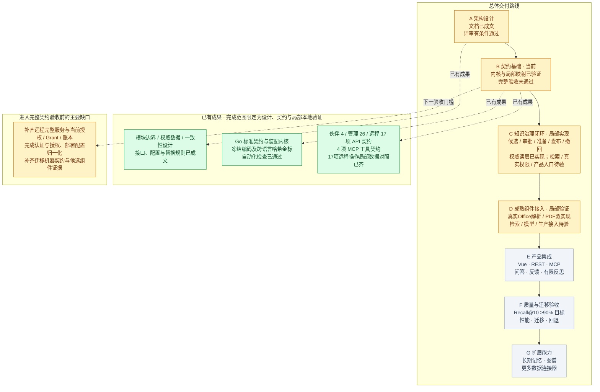

# AI Knowledge OS 总进度图

更新：2026-10-15。当前重点：契约与局部实现验证，补齐知识治理闭环。

**总体状态：架构评审有条件通过，契约基础部分完成；V1 契约冻结、业务闭环及完整运行验收尚未通过。**

图例：绿色＝标注范围内已完成；黄色＝部分完成；灰色＝待实施或待取得运行证据。本图按交付与验收阶段展示，不使用未经工作量拆分的完成百分比。

## 阶段状态与通过条件

| 阶段 | 当前状态 | 下一项可验收成果 |
|---|---|---|
| A 架构设计 | 设计已成文，评审有条件通过 | 收敛剩余契约、迁移和候选组件证据缺口 |
| B 契约基础 | 部分完成，目前所在阶段 | 完整字段与传输映射、正式部署装配、认证授权等契约验收通过 |
| C 知识治理闭环 | 候选、提交、审批、关键词准备/完成、发布CAS及撤回已实现；查询权威读层已接入，完整闭环待验 | 有效检索与当前证据复核贯通；更多通道、真实权限和产品入口验证通过 |
| D 成熟组件接入 | Office真实解析、PDF双实现及索引窄能力替换已验证 | 检索与模型等生产接入；补齐各模块的两种实现替换对照 |
| E 产品集成 | 已有接口设计，产品实现待开始 | 管理界面和 REST/MCP 运行服务，问答、反馈与有限反思贯通 |
| F 质量与迁移 | 已有验收方案，实测待开始 | 同一封存中文测试集 Recall@10 ≥90%；固定条件性能与迁移回退演练通过 |
| G 扩展能力 | 已有端口设计，实现待开始 | 记忆、图谱和连接器通过共同权限、来源与删除契约，并证明业务收益 |

阶段顺序表示交付和验收门槛；接口调研、组件实验可提前开展，但不能据此把后续阶段标为通过。

## 当前证据边界

- [当前复核应用编排](architecture/CURRENT_CHECK_FLOW.md)明确统一检查顺序、批准/Revision投影缺口及6项CHECK门槛；运行协调服务待实施。

- [当前事实比对](architecture/QUERY_AUTHORITY.md#14-当前元数据与准备事实的关系比对)：拒绝撤回/换版/代际或策略变更、不完整/重复批次；3项Go检查通过，不替代实时批准/Ready/授权。

- [当前批量读取](architecture/QUERY_AUTHORITY.md#13-另开观察点的有界当前批量读取)另开回调并限制数量/字节，错误不返回部分；3项Go检查通过，真实新鲜度/ACL未验。

- [特性声明结构](architecture/KERNEL_RUNTIME.md#特性声明结构一致性修复2026-10-14)：Go/Python名称与唯一性检查一致，合法新特性仍可扩展；实际行为未验。

- [版本协商](architecture/KERNEL_RUNTIME.md#版本协商一致性修复2026-10-14)：修复较新次版本拒绝及整数溢出问题；Go/Python声明检查一致，真实组件兼容仍待验。

- [记忆/图谱生命周期](architecture/MEMORY_GRAPH_LIFECYCLE.md)细化来源、撤回/删除及替换边界，明确接口缺口与7项EXT门槛；已补三类来源及2项Go关系检查、记录机器草案及离线Go/wire映射、实际跨语言样本及五类边缘差异修复，增加最低能力声明预检及独立图谱投影管理端口、必需联结与结果关系校验、域隔离操作摘要及独立跨语言金标；阶段G仍待实施。

- [统一本地验证](architecture/VALIDATION.md#统一本地验证入口windows)：当前Go测试/vet、227项Python和伙伴/管理/远程模块三份OpenAPI结构检查通过；报告含461项输入哈希（含依赖锁/二进制样本）、失败退出及运行验收未通过标记。

- [静态模块依赖](architecture/DEPENDENCY_BOUNDARIES.md)：192个非测试Go文件通过精确import规则，3项测试覆盖9类违规；仅pkg/cmd静态边界，实际模块替换仍待验。

- [全请求计量](architecture/REQUEST_METERING.md)已有设计、Go类型及8项精确算式/usage关系检查（含输入分桶一致性）；补齐计量端口与事务/恢复规则；6项实际计量/并发/对账门槛尚未执行。

- [反思检索应用接入](architecture/REFLECTION_PIPELINE_BINDING.md)已有初始/追加轮与新授权/向量/投影/计量设计；6项真实端到端门槛尚未执行。

- [有限反思与草稿编排](architecture/REFLECTION_ORCHESTRATION.md)已有设计、4项多查询配额、6项合并、6项整轮调度、9项有限循环Go及1项部署配置检查；六项真实模型/事务/替换门槛尚未执行。

- [探测接收账本](architecture/STORE_PROBE_LEDGER.md)已有设计、Go记录/事务端口及5项状态及5项Check集体候选关系检查；6项持久并发/恢复门槛尚未执行。

- [数据源启动门](architecture/STORE_STARTUP_GATE.md)已有设计与4项Bound探测Go及5项离线Schema及3项实际Go映射检查；真实服务/一次性账本和6项运行门槛尚未执行。

- [元数据读写绑定](architecture/METADATA_STORE_BINDING.md)已有设计、Go端口、4项身份关系及5项离线Schema及3项实际Go映射检查；6项真实端点与替换门槛尚未执行。

- [查询权威服务](architecture/QUERY_AUTHORITY.md)已接入[PostgreSQL默认读层](architecture/POSTGRES_QUERY_READS.md)：同一只读快照、真实当前批准/后端代际、跨页撤回、新观察点失效与store轮换已有实库验证。完整QueryAuthority、真实权限、最终输出与仓储替换门槛仍待通过。

- [发布投影身份](architecture/PUBLICATION_PROJECTION.md)已有闭集Schema、6项离线关系及4项摘要及3项Go/Python闭集加载检查、5组金标；实际DTO关系另有3项Go检查含wire往返；真实来源、一致性/状态与应用接入待验。

- [分库请求与授权边界](architecture/PARTITION_REQUEST.md)已有字段映射与6项运行门槛；子授权、发布投影身份、新Grant及当前状态复核未执行。

- [跨KB检索协调](architecture/RETRIEVAL_COORDINATOR.md)已有5项规划、6项合并及6项受控工作池及3项跨路线预算/错误及3项部署调用上限Go检查，验证配额、排名、并发/取消与故障分类；真实适配器截止/资源释放、当前权限/发布与效果待验。

- [RRF融合模块](architecture/FUSION_CONTRACT.md)已有4项算法Go、4项Profile策略、3项受控装配/停止及2项Schema/实际wire检查；真实获准路线/后端、多KB协调、替换和效果未验。

- [元数据1.1库存](architecture/EXPORT_CONTRACT.md)新增9类上传/部署信任记录族，4项包络/遗漏/Journal检查通过；TrustHead已有3项类型化导出/Go往返及4项Journal语义及4项独立起点及4项导出关联检查；其余typed载荷和实际导出/恢复仍未验证。

- [公钥信任激活](architecture/KEY_TRUST_ACTIVATION.md)已明确来源、高水位、退役、防回滚及中断恢复设计，新增部署仓储/事务端口和3项关系检查；6项运行门槛未执行，不能由本地快照测试证明完整安全切换。

- [Grant内部绑定契约](architecture/ACCESS_GRANT.md)已有5项离线绑定及6组基础及17操作局部Go/Python摘要金标、4项动作策略检查，[验签SDK与令牌Profile](architecture/GRANT_TOKEN_PROFILE.md)已有选型及4项真实SDK签名/绑定及4项公钥快照及3项JSON加载测试、Python4项独立摘要检查，真实服务身份、当前授权及账本未验证；声明匹配不构成授权。

- [Recall评测契约](architecture/RETRIEVAL_EVALUATION.md)已有7项离线算术、5项Schema/请求绑定及8项投影封存测试；封存中文集、真实检索/权限/来源映射与性能仍待验证，未证明90%目标。

- [上传确认与恢复](architecture/BLOB_CONFIRMATION.md)已补充设计：幂等操作、固定对象、原子关联和提交未知恢复；机器记录7项及状态转换9项离线检查已通过，9项运行门槛尚待执行。接收验证与确认成功分别验收。

- [multipart接收辅助器](architecture/BLOB_MULTIPART_TRANSPORT.md)新增7项测试：流式暂存、完整性/预算、失败清理与真实HTTP读取中断/超时通过；仅返回验证receipt，真实授权和原子存储提交待完成。

- Go 包测试、静态检查及 Python 契约检查已通过；它们证明对应实现和离线契约，不证明真实服务已上线。
- [SSE接收辅助器](architecture/SSE_TRANSPORT.md)已通过8项场景，包括3项真实本地HTTP验证：分块、阻塞取消/关闭、deadline和模拟输出拒绝。done/error等到正常EOF并复核访问回调后才输出；真实授权、模型和后台停止仍未验证。
- [远程17操作](architecture/REMOTE_MAPPING_COVERAGE.md)局部数据对照已齐，包括[控制/取消](architecture/CONTROL_WIRE_MAPPING.md)、文件metadata、生成事件及复合search；15码安全错误投影已核验。已有局部multipart/SSE网络证据；仍待全量领域/值域、完整HTTP服务、模型/后端、供应商分类、当前授权/Grant、账本与真实取消/网络联调，D-03未关闭。
- 复合能力映射 D-01 与精确冻结编码 D-02 的设计缺口已收敛；D-03远程契约仍部分完成。D-04已有[保留策略](architecture/RETENTION_CONTRACT.md)、[构建锁](architecture/BUILD_LOCK.md)、[导出清单](architecture/EXPORT_CONTRACT.md)、[事务日志链](architecture/JOURNAL_PROTOCOL.md)、[KB状态机](architecture/MIGRATION_STATE.md)和[文件字节库存](architecture/BLOB_COPY.md)局部校验，分别有7、10、9、11、13和11项专项测试。记录payload、数据库/文件迁移状态、实际复制/映射切换及真实提交/重放/部署核对仍待完成。最新Python回归161项通过，D-05已有[WeKnora部署源码与准入](architecture/COMPONENT_ADMISSION.md)局部证据，另有[解析依赖与部署包](architecture/PARSER_DEPLOYMENT.md)固定核验；增加[Qdrant独立向量](architecture/QDRANT_ADAPTER.md)与[OpenSearch中文关键词对照](architecture/KEYWORD_ADAPTER.md)；全部候选及完整制品/许可核验仍待补齐。
- 尚无可运行的完整产品服务，也没有真实数据上的 Recall、延迟、商业成本或完整模块替换验收结果。

详细依据见 [实施状态](IMPLEMENTATION_STATUS.md)、[架构验收报告](architecture/ACCEPTANCE_REVIEW.md)、[分阶段验证门槛](architecture/VALIDATION.md)和[最新索引映射检查记录](architecture/evidence/index-wire-review.json)。本图为上述记录的概览；后续在取得新的交付或验收证据后同步更新。

- 当前批准投影与MatchCurrentReview局部检查已补：批准/冻结版本/当前审核有效性在同一读取批次，缺失拒绝。2项Go测试及统一回归通过；真实权威源、应用协调与CHECK运行验收仍开放。

- 刷新主体/授权范围局部比对已补：主体、委托、空间、动作、策略固定，KB只可缩小且覆盖必要来源；3项Go测试及统一回归通过。真实认证和CHECK-01保持开放。

- 局部CheckCurrent编排已实现：两次控制刷新、批准/元数据/后端验证顺序，错误停止与父预算；4项Go模拟测试及统一回归通过。真实端口与输出调用尚未接入，CHECK门槛仍开放。

- FrozenContentReader契约和实际标准JSON双摘要核验已实现：平台文档/版本绑定、规范化内容与BlocksHash/ContentHash比对；3项Go测试及统一回归通过。真实读取、原件/索引/具体证据定位仍未验。

- CheckOperation携带具体Evidence并绑定发布文档/版本，完整副本交给后端，非法输入零提供者调用；2项Go测试及统一回归通过。真实Block/Blob/定位/摘录核验和输出调用尚未验。

- 正文证据位置/摘录局部核验已实现：实际双摘要绑定、Unicode码点范围及粗定位连续子串；3项Go测试及统一回归通过。original/表格/媒体定位未支持，真实后端及输出尚未接入。

- 多格式证据核验模块设计成文：分离内容/原件/索引/定位核验、固定能力路由与替换规则，明确音频引用时间字段缺口；6项EV运行验收尚未执行。

- 当前新增模块质量修复：标准文件存储接口、真实原件解析、上传限额、完整引用与检索前置过滤、跨版本分块ID、依赖清单；9项Go回归及统一回归通过。真实业务授权/治理尚未接入，默认业务端点503。

- 解析/分块内部Factory接入：按配置注入BlobStore实例、前置设置校验和关闭旧引用；2项Go集成测试及统一回归通过。异构实现替换与正式部署bootstrap尚未完成。

- 本地上传幂等账本局部实现：跨实例复用原结果、语义冲突拒绝、并发预留和pending阻止重复；3项Go测试及统一回归通过。自动恢复/孤儿清理及真实授权/事务仍待完成。

- 本地Blob可重试删除：先记录逻辑删除再清理，重复/并发调用、数据-only恢复和损坏记录均受控；2项Go测试及统一回归通过。Document撤回、索引传播及完整恢复/迁移尚未接入。

- 内存索引删除与旧任务阻止已实现：空间/KB/代际归属、指定分块或代际删除、重复授权删除及旧Upsert拒绝；3项Go测试及统一回归通过。标记仅内存，权威撤回/事件传播/持久化仍待接入。

- 权威撤回事务设计成文：历史幂等结果、固定CleanupPlan、同事务CAS/审计/日志/outbox及新旧代际隔离；6项WTX运行门槛未执行，历史仓储/来源epoch/SQL实现尚待补齐。

- 发布历史/固定清理计划Go契约已补：两个事务仓储端口、epoch/来源关系与索引完整覆盖检查；3项Go测试及统一回归通过。真实SQL、绑定定义、导出迁移与WTX验收未完成。

- 撤回SQL原型/独立运行器已完成，真实PostgreSQL 15.17试验通过；统一回归纳入.sql输入SHA。18版本与Go事务/真实授权/审计及完整WTX尚未完成。

- PostgreSQL运行器失败清理/标签边界补齐：3项Python回归，15.17实际数据库再次通过并移除临时容器；18下载仍运行，Go UoW/真实授权及完整WTX未验。

- PostgreSQL 18.0与15.17 SQL+Go真实探针均通过：History/Plan适配片段、作用域/预算、结束句柄与History写入回滚；3项Go单元测试。18下载已完成，完整UoW/Auth/outbox等仍未接入。

- SQL事务边界继续验证：作用域验证后取消仍拒绝，提交前复核失败回滚已执行History INSERT；1项Go回归与15.17/18.0真实探针通过。实际IAM/RLS仍未接入。

- Go清理计划/多目标实际写入读取和失败回滚已在15.17/18.0验证；第二目标失败不残留计划/先前目标。完整元数据CAS/审计/outbox事务与生产权限未接入。

2026-10-14新增撤回发布头 CAS/outbox 原子事务片段及真实数据库成功/故障探针。架构仍有条件通过，完整治理、真实授权、异构模块替换及 Recall@10 ≥90% 运行验收保持开放。详见 [撤回事务实现](architecture/POSTGRES_WITHDRAW_STORAGE.md#8-发布头-cas-与-outbox-原子提交)。

2026-10-14补命令预留与原历史重放：同事务预留回滚、同键摘要冲突和 pending 拒绝接管，重试不创建重复历史/计划/事件。完整命令编码、授权、业务服务和 WTX 验收仍待完成。

2026-10-14补撤回专用审计：同事务写入、历史关系与主体/时间匹配、应用修改/删除拒绝、漏写拒绝及审计失败全回滚；重试不重复审计。完整UoW、生产审计/授权及WTX仍待完成。

2026-10-14进入C阶段的撤回切片：标准事务端口、独立应用编排、事务内当前发布头/登记目标读取、真实提交与历史重放。保持C局部完成；真实身份、命令摘要准备、审核/发布/消费者及迁移仍待实现。

2026-10-14补撤回摘要与准备器：Go/Python金标、临时字段与稳定身份区分、Verify拒绝/取消、独立ID和拷贝隔离；真实PG应用使用实际摘要代码。身份来源仍fixture，完整生产授权/格式迁移及V1总体验收未完成。

2026-10-14补单库来源登记与清理定义封存：有效来源头/epoch匹配、登记目标双向覆盖、索引定义代际绑定、提交后目标追加拒绝。真实外部生产者/消费者、并发及恢复验证仍开放。

2026-10-14补清理任务存储切片：固定目标进度、租约及递增令牌、终态幂等和unknown停止自动领取。外部效果尚无回执核验/fencing证据，消费者循环、完整任务能力、崩溃和迁移验收保持开放。

2026-10-14补清理单项消费者：稳定操作身份、Lookup优先、独立租约/回执核验和执行准入。4项Go检查及PG存储+编排探针；外部后端仍fixture，生产外部效果、持续投递/恢复及WTX保持开放。

2026-10-14补实际本地索引清理：PG任务/消费者接入MemoryIndex删除与独立状态核验，新代际保留、旧代际重写拒绝。真实权限仍fixture，内存标记非持久化，成熟外部引擎及替换/恢复门槛保持开放。

2026-10-14补索引清理双实现：MemoryIndex与PG共用标准删除/状态读回端口，PG删除标记跨连接保留并阻止旧快照写入。完整检索/投影协议、同评测集迁移/回退与生产数据库恢复仍开放。

2026-10-14补同数据索引交接：完整投影/Owner、代际及分块标记，Memory→PG→新Memory校验值一致；实际SQL恢复故障全回滚。未完成全量元数据/任务/配置迁移、写入追平及部署切换，整体仍有条件通过。

2026-10-14补索引窄能力受控配置装配：内存/PG选择、同快照一致、ConfigVersion变化、特性不足/typed-nil/设置拒绝及旧引用关闭。完整部署/权限/检索切换验收仍开放。

2026-10-14接入MarkItDown实际解析：DOCX/XLSX/PPTX中文和原生文本PDF转换、Go文件存储/进程链路；来源coarse并进入候选。精确结构/扫描OCR、身份、生命周期、第二实现和完整解析门槛仍开放。

2026-10-14补成熟解析器受控工厂：显式BlobStore依赖、宿主转换入口/Health、格式/粗粒度能力和OCR拒绝；四类真实格式由Kernel装配调用，关闭引用拒绝。完整部署/隔离/第二实现及正式解析验收未完成。

2026-10-15强化解析进程协议：可信绝对入口、调用前格式拒绝、严格响应及正文预算；新增真实子进程故障/超时/溢出测试，四格式真实转换回归通过。OS沙箱、进程树隔离、精确结构及第二解析实现保持开放。

2026-10-15强化真实解析验证工具：每次独立构建目录与失败清理、旧成功报告失效、逐格式装配/关闭引用证据核对、探针摘要及输入变化拒绝。新增四项生命周期/证据测试；完整解析、替换与生产验收范围不变。

2026-10-15接入第二独立PDF引擎pypdf 6.19.0：独立环境、PDF/text窄能力工厂与标准Parser候选来源。三份相同原生文本PDF分别通过MarkItDown/pypdf，核对正文、原件SHA、版本、关闭引用及损坏摘要拒绝。覆盖范围是PDF文本交集，中文复杂结构/OCR、全量公共契约、生产部署与审核发布验收仍开放。见[双解析器替换试验](architecture/PARSER_REPLACEMENT.md)。

2026-10-15补双工厂公共契约：实际文件存储配合fixture转换器/授权回调，验证十三类非法请求、授权拒绝、稳定候选ID及配置变化隔离。修复Office/PDF允许缺失流水线摘要的问题；真实IAM、审核CAS、完整解析替换验收保持开放。

2026-10-15增加解析候选/草稿合并领域规则：绑定预期版本、原件和流水线，人工编辑/换附件/提交后保留迟到候选，禁止覆盖；复用块ID单调递增行版本。流水线提供ProcessCandidate；成熟解析器探针接入相同规则。持久化候选、数据库CAS/审计/outbox事务、任务回执与真实IAM仍未完成。见[解析草稿边界](architecture/PARSED_DRAFT_CANDIDATE.md)。

2026-10-15接入同步CandidateRepository与隔离PG事务源码：候选/草稿CAS/幂等回执/审计/outbox、不可变候选和延迟完整性约束，新增冷连接重放、迟到/提交保留及审计/outbox失败回滚探针。全量本地代码检查通过；Docker引擎启动失败且后端退出，真实PG试验未执行通过。旧PG证据不覆盖本次Schema，候选持久化仍未验收；任务租约/回执、完整Metadata UoW和生产接入保持开放。

2026-10-15补候选资源级授权门槛：必需AuthorizeCandidate与VerifyScope组合复核，提交前资源撤权回滚；命令和回调参数深拷贝，防止外部切片修改使摘要与实际写入内容不一致。四项驱动替身测试通过，真实PG验收仍未完成，Docker引擎仍不可用。

2026-10-15接通候选应用服务Prepare/Commit：解析前后和写入前资源授权、宿主ProfileDigest绑定、输入深拷贝、scope预算及回执一致性；未知结果用同一候选重试，不重新解析。平台区分确定拒绝/提交未知，PG适配器保留原错误兼容映射。真实文件/Markdown与服务串联，仓储/权限仍fixture；跨重启恢复、真实PG、IAM及业务端点保持开放。

2026-10-15补独立候选读取接口：精确读取动作/资源授权、限定完整归属路径、原提交主体摘要与回执核对、撤权后不返回结果。四组驱动替身测试通过，PG探针补冷连接读取/拒绝场景。读取缺失不能证明未知写入失败；跨重启恢复及真实数据库运行仍未验收。

2026-10-15补独立WSL PostgreSQL 16.15真实验证：工作区解包依赖、独立回环端口、私有数据库目录和所有权清理；两份SQL脚本及49项Go仓储检查通过，候选CAS/重放/保留/审计/outbox回滚/读取已真实运行。服务停止与目录清理成功，413项源码摘要一致。旧PG15/18报告仍不覆盖候选扩展，真实IAM、任务回执及生产接入未完成。见[WSL验证路径](architecture/WSL_POSTGRES_VALIDATION.md)。

2026-10-15补真实应用串联：实际中文/Emoji原件、文件存储、MarkdownParser、CandidateService、PG16.15与冷连接Reader串联通过；提交后丢失回执重试不重新解析，人工编辑后迟到候选持久保留，未发布且审计/outbox不重复。上传与解析读取使用独立fixture授权，初始元数据仍fixture。54项数据库/应用检查通过，生产IAM、业务端点、审核发布和跨重启恢复保持开放。见[串联验证](architecture/CANDIDATE_E2E_VALIDATION.md)。

2026-10-15补PG15/16/18同代码真实兼容验证：15.19、16.15、18.6均使用相同414项源码输入和同一Go探针二进制，通过两份SQL与同一54项仓储/应用检查。服务停止、目录清理与端口关闭均独立核对。当前已实现子集的PG15/18版本缺口已补齐；完整UoW、审核发布、IAM/RLS、迁移回退和精确Docker镜像部署仍未完成。见[数据库版本矩阵](architecture/POSTGRES_VERSION_MATRIX.md)。

2026-10-15：已实现[原生草稿冻结映射](architecture/NATIVE_FROZEN_MAPPING.md)，文本/表格/图片/音频按平台规范生成独立载荷及双摘要，通过7组独立Schema/Python金标。数据库草稿也接入同一映射，当前PG15/16/18检查增至55项。提交审核、不可变Revision持久化与审批事务仍待实施，完整知识治理闭环未通过。

2026-10-15最新进展：已实现[草稿提交审核事务](architecture/SUBMISSION_TRANSACTION.md)，原件验证在写事务外执行，事务内校验版本与载荷摘要。冻结Revision、pending审核请求、submitted草稿、回执、审计与outbox共同提交；配置绑定、同键冷连接重放、撤权、回滚、不可变保护和并发单版本均有运行证据。PG15.19/16.15/18.6使用相同425项输入及同一探针二进制，各通过64项检查；Go测试/vet、227项Python测试、OpenAPI及7组冻结金标通过。证据见[提交验收记录](architecture/evidence/submission-transaction-review.json)。

下一步仍是审批决定、有效批准与发布链路，并补齐真实IAM、完整UoW/迁移日志和正式应用入口；这些缺口不由本次局部提交验收替代。

2026-10-15最新进展：已实现[审批决定事务](architecture/REVIEW_TRANSACTION.md)，包含批准/拒绝/撤销、不可变决定、CAS当前指针、幂等历史回执及审计/outbox。复核并修正上一轮初始待审契约，统一为submitted/版本0。PG15.19/16.15/18.6使用相同431项输入及同一探针二进制，各通过73项仓储/应用检查；21个真实审批投影通过管理OpenAPI校验。Go全包测试/vet、227项Python测试及7组冻结金标通过，实例与临时目录均已清理。

下一步是当前有效批准、发布前检查及原子发布/检索接入；真实IAM、正式管理接口、完整UoW/迁移日志和召回性能目标仍未通过。

2026-10-15最新进展：已实现[当前有效批准与发布准备登记](architecture/PUBLICATION_START.md)。当前规则头、审批指针和后端头在事务内受写入屏障保护；操作、初始任务、审计及outbox共同提交，支持冷连接重放、政策/后端切换、撤权、回滚与同键并发。PG15.19/16.15/18.6使用相同437项输入及同一探针，各通过83项检查；18个发布操作/任务投影与9个规则摘要通过独立Schema/跨语言对照，审批21个投影及冻结7组金标保持通过。Go全包测试/vet、227项Python回归与OpenAPI通过，私有实例均已清理。

下一步为发布任务的租约/恢复、实际索引准备、ReadinessProof及最终发布指针原子切换。当前只有preparing登记和queued初始任务，不代表已完成发布或已发布检索。真实权限、完整UoW/迁移治理、REST/MCP/UI与Recall目标仍开放。

2026-10-15最新进展：已实现[发布准备租约与内容读取](architecture/PUBLICATION_TASKS.md)的Claim/Renew/ReadOwned，分离稳定CommandID与调用追踪ID，支持提交后丢失响应的冷连接恢复、到期接管、更高fence及精确租约核验。Worker与原发布者分别再授权，配置ABA/批准撤销/epoch变化导致过期计划隔离；回执与任务头不一致会整体回滚。PG15.19/16.15/18.6使用相同443项输入及同一Go探针，各通过96项仓储/应用检查；21个任务投影、12份租约样本及已有发布/审批/冻结对照通过。统一Go测试/vet、227项Python回归、OpenAPI通过，私有实例/目录/端口已清理并核对。

下一步接入实际索引准备与外部写入fencing，持久化并独立验证ReadinessProof，再完成任务与最终发布CAS。当前没有持续队列、完整TaskRepository/迁移、正式API/MCP/UI或Recall实测成果。

2026-10-15最新进展：已实现[实际关键词索引准备与独立读回](architecture/INDEX_PREPARATION.md)。Worker通过独立分块/配置/后端端口处理已批准内容，PostgreSQL默认复合适配器在租约锁内原子写入attempt独立代际、不可变产物、审计和outbox，另开事务核验真实投影；封存防修改、删除后旧证明拒绝及接管隔离已有实库证据。相同448项输入与同一Go探针在PG15.19/16.15/18.6各通过108项检查；6组实际产物/快照通过独立摘要与标准PrepareResult Schema校验。Go全包测试/vet、227项Python回归及三份OpenAPI通过，测试目录/端口已独立确认清理。

下一步贯通任务完成、未知结果对账和最终发布CAS，再接有效发布检索。目前准备结果仅为文本关键词候选，不等同完整IndexWriter、第二准备后端替换或外部引擎fencing；真实权限、持续队列、向量/图谱、迁移回退、产品接口与Recall目标仍开放。

2026-10-15最新进展：已实现[准备任务完成与未知结果恢复](architecture/PREPARATION_COMPLETION.md)。完成前重新读回真实候选投影、冻结来源和配置，精确租约/版本匹配后将completed、产物引用、命令回执、审计与事件原子提交；历史回执可在执行租约到期后冷连接对账，不能充当当前发布授权。相同453项输入与同一探针在PG15.19/16.15/18.6各通过122项检查，6组实际完成响应/Job投影通过独立关系与管理Schema验证；Go/vet、227项Python与OpenAPI通过，私有实例清理已核对。

下一步实现最终发布CAS、当前准备效果复核及有效发布检索。完整任务队列/取消重试、第二准备后端、真实IAM、迁移回退、REST/MCP/UI与Recall/性能仍待验收。

2026-10-15最新进展：已实现[最终发布CAS与替换](architecture/FINAL_PUBLICATION.md)。当前批准、配置头、已完成任务及实际索引重新核验，原子切换有效头并保存历史/回执/审计/outbox；同一Revision的独立重建候选只有一个发布赢家，旧源固定清理可领取并实际删除旧索引，新代际保持完整。既有撤回服务与新发布互操作，撤回后重放旧发布不会复活来源。相同458项输入与同一Go探针在PG15.19/16.15/18.6各通过138项检查，6份结果/12个公共投影/6个命令摘要通过独立校验；统一Go/vet、227项Python与OpenAPI通过，实例/目录/端口清理已核对。

下一步是按当前权限与有效发布集合过滤的检索、最终证据复核和产品入口。新正文Revision换版实测、真实IAM、第二后端替换、持续队列/完整清理、迁移回退、REST/MCP/UI与Recall/性能验收仍开放。

2026-10-15最新进展：已实现[PostgreSQL查询权威读层](architecture/POSTGRES_QUERY_READS.md)，上层使用标准QueryReadUnit/Repository，同一只读Repeatable Read读取有效发布、当前批准/规则及后端代际，分页游标和句柄限制在回调内。真实撤回、撤销批准、对象隔离、权限回调、取消和store epoch轮换均有实库场景；撤回前的当前元数据比对通过，新读取后明确拒绝旧来源。同一461项输入与同一Go探针在PG15.19/16.15/18.6各通过150项累计检查，三组真实观察投影通过独立关系校验；Go全量测试/vet、227项Python与三份OpenAPI通过，测试实例/目录/端口清理已核对。

下一步贯通正式Retriever、真实索引及正文证据核验与输出前复核。当前实现仅证明元数据读取子集，最多1000个有效发布头；真实IAM、生产装配、第二仓储替换/恢复、REST/MCP/UI与Recall/性能验收继续开放。
