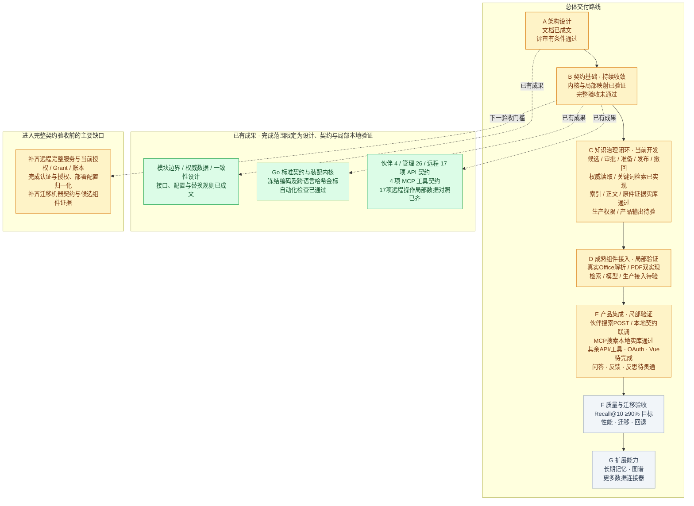

2026-10-30最新增量：检索证据核对面板补充最终排名与相关分数，和已有检索路径、版本、发布状态、更新时间、标签及原文定位一起展示，便于解释混合召回/重排结果。Dashboard 构建通过。

2026-10-30最新增量：来源反馈新增“创建修订草稿”操作：对引用不准确、缺少来源或内容过期反馈，服务端在当前授权下复制当前文档文本为新草稿，将 `proposal_draft_id` 回写反馈；后续仍必须按原有编辑、提交审核、批准和发布流程处理，不直接改发布版本。Dashboard 可直接打开新草稿。全量 Go 测试和 Dashboard 构建通过。

2026-10-30最新增量：反馈评测新增本地评测集草稿持久化：`POST/GET /local/api/evaluation-sets` 与单集读取会保存创建时的筛选条件和反馈快照，支持按当前 Dashboard 文档/版本/标签/时间范围一键保存，避免后续反馈状态变化导致评测样本漂移。localcli 单测、全量 Go 回归和 Dashboard 构建通过。

2026-10-30最新增量：检索证据卡片对带音频转写时间段的原件引用新增播放器，加载后定位到 `start_ms`，播放到 `end_ms` 自动暂停；播放器仍使用当前发布版本的原件读取 URL，不绕过授权。Dashboard 构建通过。

2026-10-30最新增量：反馈和评测接口新增按文档、版本、标签筛选，筛选在本地会话授权边界内执行；Dashboard 反馈面板可按这些范围生成覆盖数、帮助率和问题率报告，导出接口同步支持版本/标签条件。localcli 单测、全量 Go 回归和 Dashboard 构建通过。

2026-10-30最新增量：本地工作台新增受会话保护的 `GET /local/api/tags` 标签统计，按当前知识库的未删除文档返回标签使用次数；Dashboard 用统计结果提供标签输入建议，标签筛选仍在服务端执行。localcli 单测和 Dashboard 构建通过。

2026-10-30最新增量：本地文档列表新增服务端标签筛选，支持逗号分隔/重复参数的归一化；筛选条件写入分页游标，服务端跨底层页扫描到足够匹配项，避免标签过滤造成分页漏项。Dashboard 增加标签输入与应用操作，localcli 回归测试和前端构建通过。

2026-10-30最新增量：Dashboard 任务暂停、取消、重试失败时不再静默吞错，现展示安全错误和冲突/权限恢复提示；成功操作仍按当前时间筛选刷新任务列表。前端构建通过。

2026-10-30最新增量：反馈评测面板新增起止日期筛选，反馈列表和评测报告共享半开 RFC3339 时间范围；新增反馈时间过滤回归测试，localcli 单测与 Dashboard 构建通过。

2026-10-30最新增量：本地流式和 JSON 知识问答现在接收并执行来源类型、发布状态、标签和更新时间筛选；候选在语义排序/模型调用前按当前文档事实、发布历史和标签裁剪，筛选后无证据继续返回拒答状态，答案引用只来自筛选后的候选。新增筛选解析测试，全量 Go/vet、契约检查和 Dashboard 构建通过。

2026-10-30最新增量：本地任务中心任务快照增加创建时间，`/local/api/jobs` 支持 `created_after`/`created_before` 严格时间范围过滤；解析任务使用本地持久时间，发布/删除任务分别使用启动审计和发布历史时间，Dashboard 增加日期筛选和任务创建时间展示。localcli 单测和 Dashboard 构建通过。

2026-10-30最新增量：伙伴搜索继续补齐标签筛选，新增严格 `tags` 数组校验（去空白、去重、数量和长度上限），来源元数据返回标签并按全部标签匹配；同步更新 OpenAPI/MCP Schema 和测试。标签缺失或元数据不可用时过滤默认拒绝，避免越权扩大结果。

2026-10-30最新增量：管理任务列表新增 `created_after`/`created_before` RFC3339 时间筛选，解析、发布和删除任务分别按权威创建/启动/历史时间在 PostgreSQL 侧过滤；分页游标绑定类型、状态、文档和时间条件，避免换条件复用旧游标。`paused` 状态同时加入管理 API 和本地任务筛选。相关 API/运行时单测、管理契约生成检查和架构依赖检查通过。

2026-10-30最新增量：伙伴搜索 API 与本地检索筛选能力对齐，新增 `source_kind`、`updated_after`、`updated_before` 字段；请求仍严格拒绝未知字段和非法时间，筛选后重排证据排名并同步更新 OpenAPI/MCP 契约。伙伴定向测试、全量 Go 测试、go vet、伙伴契约检查和 Dashboard 构建通过；完整 OpenAPI 校验仍缺少宿主 `openapi_spec_validator` 依赖。

2026-10-30最新增量：检索证据的“打开原件”链接统一保留定位片段，支持 PDF 页码、Office 幻灯片/工作表/单元格/段落和音频起止时间参数；异步任务列表新增“已暂停”筛选；Dashboard 生产构建通过。

2026-10-30最新增量：`memorys-local` 初始化会按已安装任务表自动应用 `publication_tasks_v2` 和 `parse_tasks_v3` 暂停迁移；纯文本数据库不执行不存在的解析表迁移，Dashboard 暂停按钮不再依赖手工迁移步骤。

2026-10-30最新增量：本地 Dashboard 异步任务列表接入暂停/恢复操作和 `paused` 状态展示；解析任务支持运行中安全暂停并保留输入文件，发布任务通过同一 CAS 控制接口写入暂停状态，Vite 生产构建和 localcli 回归通过。

2026-10-30最新增量：发布任务控制新增持久化 `paused` 状态和 `POST /publication-jobs/{id}/pause`，暂停清除 publication lease、推进 fencing 并写入 superseded receipt/audit/outbox；发布重试现允许从 paused 创建新的 queued publication job。新增 `publication_tasks_v2.sql` 和 `-with-publication-pause` 迁移开关，管理契约更新为 30 个操作。

2026-10-30最新增量：解析任务控制新增持久化 `paused` 状态和管理 API `POST /parse-jobs/{id}/pause`；暂停使用当前 Job 版本 CAS，清理运行租约并推进 fencing，记录审计/outbox，重试可从 paused 恢复为 queued；新增 `parse_tasks_v3.sql` 和 `-with-parse-pause` 迁移开关。管理契约更新为 29 个操作。

2026-10-30最新增量：发布准备 Worker 接入服务器可选装配。`publicationassembly` 在显式启用并提供 Worker Bearer Token、space/KB/worker 身份后，将 PostgreSQL publication queue、租约/fencing、chunk splitter、真实索引准备和 completion 回执接入 `preparation.Service` 生命周期；任务读取、Worker 权限和原发布者权限分别重新核验。

2026-10-30最新增量：解析 Worker 增加全局分区队列模式（`MEMORYS_PARSE_ALL=1`），可跨空间/知识库领取 queued 或过期任务；租约回写携带原始分区，候选授权按任务 Scope 复核，避免跨租户提交。默认仍是显式单分区模式。

2026-10-30最新增量：服务器新增可选的真实解析 Worker 装配：独立 `parseassembly` 层在显式启用并提供空间、知识库、Worker 身份、Blob 根目录和解析器配置后，先健康探测 Markdown/Office/PDF/OCR/音频工具，再将持久 parse task、候选事务仓储和当前授权复核接入同一后台生命周期；未配置或工具不健康时保持 fail-closed，不伪造 Worker。

2026-10-30最新增量：修正管理上传任务的 MIME→解析格式映射，DOCX/XLSX/PPTX/PDF、图片、音频和 Markdown 现在进入解析器要求的规范格式，避免 Office 上传后因 MIME 子类型错误被拒绝；新增映射回归测试。

2026-10-30最新增量：Bootstrap新增可注入解析 Worker 生命周期，宿主可把持久解析任务队列和 `ingestion.ParseWorker` 接入统一启动、停止、就绪与错误隔离；上传接口仍只负责入队，解析执行不再需要绕过服务器生命周期。`go test ./...`、`go vet ./...` 通过。

2026-10-30最新增量：伙伴搜索结果补充可选来源元数据（标题、发布状态、发布epoch、更新时间），本地搜索与管理仪表盘展示来源标题；XLSX解析按工作表输出结构化表格块和精确单元格锚点，并加强伙伴OpenAPI `$ref` 结构回归检查。前端Vite构建、Go全量测试、go vet、管理/伙伴契约检查通过；真实PostgreSQL/Redis/IAM和完整OpenAPI验证环境仍待补齐。

2026-10-18最新增量：严格BuildLock构造路径现在要求assembler实现`ProductionHealthAssembler`，在启动HTTP/Runner前检查真实DB、IAM和模块健康；检查失败会关闭资源并拒绝启动。当前本地630项门禁通过。

2026-10-18最新增量：严格BuildLock构造路径新增`CoversRuntimeModules`，在调用assembler前核对实际kernel模块目录与锁定provider/release集合精确一致，拒绝缺失、额外或重复模块；本地630项门禁通过。

2026-10-18最新增量：生产Bootstrap新增严格`ProductionLockInput`/`NewProductionRuntimeWithBuildLock`路径，先执行Go BuildLock离线摘要校验，失败时不会调用assembler；成功后传入锁定报告与单次字节快照。当前本地630项门禁通过，PG新轮次仍受宿主时钟门禁影响。

2026-10-18最新增量：新增Go `pkg/buildlock.Verify/VerifyFiles`，对部署/锁/保留策略/模块清单/显式制品执行闭集JSON、原始字节SHA-256、覆盖、生命周期契约、源码revision和制品摘要绑定；报告固定ReadyForService=false，不替代来源信任与生产控制面。当前本地630项门禁通过。

2026-10-18最新增量：`events.RunnerGroup`与`NewRuntimeWithRunnerGroup`支持多个命名outbox消费者的确定性启动、失败回滚、逆序停止和全组Ready；`NewProductionRuntimeWithRunnerGroup`把同一制品快照交给所有Runner。当前本地628项门禁通过；PG新轮次受宿主墙钟跳变拒绝，未覆盖上一份PG证据。

2026-10-18最新增量：Bootstrap新增`NewProductionAuthenticator`，将同一代JWKS、部署issuer/audience、显式subject type和token lifetime绑定到Authenticator，并强制宿主提供真实StatusSource；不生成默认身份或撤销状态。

2026-10-18最新增量：ProductionArtifacts改为每个部署文件只读一次，从同一字节快照解码并记录JWKS/Profile/模块目录SHA-256，避免装配期间重新打开可变路径造成代际混用；本地与PG16当前626项证据通过。

2026-10-18最新增量：删除控制outbox改用PostgreSQL identity-backed `event_seq`排序与固定20位游标，修复随机请求ID作为keyset游标可能跳过并发后写事件的问题；SQL/Go探针与PG16.15当前626项源码快照通过。

2026-10-18最新增量：ProductionArtifactAssembler已接入生产Runtime可选路径；宿主实现该接口时，Bootstrap先加载同一代JWKS/Profile/模块目录并将不可变ProductionArtifacts传入，缺失或不合法制品fail-closed，基础assembler接口保持兼容。

2026-10-18当前稳定窗口更新：加入FactoryRegistry及Profile→kernel可替换工厂解析后的625项源码快照已通过PG16.15 WSL完整探针，临时实例停止与资源清理完成；fixture身份/部署仍使`production_acceptance=false`。见[当前PG证据](architecture/evidence/current-postgres16-wsl.json)。

2026-10-18实库证据：PG16 WSL探针最近稳定窗口通过326项检查且资源已清理；随后为覆盖游标单调约束的复跑捕获约4.83秒墙钟跳变并拒绝，当前完整PG验收保持未通过，production_acceptance仍为false。

2026-10-18当前稳定窗口：[PG16 WSL完整探针](architecture/evidence/current-postgres16-wsl.json)再次通过，SQL/Go仓储、临时实例停止和资源清理均有记录；身份和部署仍是fixture，`production_acceptance=false`，不把该实库结果升级为生产验收。

2026-10-18当前稳定窗口更新：JWKS装配组件加入后的619项源码快照仍通过PG16.15 WSL完整探针；资源清理完成，生产身份/部署边界保持未验收。

2026-10-18当前稳定窗口再次更新：Profile/模块目录加载器加入后的622项源码快照通过PG16.15 WSL完整探针，资源清理完成；生产身份/部署仍未验收。

2026-10-18当前稳定窗口更新：Profile/kernel factory装配路径加入后的623项源码快照通过PG16.15 WSL完整探针，资源清理完成；生产身份/部署仍未验收。

2026-10-18最新增量：Bootstrap Runtime新增Ready探针，Runner未启动、已停止或最近投递失败时报告不可用；无后台Runner的HTTP组合保持可用。

2026-10-18最新增量：Runner隔离告警钩子panic，告警后端故障不会终止事件消费主循环，也不会改变游标提交和重放边界。

2026-10-18最新增量：Runner新增只读Snapshot，可供Bootstrap健康检查采集游标、启动/停止状态和最近错误，但不被当作业务完成或租约有效性的证明。

2026-10-18最新增量：事件Runner新增可注入OnError告警钩子，投递失败会保留游标并重试，告警接入不改变事件幂等和游标提交边界。

2026-10-18最新增量：outbox Runner将游标持久化失败与投递失败统一进入告警/重放边界；失败时不推进本地游标，退避等待可被停止取消。该增量仅强化进程内运行保障，真实部署告警接线、持久调度和生产身份仍未验收。

2026-10-18最新增量：[清理显式重试控制](architecture/DELETION_CONTROL_RUNTIME.md)已接入当前版本CAS、未知效果拒绝、目标attempt/fencing保留和retry审计/outbox屏障；PG探针执行了unknown拒绝与已知failed恢复分支，但整体轮次被宿主墙钟健康门禁拒绝，不能升级为当前完整PG或生产验收。

2026-10-18最新增量：Job显式重试已贯通认证应用、HTTP handler和Bootstrap管理路由，复用既有OpenAPI `POST /jobs/{id}/retry` 命令契约；本地验证覆盖参数门禁、失败状态绑定和缺失能力503，生产身份/授权和端到端管理重试仍待验收。

2026-10-18最新增量：生产Bootstrap新增部署设置边界与assembler生命周期门面，校验TLS DB、HTTPS issuer、绝对JWKS/Profile/模块目录和显式资源关闭；当前仅建立可替换宿主接口，未把默认memorys-server标为生产装配。

2026-10-18最新增量：[检索性能Harness](architecture/RETRIEVAL_PERFORMANCE_RUNTIME.md)已加入固定请求数/并发上限/deadline、失败分类、分位数和成本代理采集；它只验证执行与计量边界，不代表中文Recall@10、真实供应商费用或生产性能通过。

2026-10-18最新增量：生产身份装配补充JWKS快照到RS256公钥映射，拒绝私钥、重复kid、非RS256和不安全尺寸，并可接入PostgreSQL当前身份状态；真实issuer、令牌登记、轮换和IAM Grant仍待验收。

2026-10-18最新增量：ProductionAssembler新增严格Profile/模块目录文件加载端口，拒绝未知字段、尾随JSON和超限文件；实际制品签名、来源治理、factory目录和生产模块健康仍开放。

2026-10-18最新增量：生产装配新增统一`LoadProductionArtifacts`快照入口，JWKS/Profile/kernel配置作为同一代输入后再交给可替换Assembler；真实DB/IAM/factory健康和制品证明仍开放。

2026-10-18最新增量：Profile文件与模块目录已通过`profileassembly.BuildFromFiles`接入宿主factory resolver及kernel阶段健康检查，形成可替换模块的实际构造路径；生产factory目录、制品信任和远程模块Grant仍开放。

2026-10-18最新增量：模块替换边界新增不可变FactoryRegistry，provider+implementation release唯一选择并拒绝重复/未知项；Profile装配可直接使用Registry，真实factory来源和部署制品证明仍待验收。

2026-10-18最新增量：PG CursorStore改为单调游标upsert，旧实例覆盖较新游标会失败，避免同一consumer并发/重启时消费位置倒退。

2026-10-18最新增量：Bootstrap新增Runtime生命周期门面，可同时启动/停止注入的事件Runner；退出时等待Runner收敛，HTTP组合与后台消费不再由调用方分别管理。

2026-10-18最新增量：新增`postgres.DeletionControlEventBus`，把删除控制outbox按keyset分页映射为只读EventBus，Runner可直接消费事务事件；发布和任务状态修改仍不允许通过事件总线绕过应用层。

2026-10-18最新增量：HTTP组合根已抽出为`pkg/bootstrap`，集中校验搜索/读取/删除/profile等能力绑定，部分装配失败即拒绝启动，缺失能力继续fail-closed返回503。

2026-10-18最新增量：Runner现在要求注入CursorStore，并仅在游标持久化成功后推进本地位置，宿主重启可恢复消费边界；调度、告警和处理器生命周期仍由Bootstrap负责。

2026-10-18最新增量：事件Runner加入可停止周期调度、每轮deadline和游标边界，正常停止不误报取消，宿主仍负责持久游标和处理器装配。

2026-10-18最新增量：[Outbox事件消费运行时](architecture/EVENT_CONSUMER_RUNTIME.md)新增有界、可重放且回执去重的通用消费者，取消事件可由宿主Bootstrap异步投递；失败不推进游标，具体调度和处理器仍由宿主装配。

# AI Knowledge OS 总进度图

2026-10-18最新增量：[删除清理安全取消控制](architecture/DELETION_CONTROL_RUNTIME.md)新增独立control端口、持久cancelled状态及事务审计/outbox；取消要求当前控制授权、任务未终态且无活跃目标租约，unknown/failed/completed不能被重置，SQL进度门禁保持计数和版本约束。本地契约/PG编译检查通过，管理HTTP取消路径已接入应用层，审计装配和PG时钟实库验收仍开放。

2026-10-18最新本地证据：当前读取装配、幂等时钟监控和健康门禁已完成；最新源码清单609项，Go全量/go vet、232项Python及三份OpenAPI通过。PG16当前实库轮次已通过，历史墙钟跳变诊断仍保留，未把历史PG通过快照升级为当前验收。

2026-10-18当前本地门禁：最新源码清单617项，Go全量/go vet、232项Python和三份OpenAPI均通过，检查期间清单保持不变；生产验收仍为false。

2026-10-18当前本地门禁更新：JWKS组件加入后源码清单619项，Go全量/go vet、232项Python和三份OpenAPI仍通过，检查期间清单保持不变；生产验收仍为false。

2026-10-18当前本地门禁再次更新：Profile/模块目录加载器加入后源码清单622项，Go全量/go vet、232项Python和三份OpenAPI仍通过，检查期间清单保持不变；生产验收仍为false。

2026-10-18当前本地门禁更新：Profile/kernel factory装配路径加入后源码清单623项，Go全量/go vet、232项Python和三份OpenAPI仍通过，检查期间清单保持不变；生产验收仍为false。

2026-10-18当前本地门禁更新：FactoryRegistry加入后源码清单625项，Go全量/go vet、232项Python和三份OpenAPI仍通过，检查期间清单保持不变；生产验收仍为false。

2026-10-18补充：[运行时墙钟健康门禁](architecture/CLOCK_HEALTH_RUNTIME.md)将墙钟/单调观测做成可复用组件，ConfiguredRuntime要求ClockHealth通过才构造；本地组件、运行时和依赖测试通过。它不改变租约时间或修正系统时钟，生产Bootstrap与PG时钟稳定性仍开放。

2026-10-18最新增量：[当前授权驱动的可替换搜索规划](architecture/CONFIGURED_SEARCH_RUNTIME.md)已加入配置Profile、当前事实/发布清单、父摘要及命名模块解析；本地单元/依赖检查通过，尚未把启动服务标为生产装配。

2026-10-18当前验证状态：[治理时钟诊断](architecture/GOVERNANCE_CLOCK_DIAGNOSTICS.md)。新增有界审批/首次续租检查点及墙钟/单调观测，实际捕获约4.18秒步变；审批提交年龄为负、续租过期的Go/PG值与当前头匹配，业务守卫保持拒绝。正常完整轮次又观测约5.22秒跳变，故当前PG完整验证未通过，不能用此前586项/326检查快照替代。当前590项输入的Go全量/go vet、232项Python及三份OpenAPI通过；诊断禁止伪装完整通过或覆盖标准报告，失败保留源码摘要，五个私有PG实例及端口清理已核对。未修改业务时间守卫、未延长租约、未调整系统时钟；生产时钟健康、审批/续租稳定性及完整V1仍未验收。

2026-10-18最新增量：[上传读取deadline与取消分类修复](architecture/UPLOAD_DEADLINE_RUNTIME.md)。真实HTTP固定读超时先于context定时回调，修复前3/3复现i/o timeout被ctx.Err覆盖成Canceled；新增读取边界分类，仅在实际网络timeout且有效deadline已到时返回DeadlineExceeded。期限内主动取消仍Canceled，Abort错误仍安全ErrCleanup，失败无receipt。六场景各10次共60/60通过，586项输入下Go全量/go vet、228项Python及三份OpenAPI通过；PG16保持326项检查和八组独立实库复核，PG资源清理确认。审批/续租间歇失败及完整V1仍开放；Windows测试空文件已清理，剩余临时目录结构删除被自动审批拒绝，已记录。

2026-10-18最新增量：[清理模块保留绑定与可信装配](architecture/CLEANUP_REGISTRY_RUNTIME.md)。新增标准模块来源、PG封存部署目录及按命名实例解析的注册器，核对旧Profile/目标/代际、实际Provider/实现/契约/特性及kernel配置摘要；逐次重查，撤销、错误实现/配置/Profile和已关闭引用均拒绝。真实service授权下，另一任务通过正确绑定完成实际PG索引fence/零行，负向目标unknown隔离且记录保留；SQL封存/单调head约束及独立摘要/目录/租约/效果复核通过。585项输入在PG16通过326项检查、八组独立复核、Go全量/go vet、228项Python和三份OpenAPI，资源清理已确认。目录发布/来源治理仍fixture；生产部署控制、数据集/制品证明、远程Grant/原子写屏障、对账/Purge及完整V1仍开放。重跑遇到既有续租、审批和上传超时间歇失败，已保留并补充诊断，未认定稳定性问题已修复；本轮仅PG16。

2026-10-18最新增量：[清理worker真实身份与独立授权](architecture/WORKER_AUTHORITY_RUNTIME.md)。新增标准认证/授权控制器及PG当前冻结目标准入，实际RS256 service身份、token/client/key状态及封存ACL反复核查，任务执行与index.delete分别获权；旧策略、改名作用域、跨KB、完成目标、关闭及发现期间撤权均拒绝。只有清理权限的任务failed/unknown且无实际索引删除；独立索引权限齐备后，另一任务自动完成真实fence/零行，失败任务不重试。579项输入在PG16通过317项检查、七组独立复核、Go全量/go vet、228项Python与三份OpenAPI，资源清理已确认。新源/治理仍fixture，生产身份发放/worker装配、模块注册、远程Grant、对账/并发恢复、其他后端/Purge和完整V1仍未验收；本轮仅PG16。

2026-10-18最新增量：[删除队列发现与有界轮询](architecture/DELETION_QUEUE_RUNTIME.md)。新增标准队列端口、PG作用域发现及可取消轮询器；每周期续权，内部keyset游标跨周期保持公平位置，策略变更重置，整页及结果配置核对，终态与有效目标租约任务排除。实库三待处理Job自动完成、实际索引fence/零行、失败unknown无重试、旧策略游标/跨KB/过期/撤权拒绝、取消及其他KB不变通过独立复核。574项输入在PG16通过309项检查，六组独立队列/清理/任务/删除/历史/当前复核、Go全量/go vet、228项Python与三份OpenAPI通过，资源清理已确认。新增任务来源及worker/index授权仍fixture；可嵌入运行循环不等于生产持久调度，生产IAM/装配、并发恢复/对账、其他后端、Purge和完整V1仍开放。初次SQL参数类型失败已保留，本轮仅PG16。

2026-10-18最新增量：[删除任务实际清理与运行进度](architecture/DELETION_CLEANUP_RUNTIME.md)。删除时冻结全部历史/当前退役计划成员，新增标准协调端口及有界消费者，复用目标租约/fence和实际PG索引适配器。真实7个目标清除后GET显示completed，逐步running进度、完成重放、零目标完成及unknown故障隔离通过；伪造成功元数据和裸completed更新不能绕过实际后端事实。568项输入在PG16通过302项检查，独立摘要/回执/效果/状态及既有回归、Go全量/go vet、228项Python和三份OpenAPI通过，资源清理已核对。worker/执行授权仍fixture，持续调度、其他后端、对账/重试、Purge及完整V1仍开放；故障fixture失败记录保留。

2026-10-18最新增量：[管理任务状态GET](architecture/JOB_STATUS_RUNTIME.md)。新增标准ResourceJobReader、反复认证应用、PG删除任务来源及管理Job映射，真实202任务可查询queued状态。resource.view_job独立授权，删除专用主体不能查看；实际删除资源可查，跨KB/缺失隐藏，读取期间令牌或权限撤销均阻止输出。561项输入在PG16通过291项检查，公开字段/Job/回执/ACL独立Schema复核及删除/历史/当前回归、Go全量/go vet、228项Python与三份OpenAPI通过，资源清理已核对。当前仅初始queued定义，其他任务类型、运行进度/消费、取消重试、生产装配/发送屏障及完整V1仍开放；本轮未重验PG15/18。

2026-10-18最新增量：[管理DELETE及真实任务202](architecture/MANAGEMENT_DELETE_RUNTIME.md)。新增认证删除应用和资源权限适配器，从主库解析归属并以真实kb.delete授权映射内部动作，事务多次认证/核权；初始清理Job与删除回执共同提交。真实删除专用用户无read授权仍可删除，读取用户拒绝，同键重放原任务、版本/新键重复冲突、令牌与权限撤销均通过实际HTTP及独立OpenAPI/Job/授权行复核。553项输入在PG16通过283项检查，Go全量/go vet、228项Python、三份OpenAPI及历史/当前读取回归通过，资源清理已核对。默认服务依赖未装配仍503；生产Bootstrap/IAM、任务查询/消费、Purge及完整V1仍开放。本轮未重验PG15/18。

2026-10-18最新增量：[实际文档软删除](architecture/DOCUMENT_DELETION.md)。新增标准删除端口和内部服务、PG Serializable事务；按文档行版本CAS，原子提交删除状态、历史、回执、审计、事件及当前源清理计划。已发布/未发布/实际已撤回三状态通过，覆盖事件失败与撤权回滚、漏审计/裸删除提交拒绝、冷连接幂等恢复；删除后当前/历史及REST/MCP拒绝，原件和Revision保留。547项输入在PG16通过275项检查，删除/历史/当前独立复核、Go全量/go vet、228项Python与三份OpenAPI通过，资源清理已核对。管理DELETE接口、生产授权、Purge和完整V1仍开放；本轮未重验PG15/18。见[本轮证据](architecture/evidence/document-deletion-runtime-review.json)。

2026-10-18最新增量：[历史读取REST/MCP撤回重发生命周期](architecture/HISTORICAL_READ_RUNTIME.md)。真实localhost契约REST初页游标经MCP继续，重发前后正文/引用/双格式逐项复核；撤回与其他版本发布后两端安全拒绝，显式重发后旧游标REST 409/conflict与MCP isError，新分页仍可跨协议继续。541项输入在PG16通过261项检查，全量Go/go vet、228项Python、三份OpenAPI及历史/当前读取独立复核通过，资源清理已核对。删除、跨issuer/客户端、生产Grant/发送屏障与完整V1仍开放；本轮未重验PG15/18。见[本轮证据](architecture/evidence/history-transport-lifecycle-runtime-review.json)。

2026-10-17最新增量：[历史读取应用游标的撤回/重发](architecture/HISTORICAL_READ_RUNTIME.md)。真实认证和CurrentReadService完成重发前后各两页；明确撤回及发布其他版本后均拒绝目标，显式重发后的新分页通过，旧游标仍返回ErrReadCursor且无正文/块选择/游标。540项输入在PG16通过258项检查及实际页面/冻结正文独立复核，当前读取回归、Go全量/go vet、228项Python及三份OpenAPI通过，资源清理已核对。修正跨阶段fixture沿用旧配置摘要，应用配置校验保持拒绝；凭据复制及退出清除。删除、跨issuer/客户端、该生命周期的REST/MCP传输和完整生产验收仍开放。见[本轮证据](architecture/evidence/history-app-lifecycle-runtime-review.json)。

2026-10-17最新增量：[历史来源撤回/重发生命周期](architecture/HISTORICAL_READ_RUNTIME.md)。真实发布/撤回事务形成八个连续epoch：正常换版可读，明确撤回后拒绝，发布其他版本仍拒绝，显式重发目标再换版后以新发布记录恢复。独立复核实际历史、撤回回执、冻结字节/批准不变和策略3双授权。540项输入在PG16通过255项检查，全量Go/go vet、228项Python及三份OpenAPI通过，当前读取回归及资源清理已核对。本轮仅来源端口生命周期；治理权限仍fixture，删除、应用旧游标和发送屏障仍待验，既有租约间歇失败未关闭。见[本轮证据](architecture/evidence/history-lifecycle-runtime-review.json)。

2026-10-17最新增量：[历史读取跨主体游标验证](architecture/HISTORICAL_READ_RUNTIME.md)。第二位阅读者使用独立登记的真实RS256令牌和封存read/history双授权，通过REST读取同一历史正文；复用第一位阅读者的游标明确返回ErrReadCursor且无正文/游标。539项输入在PG16通过252项检查及独立身份/授权/正文复核，当前读取回归、Go全量/go vet、228项Python和三份OpenAPI通过，资源清理已独立确认。原件权限仍为受控fixture；撤回后重发、删除及完整生命周期仍待补验。重复授权fixture错误已修正，另一次既有任务租约间歇失败已保留，未认定稳定性达标。见[本轮证据](architecture/evidence/history-subject-runtime-review.json)。

更新：2026-10-17。当前重点：贯通知识治理与有效检索，补齐最终输出复核。

**总体状态：架构评审有条件通过，契约基础部分完成；V1 契约冻结、业务闭环及完整运行验收尚未通过。**

最新增量为已发布历史版本读取：539项源码输入在PG16通过250项原生检查；实际独立history授权、同文档换版、旧索引删除后历史原文读取、REST/MCP继续分页、批准未发布与撤销批准拒绝已独立复核。当前读取回归、全量Go/go vet、Python契约和OpenAPI通过。历史源码预期值深副本修复已通过先失败再修复的回归测试。本轮未重验PG15/18；527项/243检查及更早记录均是历史快照。历史全生命周期矩阵、复杂来源、生产装配、其余工具、OAuth、UI及完整效果验收仍待完成；其他间歇失败根因仍开放。

图例：绿色＝标注范围内已完成；黄色＝部分完成；灰色＝待实施或待取得运行证据。本图按交付与验收阶段展示，不使用未经工作量拆分的完成百分比。

## 阶段状态与通过条件

| 阶段 | 当前状态 | 下一项可验收成果 |
|---|---|---|
| A 架构设计 | 设计已成文，评审有条件通过 | 收敛剩余契约、迁移和候选组件证据缺口 |
| B 契约基础 | 部分完成，持续收敛 | 完整字段与传输映射、正式部署装配、认证授权等契约验收通过 |
| C 知识治理闭环 | 候选、提交、审批、关键词准备/完成、发布CAS及撤回已实现；查询权威读层、关键词检索及当前证据后端已接入实库，完整闭环待验 | 当前证据复核与产品输出贯通；更多召回通道、真实权限和产品入口验证通过 |
| D 成熟组件接入 | Office真实解析/原件投影、PDF双实现及索引窄能力替换已验证 | 检索与模型等生产接入；补齐各模块的两种实现替换对照 |
| E 产品集成 | 伙伴搜索POST与MCP搜索已贯通并独立复核；生产装配/其余API与工具/OAuth/Vue待完成 | 管理界面和 REST/MCP 运行服务，问答、反馈与有限反思贯通 |
| F 质量与迁移 | 已有验收方案，实测待开始 | 同一封存中文测试集 Recall@10 ≥90%；固定条件性能与迁移回退演练通过 |
| G 扩展能力 | 已有端口设计，实现待开始 | 记忆、图谱和连接器通过共同权限、来源与删除契约，并证明业务收益 |

阶段顺序表示交付和验收门槛；接口调研、组件实验可提前开展，但不能据此把后续阶段标为通过。

## 当前证据边界

- [当前读取与REST/MCP](architecture/PARTNER_READ_DESIGN.md)：按文档读取代替整库扫描；标准游标端口、本地签名模块与应用分页已实现，每页重新认证/授权/验证全正文来源，签名后最终复核。PG16实际两页REST/MCP、原件与字段/Schema复核通过。首个来源实现限非空粗定位文本，原件授权仍是fixture；历史、生产Grant/发送屏障与性能未验收，其他间歇失败仍开放。

- [已发布历史正文](architecture/HISTORICAL_READ_RUNTIME.md)：可替换历史读取/验证端口要求独立history授权，核对曾发布及当前批准有效性；整块来源和最终批准复核后输出。PG16实际旧索引删除后的历史REST/MCP分页及批准未发布/撤销拒绝通过；完整历史生命周期、生产治理和Grant仍待验收。

- [可信读取定位](architecture/PARTNER_READ_DESIGN.md)：标准端口和PG实现已加入，PG16实库通过read-only/search-only动作隔离及受授权元数据读取；伙伴正文/历史/分页和REST/MCP读取仍待贯通。

- [读取权限隔离](architecture/PARTNER_READ_DESIGN.md)：共享当前内容读层新增read动作，检索仍只接受search，范围刷新拒绝跨动作替换；本轮Go/Python/OpenAPI全量检查通过。509项/235检查为此前实库归档快照，本轮读取实库授权与REST/MCP读取尚未验收。

- [MCP搜索运行接入](architecture/MCP_SEARCH_RUNTIME.md)：官方SDK适配器隔离，运行仅开放搜索；三版PG真实后端、REST一致性、Schema与双格式复核通过。受控私有Bearer，通用OAuth及跨请求取消待验。

- [伙伴搜索POST](architecture/PARTNER_SEARCH_RUNTIME.md)：按契约路径调用统一服务，省略KB从当前授权解析，空列表不扩大范围；实际SearchRequest/SearchResult/Error复核通过。默认启动未配生产依赖时拒绝服务，完整字段值域与错误分类仍待验。

- [重排候选预算](architecture/SEARCH_RERANKING.md)：配置决定重排输入池，用户Top K限制输出；实际两条索引候选中选第二条返回一条，并核对原件。此用例验证预算分层，不证明模型效果或Recall达标。

- [替换融合器交付边界](architecture/SEARCH_MULTI_ROUTE.md)：全部原始候选通过当前证据复核后才交给注入Fuser，输出再复核；原始形状/代际校验不依赖具体Fuser。实库记录调用前后两次实际后端验证，远程发送屏障及Grant仍待验。

- [多路由搜索](architecture/SEARCH_MULTI_ROUTE.md)：各路独立预算并执行，合并一致发布事实，默认RRF及可替换Fuser均检查来源贡献；实库双路同实现，尚非两种成熟检索引擎或Recall目标验收。

- [搜索重排与前后复核](architecture/SEARCH_RERANKING.md)：实际PG候选先通过证据检查，再经已配置测试重排器处理，最终重新认证/授权及来源复核。成熟重排模型与效果未验收，反思配置目前明确拒绝。

- [统一搜索应用与REST](architecture/KNOWLEDGE_SEARCH_APPLICATION.md)：实际RS256、PG授权/配置、SQL检索与原件复核，经本地HTTP调用通过；计划准入仍为测试宿主绑定，默认服务器未完成生产装配，MCP与正式接口未完成。

- [配置与模块装配](architecture/PROFILE_MODULE_ASSEMBLY.md)：同能力多个实例按路由独立解析；配置绑定错误在创建前拒绝；实际PG候选来自装配实例。查询阶段不代表索引阶段或完整生产启动已通过。

- [配置快照完整性](architecture/PROFILE_SNAPSHOT_INTEGRITY.md)：数据库实际保存Index/Query/Pipeline配置并重算摘要；Python独立复算三层摘要与引用关系。此项不替代完整模式语义、制品锁或运行装配验收。

- [数据库当前事实源](architecture/POSTGRES_CURRENT_FACTS.md)：读取当前配置引用、审核策略与授权版本，替换主链路测试配置回调；不代表完整配置目录/编译器与实际部署装配已验证。

- [持久化授权](architecture/PERSISTENT_AUTHORIZATION.md)：查询证据主链路已改用数据库封存ACL，独立核对实际授权行与请求范围；撤权后再次检查拒绝。用户组/角色与权限管理界面、审计及正式部署仍待完成。

- [访问令牌认证](architecture/IDENTITY_ACCESS_TOKENS.md)：真实RS256签名、主库当前状态及原生证据链路已验证；支持令牌撤销、主体/客户端/密钥停用、公钥指纹不一致与状态失败拒绝。生产发行方与授权管理仍待接入。

- [当前复核应用编排](architecture/CURRENT_CHECK_FLOW.md)明确统一检查顺序、批准/Revision投影缺口及6项CHECK门槛；运行协调服务待实施。

- [当前事实比对](architecture/QUERY_AUTHORITY.md#14-当前元数据与准备事实的关系比对)：拒绝撤回/换版/代际或策略变更、不完整/重复批次；3项Go检查通过，不替代实时批准/Ready/授权。

- [当前批量读取](architecture/QUERY_AUTHORITY.md#13-另开观察点的有界当前批量读取)另开回调并限制数量/字节，错误不返回部分；3项Go检查通过，真实新鲜度/ACL未验。

- [特性声明结构](architecture/KERNEL_RUNTIME.md#特性声明结构一致性修复2026-10-14)：Go/Python名称与唯一性检查一致，合法新特性仍可扩展；实际行为未验。

- [版本协商](architecture/KERNEL_RUNTIME.md#版本协商一致性修复2026-10-14)：修复较新次版本拒绝及整数溢出问题；Go/Python声明检查一致，真实组件兼容仍待验。

- [记忆/图谱生命周期](architecture/MEMORY_GRAPH_LIFECYCLE.md)细化来源、撤回/删除及替换边界，明确接口缺口与7项EXT门槛；已补三类来源及2项Go关系检查、记录机器草案及离线Go/wire映射、实际跨语言样本及五类边缘差异修复，增加最低能力声明预检及独立图谱投影管理端口、必需联结与结果关系校验、域隔离操作摘要及独立跨语言金标；阶段G仍待实施。

- [统一本地验证](architecture/VALIDATION.md#统一本地验证入口windows)：当前Go测试/vet、228项Python和伙伴/管理/远程模块三份OpenAPI结构检查通过；报告含479项输入哈希（含依赖锁/二进制样本）、失败退出及运行验收未通过标记。

- [静态模块依赖](architecture/DEPENDENCY_BOUNDARIES.md)：202个非测试Go文件通过精确import规则，3项测试覆盖9类违规；仅pkg/cmd静态边界，实际模块替换仍待验。

- [全请求计量](architecture/REQUEST_METERING.md)已有设计、Go类型及8项精确算式/usage关系检查（含输入分桶一致性）；补齐计量端口与事务/恢复规则；6项实际计量/并发/对账门槛尚未执行。

- [反思检索应用接入](architecture/REFLECTION_PIPELINE_BINDING.md)已有初始/追加轮与新授权/向量/投影/计量设计；6项真实端到端门槛尚未执行。

- [有限反思与草稿编排](architecture/REFLECTION_ORCHESTRATION.md)已有设计、4项多查询配额、6项合并、6项整轮调度、9项有限循环Go及1项部署配置检查；六项真实模型/事务/替换门槛尚未执行。

- [探测接收账本](architecture/STORE_PROBE_LEDGER.md)已有设计、Go记录/事务端口及5项状态及5项Check集体候选关系检查；6项持久并发/恢复门槛尚未执行。

- [数据源启动门](architecture/STORE_STARTUP_GATE.md)已有设计与4项Bound探测Go及5项离线Schema及3项实际Go映射检查；真实服务/一次性账本和6项运行门槛尚未执行。

- [元数据读写绑定](architecture/METADATA_STORE_BINDING.md)已有设计、Go端口、4项身份关系及5项离线Schema及3项实际Go映射检查；6项真实端点与替换门槛尚未执行。

- [查询权威服务](architecture/QUERY_AUTHORITY.md)已接入[PostgreSQL默认读层](architecture/POSTGRES_QUERY_READS.md)：同一只读快照、真实当前批准/后端代际、跨页撤回、新观察点失效与store轮换已有实库验证。完整QueryAuthority、真实权限、最终输出与仓储替换门槛仍待通过。

- [发布投影身份](architecture/PUBLICATION_PROJECTION.md)已有闭集Schema、6项离线关系及4项摘要及3项Go/Python闭集加载检查、5组金标；实际DTO关系另有3项Go检查含wire往返；真实来源、一致性/状态与应用接入待验。

- [分库请求与授权边界](architecture/PARTITION_REQUEST.md)已有字段映射与6项运行门槛；子授权、发布投影身份、新Grant及当前状态复核未执行。

- [跨KB检索协调](architecture/RETRIEVAL_COORDINATOR.md)已有5项规划、6项合并及6项受控工作池及3项跨路线预算/错误及3项部署调用上限Go检查，验证配额、排名、并发/取消与故障分类；真实适配器截止/资源释放、当前权限/发布与效果待验。

- [RRF融合模块](architecture/FUSION_CONTRACT.md)已有4项算法Go、4项Profile策略、3项受控装配/停止及2项Schema/实际wire检查；真实获准路线/后端、多KB协调、替换和效果未验。

- [元数据1.1库存](architecture/EXPORT_CONTRACT.md)新增9类上传/部署信任记录族，4项包络/遗漏/Journal检查通过；TrustHead已有3项类型化导出/Go往返及4项Journal语义及4项独立起点及4项导出关联检查；其余typed载荷和实际导出/恢复仍未验证。

- [公钥信任激活](architecture/KEY_TRUST_ACTIVATION.md)已明确来源、高水位、退役、防回滚及中断恢复设计，新增部署仓储/事务端口和3项关系检查；6项运行门槛未执行，不能由本地快照测试证明完整安全切换。

- [Grant内部绑定契约](architecture/ACCESS_GRANT.md)已有5项离线绑定及6组基础及17操作局部Go/Python摘要金标、4项动作策略检查，[验签SDK与令牌Profile](architecture/GRANT_TOKEN_PROFILE.md)已有选型及4项真实SDK签名/绑定及4项公钥快照及3项JSON加载测试、Python4项独立摘要检查，真实服务身份、当前授权及账本未验证；声明匹配不构成授权。

- [Recall评测契约](architecture/RETRIEVAL_EVALUATION.md)已有7项离线算术、5项Schema/请求绑定及8项投影封存测试；封存中文集、真实检索/权限/来源映射与性能仍待验证，未证明90%目标。

- [上传确认与恢复](architecture/BLOB_CONFIRMATION.md)已补充设计：幂等操作、固定对象、原子关联和提交未知恢复；机器记录7项及状态转换9项离线检查已通过，9项运行门槛尚待执行。接收验证与确认成功分别验收。

- [multipart接收辅助器](architecture/BLOB_MULTIPART_TRANSPORT.md)新增7项测试：流式暂存、完整性/预算、失败清理与真实HTTP读取中断/超时通过；仅返回验证receipt，真实授权和原子存储提交待完成。

- Go 包测试、静态检查及 Python 契约检查已通过；它们证明对应实现和离线契约，不证明真实服务已上线。
- [SSE接收辅助器](architecture/SSE_TRANSPORT.md)已通过8项场景，包括3项真实本地HTTP验证：分块、阻塞取消/关闭、deadline和模拟输出拒绝。done/error等到正常EOF并复核访问回调后才输出；真实授权、模型和后台停止仍未验证。
- [远程17操作](architecture/REMOTE_MAPPING_COVERAGE.md)局部数据对照已齐，包括[控制/取消](architecture/CONTROL_WIRE_MAPPING.md)、文件metadata、生成事件及复合search；15码安全错误投影已核验。已有局部multipart/SSE网络证据；仍待全量领域/值域、完整HTTP服务、模型/后端、供应商分类、当前授权/Grant、账本与真实取消/网络联调，D-03未关闭。
- 复合能力映射 D-01 与精确冻结编码 D-02 的设计缺口已收敛；D-03远程契约仍部分完成。D-04已有[保留策略](architecture/RETENTION_CONTRACT.md)、[构建锁](architecture/BUILD_LOCK.md)、[导出清单](architecture/EXPORT_CONTRACT.md)、[事务日志链](architecture/JOURNAL_PROTOCOL.md)、[KB状态机](architecture/MIGRATION_STATE.md)和[文件字节库存](architecture/BLOB_COPY.md)局部校验，分别有7、10、9、11、13和11项专项测试。记录payload、数据库/文件迁移状态、实际复制/映射切换及真实提交/重放/部署核对仍待完成。最新Python回归161项通过，D-05已有[WeKnora部署源码与准入](architecture/COMPONENT_ADMISSION.md)局部证据，另有[解析依赖与部署包](architecture/PARSER_DEPLOYMENT.md)固定核验；增加[Qdrant独立向量](architecture/QDRANT_ADAPTER.md)与[OpenSearch中文关键词对照](architecture/KEYWORD_ADAPTER.md)；全部候选及完整制品/许可核验仍待补齐。
- 尚无可运行的完整产品服务，也没有真实数据上的 Recall、延迟、商业成本或完整模块替换验收结果。

详细依据见 [实施状态](IMPLEMENTATION_STATUS.md)、[架构验收报告](architecture/ACCEPTANCE_REVIEW.md)、[分阶段验证门槛](architecture/VALIDATION.md)和[最新索引映射检查记录](architecture/evidence/index-wire-review.json)。本图为上述记录的概览；后续在取得新的交付或验收证据后同步更新。

- 当前批准投影与MatchCurrentReview局部检查已补：批准/冻结版本/当前审核有效性在同一读取批次，缺失拒绝。2项Go测试及统一回归通过；真实权威源、应用协调与CHECK运行验收仍开放。

- 刷新主体/授权范围局部比对已补：主体、委托、空间、动作、策略固定，KB只可缩小且覆盖必要来源；3项Go测试及统一回归通过。真实认证和CHECK-01保持开放。

- 局部CheckCurrent编排已实现：两次控制刷新、批准/元数据/后端验证顺序，错误停止与父预算；4项Go模拟测试及统一回归通过。真实端口与输出调用尚未接入，CHECK门槛仍开放。

- FrozenContentReader契约和实际标准JSON双摘要核验已实现：平台文档/版本绑定、规范化内容与BlocksHash/ContentHash比对；3项Go测试及统一回归通过。真实读取、原件/索引/具体证据定位仍未验。

- CheckOperation携带具体Evidence并绑定发布文档/版本，完整副本交给后端，非法输入零提供者调用；2项Go测试及统一回归通过。真实Block/Blob/定位/摘录核验和输出调用尚未验。

- 正文证据位置/摘录局部核验已实现：实际双摘要绑定、Unicode码点范围及粗定位连续子串；3项Go测试及统一回归通过。original/表格/媒体定位未支持，真实后端及输出尚未接入。

- 多格式证据核验模块设计成文：分离内容/原件/索引/定位核验、固定能力路由与替换规则，明确音频引用时间字段缺口；6项EV运行验收尚未执行。

- 当前新增模块质量修复：标准文件存储接口、真实原件解析、上传限额、完整引用与检索前置过滤、跨版本分块ID、依赖清单；9项Go回归及统一回归通过。真实业务授权/治理尚未接入，默认业务端点503。

- 解析/分块内部Factory接入：按配置注入BlobStore实例、前置设置校验和关闭旧引用；2项Go集成测试及统一回归通过。异构实现替换与正式部署bootstrap尚未完成。

- 本地上传幂等账本局部实现：跨实例复用原结果、语义冲突拒绝、并发预留和pending阻止重复；3项Go测试及统一回归通过。自动恢复/孤儿清理及真实授权/事务仍待完成。

- 本地Blob可重试删除：先记录逻辑删除再清理，重复/并发调用、数据-only恢复和损坏记录均受控；2项Go测试及统一回归通过。Document撤回、索引传播及完整恢复/迁移尚未接入。

- 内存索引删除与旧任务阻止已实现：空间/KB/代际归属、指定分块或代际删除、重复授权删除及旧Upsert拒绝；3项Go测试及统一回归通过。标记仅内存，权威撤回/事件传播/持久化仍待接入。

- 权威撤回事务设计成文：历史幂等结果、固定CleanupPlan、同事务CAS/审计/日志/outbox及新旧代际隔离；6项WTX运行门槛未执行，历史仓储/来源epoch/SQL实现尚待补齐。

- 发布历史/固定清理计划Go契约已补：两个事务仓储端口、epoch/来源关系与索引完整覆盖检查；3项Go测试及统一回归通过。真实SQL、绑定定义、导出迁移与WTX验收未完成。

- 撤回SQL原型/独立运行器已完成，真实PostgreSQL 15.17试验通过；统一回归纳入.sql输入SHA。18版本与Go事务/真实授权/审计及完整WTX尚未完成。

- PostgreSQL运行器失败清理/标签边界补齐：3项Python回归，15.17实际数据库再次通过并移除临时容器；18下载仍运行，Go UoW/真实授权及完整WTX未验。

- PostgreSQL 18.0与15.17 SQL+Go真实探针均通过：History/Plan适配片段、作用域/预算、结束句柄与History写入回滚；3项Go单元测试。18下载已完成，完整UoW/Auth/outbox等仍未接入。

- SQL事务边界继续验证：作用域验证后取消仍拒绝，提交前复核失败回滚已执行History INSERT；1项Go回归与15.17/18.0真实探针通过。实际IAM/RLS仍未接入。

- Go清理计划/多目标实际写入读取和失败回滚已在15.17/18.0验证；第二目标失败不残留计划/先前目标。完整元数据CAS/审计/outbox事务与生产权限未接入。

2026-10-14新增撤回发布头 CAS/outbox 原子事务片段及真实数据库成功/故障探针。架构仍有条件通过，完整治理、真实授权、异构模块替换及 Recall@10 ≥90% 运行验收保持开放。详见 [撤回事务实现](architecture/POSTGRES_WITHDRAW_STORAGE.md#8-发布头-cas-与-outbox-原子提交)。

2026-10-14补命令预留与原历史重放：同事务预留回滚、同键摘要冲突和 pending 拒绝接管，重试不创建重复历史/计划/事件。完整命令编码、授权、业务服务和 WTX 验收仍待完成。

2026-10-14补撤回专用审计：同事务写入、历史关系与主体/时间匹配、应用修改/删除拒绝、漏写拒绝及审计失败全回滚；重试不重复审计。完整UoW、生产审计/授权及WTX仍待完成。

2026-10-14进入C阶段的撤回切片：标准事务端口、独立应用编排、事务内当前发布头/登记目标读取、真实提交与历史重放。保持C局部完成；真实身份、命令摘要准备、审核/发布/消费者及迁移仍待实现。

2026-10-14补撤回摘要与准备器：Go/Python金标、临时字段与稳定身份区分、Verify拒绝/取消、独立ID和拷贝隔离；真实PG应用使用实际摘要代码。身份来源仍fixture，完整生产授权/格式迁移及V1总体验收未完成。

2026-10-14补单库来源登记与清理定义封存：有效来源头/epoch匹配、登记目标双向覆盖、索引定义代际绑定、提交后目标追加拒绝。真实外部生产者/消费者、并发及恢复验证仍开放。

2026-10-14补清理任务存储切片：固定目标进度、租约及递增令牌、终态幂等和unknown停止自动领取。外部效果尚无回执核验/fencing证据，消费者循环、完整任务能力、崩溃和迁移验收保持开放。

2026-10-14补清理单项消费者：稳定操作身份、Lookup优先、独立租约/回执核验和执行准入。4项Go检查及PG存储+编排探针；外部后端仍fixture，生产外部效果、持续投递/恢复及WTX保持开放。

2026-10-14补实际本地索引清理：PG任务/消费者接入MemoryIndex删除与独立状态核验，新代际保留、旧代际重写拒绝。真实权限仍fixture，内存标记非持久化，成熟外部引擎及替换/恢复门槛保持开放。

2026-10-14补索引清理双实现：MemoryIndex与PG共用标准删除/状态读回端口，PG删除标记跨连接保留并阻止旧快照写入。完整检索/投影协议、同评测集迁移/回退与生产数据库恢复仍开放。

2026-10-14补同数据索引交接：完整投影/Owner、代际及分块标记，Memory→PG→新Memory校验值一致；实际SQL恢复故障全回滚。未完成全量元数据/任务/配置迁移、写入追平及部署切换，整体仍有条件通过。

2026-10-14补索引窄能力受控配置装配：内存/PG选择、同快照一致、ConfigVersion变化、特性不足/typed-nil/设置拒绝及旧引用关闭。完整部署/权限/检索切换验收仍开放。

2026-10-14接入MarkItDown实际解析：DOCX/XLSX/PPTX中文和原生文本PDF转换、Go文件存储/进程链路；来源coarse并进入候选。精确结构/扫描OCR、身份、生命周期、第二实现和完整解析门槛仍开放。

2026-10-14补成熟解析器受控工厂：显式BlobStore依赖、宿主转换入口/Health、格式/粗粒度能力和OCR拒绝；四类真实格式由Kernel装配调用，关闭引用拒绝。完整部署/隔离/第二实现及正式解析验收未完成。

2026-10-15强化解析进程协议：可信绝对入口、调用前格式拒绝、严格响应及正文预算；新增真实子进程故障/超时/溢出测试，四格式真实转换回归通过。OS沙箱、进程树隔离、精确结构及第二解析实现保持开放。

2026-10-15强化真实解析验证工具：每次独立构建目录与失败清理、旧成功报告失效、逐格式装配/关闭引用证据核对、探针摘要及输入变化拒绝。新增四项生命周期/证据测试；完整解析、替换与生产验收范围不变。

2026-10-15接入第二独立PDF引擎pypdf 6.19.0：独立环境、PDF/text窄能力工厂与标准Parser候选来源。三份相同原生文本PDF分别通过MarkItDown/pypdf，核对正文、原件SHA、版本、关闭引用及损坏摘要拒绝。覆盖范围是PDF文本交集，中文复杂结构/OCR、全量公共契约、生产部署与审核发布验收仍开放。见[双解析器替换试验](architecture/PARSER_REPLACEMENT.md)。

2026-10-15补双工厂公共契约：实际文件存储配合fixture转换器/授权回调，验证十三类非法请求、授权拒绝、稳定候选ID及配置变化隔离。修复Office/PDF允许缺失流水线摘要的问题；真实IAM、审核CAS、完整解析替换验收保持开放。

2026-10-15增加解析候选/草稿合并领域规则：绑定预期版本、原件和流水线，人工编辑/换附件/提交后保留迟到候选，禁止覆盖；复用块ID单调递增行版本。流水线提供ProcessCandidate；成熟解析器探针接入相同规则。持久化候选、数据库CAS/审计/outbox事务、任务回执与真实IAM仍未完成。见[解析草稿边界](architecture/PARSED_DRAFT_CANDIDATE.md)。

2026-10-15接入同步CandidateRepository与隔离PG事务源码：候选/草稿CAS/幂等回执/审计/outbox、不可变候选和延迟完整性约束，新增冷连接重放、迟到/提交保留及审计/outbox失败回滚探针。全量本地代码检查通过；Docker引擎启动失败且后端退出，真实PG试验未执行通过。旧PG证据不覆盖本次Schema，候选持久化仍未验收；任务租约/回执、完整Metadata UoW和生产接入保持开放。

2026-10-15补候选资源级授权门槛：必需AuthorizeCandidate与VerifyScope组合复核，提交前资源撤权回滚；命令和回调参数深拷贝，防止外部切片修改使摘要与实际写入内容不一致。四项驱动替身测试通过，真实PG验收仍未完成，Docker引擎仍不可用。

2026-10-15接通候选应用服务Prepare/Commit：解析前后和写入前资源授权、宿主ProfileDigest绑定、输入深拷贝、scope预算及回执一致性；未知结果用同一候选重试，不重新解析。平台区分确定拒绝/提交未知，PG适配器保留原错误兼容映射。真实文件/Markdown与服务串联，仓储/权限仍fixture；跨重启恢复、真实PG、IAM及业务端点保持开放。

2026-10-15补独立候选读取接口：精确读取动作/资源授权、限定完整归属路径、原提交主体摘要与回执核对、撤权后不返回结果。四组驱动替身测试通过，PG探针补冷连接读取/拒绝场景。读取缺失不能证明未知写入失败；跨重启恢复及真实数据库运行仍未验收。

2026-10-15补独立WSL PostgreSQL 16.15真实验证：工作区解包依赖、独立回环端口、私有数据库目录和所有权清理；两份SQL脚本及49项Go仓储检查通过，候选CAS/重放/保留/审计/outbox回滚/读取已真实运行。服务停止与目录清理成功，413项源码摘要一致。旧PG15/18报告仍不覆盖候选扩展，真实IAM、任务回执及生产接入未完成。见[WSL验证路径](architecture/WSL_POSTGRES_VALIDATION.md)。

2026-10-15补真实应用串联：实际中文/Emoji原件、文件存储、MarkdownParser、CandidateService、PG16.15与冷连接Reader串联通过；提交后丢失回执重试不重新解析，人工编辑后迟到候选持久保留，未发布且审计/outbox不重复。上传与解析读取使用独立fixture授权，初始元数据仍fixture。54项数据库/应用检查通过，生产IAM、业务端点、审核发布和跨重启恢复保持开放。见[串联验证](architecture/CANDIDATE_E2E_VALIDATION.md)。

2026-10-15补PG15/16/18同代码真实兼容验证：15.19、16.15、18.6均使用相同414项源码输入和同一Go探针二进制，通过两份SQL与同一54项仓储/应用检查。服务停止、目录清理与端口关闭均独立核对。当前已实现子集的PG15/18版本缺口已补齐；完整UoW、审核发布、IAM/RLS、迁移回退和精确Docker镜像部署仍未完成。见[数据库版本矩阵](architecture/POSTGRES_VERSION_MATRIX.md)。

2026-10-15：已实现[原生草稿冻结映射](architecture/NATIVE_FROZEN_MAPPING.md)，文本/表格/图片/音频按平台规范生成独立载荷及双摘要，通过7组独立Schema/Python金标。数据库草稿也接入同一映射，当前PG15/16/18检查增至55项。提交审核、不可变Revision持久化与审批事务仍待实施，完整知识治理闭环未通过。

2026-10-15最新进展：已实现[草稿提交审核事务](architecture/SUBMISSION_TRANSACTION.md)，原件验证在写事务外执行，事务内校验版本与载荷摘要。冻结Revision、pending审核请求、submitted草稿、回执、审计与outbox共同提交；配置绑定、同键冷连接重放、撤权、回滚、不可变保护和并发单版本均有运行证据。PG15.19/16.15/18.6使用相同425项输入及同一探针二进制，各通过64项检查；Go测试/vet、227项Python测试、OpenAPI及7组冻结金标通过。证据见[提交验收记录](architecture/evidence/submission-transaction-review.json)。

下一步仍是审批决定、有效批准与发布链路，并补齐真实IAM、完整UoW/迁移日志和正式应用入口；这些缺口不由本次局部提交验收替代。

2026-10-15最新进展：已实现[审批决定事务](architecture/REVIEW_TRANSACTION.md)，包含批准/拒绝/撤销、不可变决定、CAS当前指针、幂等历史回执及审计/outbox。复核并修正上一轮初始待审契约，统一为submitted/版本0。PG15.19/16.15/18.6使用相同431项输入及同一探针二进制，各通过73项仓储/应用检查；21个真实审批投影通过管理OpenAPI校验。Go全包测试/vet、227项Python测试及7组冻结金标通过，实例与临时目录均已清理。

下一步是当前有效批准、发布前检查及原子发布/检索接入；真实IAM、正式管理接口、完整UoW/迁移日志和召回性能目标仍未通过。

2026-10-15最新进展：已实现[当前有效批准与发布准备登记](architecture/PUBLICATION_START.md)。当前规则头、审批指针和后端头在事务内受写入屏障保护；操作、初始任务、审计及outbox共同提交，支持冷连接重放、政策/后端切换、撤权、回滚与同键并发。PG15.19/16.15/18.6使用相同437项输入及同一探针，各通过83项检查；18个发布操作/任务投影与9个规则摘要通过独立Schema/跨语言对照，审批21个投影及冻结7组金标保持通过。Go全包测试/vet、227项Python回归与OpenAPI通过，私有实例均已清理。

下一步为发布任务的租约/恢复、实际索引准备、ReadinessProof及最终发布指针原子切换。当前只有preparing登记和queued初始任务，不代表已完成发布或已发布检索。真实权限、完整UoW/迁移治理、REST/MCP/UI与Recall目标仍开放。

2026-10-15最新进展：已实现[发布准备租约与内容读取](architecture/PUBLICATION_TASKS.md)的Claim/Renew/ReadOwned，分离稳定CommandID与调用追踪ID，支持提交后丢失响应的冷连接恢复、到期接管、更高fence及精确租约核验。Worker与原发布者分别再授权，配置ABA/批准撤销/epoch变化导致过期计划隔离；回执与任务头不一致会整体回滚。PG15.19/16.15/18.6使用相同443项输入及同一Go探针，各通过96项仓储/应用检查；21个任务投影、12份租约样本及已有发布/审批/冻结对照通过。统一Go测试/vet、227项Python回归、OpenAPI通过，私有实例/目录/端口已清理并核对。

下一步接入实际索引准备与外部写入fencing，持久化并独立验证ReadinessProof，再完成任务与最终发布CAS。当前没有持续队列、完整TaskRepository/迁移、正式API/MCP/UI或Recall实测成果。

2026-10-15最新进展：已实现[实际关键词索引准备与独立读回](architecture/INDEX_PREPARATION.md)。Worker通过独立分块/配置/后端端口处理已批准内容，PostgreSQL默认复合适配器在租约锁内原子写入attempt独立代际、不可变产物、审计和outbox，另开事务核验真实投影；封存防修改、删除后旧证明拒绝及接管隔离已有实库证据。相同448项输入与同一Go探针在PG15.19/16.15/18.6各通过108项检查；6组实际产物/快照通过独立摘要与标准PrepareResult Schema校验。Go全包测试/vet、227项Python回归及三份OpenAPI通过，测试目录/端口已独立确认清理。

下一步贯通任务完成、未知结果对账和最终发布CAS，再接有效发布检索。目前准备结果仅为文本关键词候选，不等同完整IndexWriter、第二准备后端替换或外部引擎fencing；真实权限、持续队列、向量/图谱、迁移回退、产品接口与Recall目标仍开放。

2026-10-15最新进展：已实现[准备任务完成与未知结果恢复](architecture/PREPARATION_COMPLETION.md)。完成前重新读回真实候选投影、冻结来源和配置，精确租约/版本匹配后将completed、产物引用、命令回执、审计与事件原子提交；历史回执可在执行租约到期后冷连接对账，不能充当当前发布授权。相同453项输入与同一探针在PG15.19/16.15/18.6各通过122项检查，6组实际完成响应/Job投影通过独立关系与管理Schema验证；Go/vet、227项Python与OpenAPI通过，私有实例清理已核对。

下一步实现最终发布CAS、当前准备效果复核及有效发布检索。完整任务队列/取消重试、第二准备后端、真实IAM、迁移回退、REST/MCP/UI与Recall/性能仍待验收。

2026-10-15最新进展：已实现[最终发布CAS与替换](architecture/FINAL_PUBLICATION.md)。当前批准、配置头、已完成任务及实际索引重新核验，原子切换有效头并保存历史/回执/审计/outbox；同一Revision的独立重建候选只有一个发布赢家，旧源固定清理可领取并实际删除旧索引，新代际保持完整。既有撤回服务与新发布互操作，撤回后重放旧发布不会复活来源。相同458项输入与同一Go探针在PG15.19/16.15/18.6各通过138项检查，6份结果/12个公共投影/6个命令摘要通过独立校验；统一Go/vet、227项Python与OpenAPI通过，实例/目录/端口清理已核对。

下一步是按当前权限与有效发布集合过滤的检索、最终证据复核和产品入口。新正文Revision换版实测、真实IAM、第二后端替换、持续队列/完整清理、迁移回退、REST/MCP/UI与Recall/性能验收仍开放。

2026-10-15最新进展：已实现[PostgreSQL查询权威读层](architecture/POSTGRES_QUERY_READS.md)，上层使用标准QueryReadUnit/Repository，同一只读Repeatable Read读取有效发布、当前批准/规则及后端代际，分页游标和句柄限制在回调内。真实撤回、撤销批准、对象隔离、权限回调、取消和store epoch轮换均有实库场景；撤回前的当前元数据比对通过，新读取后明确拒绝旧来源。同一461项输入与同一Go探针在PG15.19/16.15/18.6各通过150项累计检查，三组真实观察投影通过独立关系校验；Go全量测试/vet、227项Python与三份OpenAPI通过，测试实例/目录/端口清理已核对。

下一步贯通正式Retriever、真实索引及正文证据核验与输出前复核。当前实现仅证明元数据读取子集，最多1000个有效发布头；真实IAM、生产装配、第二仓储替换/恢复、REST/MCP/UI与Recall/性能验收继续开放。

2026-10-15最新进展：已实现[当前发布关键词Retriever](architecture/POSTGRES_KEYWORD_RETRIEVER.md)，通过标准Retriever接口调用，可信发布投影与实际当前发布/批准/代际比对后，在同一主库快照核验真实索引并执行SQL查询，返回前重新授权并另开观察点复核。实际准备投影保留Published=false，检索依据平台当前发布头；未发布、撤回、撤销批准或实际索引删除均会拒绝旧请求。独立对照三版PG共9个实际候选、18条原生索引记录、3组发布投影摘要及模块Schema。相同464项输入与同一Go探针在PG15.19/16.15/18.6各通过164项检查；Go全量测试/vet、227项Python及三份OpenAPI通过，测试资源清理已独立核对。

下一步接最终正文/索引证据提供者与当前输出复核，再贯通REST/MCP和产品入口。当前只有关键词候选检索；真实身份及QueryAuthority/Grant、更多召回通道、第二引擎替换、生产规模延迟、中文Recall@10≥90%、迁移回退均保持开放。

2026-10-15最新进展：已实现[当前发布冻结正文读取器](architecture/PUBLISHED_FROZEN_READER.md)，通过标准FrozenContentReader端口读取真实持久化正文。当前发布/批准准入后，以类型化Revision重新构建标准JSON并逐字节及双摘要比对，返回前新观察点复核；与发布准备任务共享底层内容核验，并保留操作/审核文档及版本一致性检查。三版PG共9份实际正文通过独立Schema/canonical/双摘要及归属验证。相同466项输入与同一探针在PG15.19/16.15/18.6各通过172项检查，Go全量测试/vet、227项Python与三份OpenAPI通过，私有测试资源清理已独立核对。

下一步补具体引用位置与原件字节核验，再接完整CurrentBackend/CurrentControl及产品输出。现有原生引用为original/coarse，既有文本核验器仅支持revision定位；不能改写来源类型来跳过校验。真实IAM、混合召回、第二引擎替换、生产迁移/回退、REST/MCP/UI及Recall/性能继续开放。

本轮进展：新增[原件字节核验](architecture/ORIGINAL_BYTES_VERIFICATION.md)，通过标准BlobStore读取完整流并验证长度、SHA-256、EOF及成功关闭，保留当前Scope/Action，不自动授予原件读取权限。真实本地存储和拒权、截断/超长/错误摘要、读取/关闭错误、无进展与取消检查通过；当前468项输入的Go全量测试/vet、227项Python及三份OpenAPI均通过。

下一步从已核实的冻结正文绑定BlobRef，并串联来源锚点、摘录/定位与输出前权限复核。本轮没有新增PostgreSQL集成证据；原三版各172项保留为466项输入的历史基线，不能代替新模块或完整输出验收。

本轮进展：已实现[批准正文与原件读取绑定](architecture/APPROVED_ORIGINAL_BINDING.md)，只从新读取且双摘要通过的冻结正文清单提取完整BlobRef；经独立原件控制源解析读取授权，实际核验文件后再次核对授权与批准正文。最终正文检查受最新文件授权期限约束，授权已过期或在检查中到期均失败。修复AKOS-CJSON整数指数表示兼容，并用规范字节往返比较拒绝小数舍入、null及超限大小。真实本地文件与测试正文/控制提供者的正反向检查通过；当前470项输入的Go全量测试/vet、227项Python及三份OpenAPI通过。

下一步把具体Evidence绑定到批准块和原件来源锚点，按格式核验摘录及位置，再接CurrentBackend和产品输出。生产控制源与本轮PostgreSQL联调仍未完成；原PG三版各172项保留为466项输入历史证据，不能用于宣称本轮完整输出验收。

本轮进展：已实现[文本原件粗粒度引用核验](architecture/ORIGINAL_TEXT_EVIDENCE.md)。Evidence必须匹配指定批准文本块与完整original/coarse锚点，摘录既存在于批准块，也存在于实际核实原件字节的文本投影。只捕获同一已验流交给可注入的文本投影器，投影受原件读取期限限制，完成后再次检查原件和批准状态。默认UTF-8文本/Markdown已通过真实文件正向及错误绑定、损坏、期间批准失效等检查；人工新增文字不能冒充原件引文。当前472项输入的Go全量测试/vet、227项Python及三份OpenAPI通过。

下一步接真实CurrentBackend及PostgreSQL输出复核，并接入PDF/Office等成熟投影组件。页码、表格、OCR与其他精确定位当前明确拒绝；进程内投影端口不代表远程模块/替换验收。生产权限、最终模型/API输出、Recall/性能、迁移回退继续开放；旧PG172项仍为466项输入历史基线。

2026-10-16最新进展：已实现[PostgreSQL当前证据后端](architecture/POSTGRES_EVIDENCE_BACKEND.md)，由CheckCurrent实际串联当前发布/审核、真实关键词索引、类型化冻结正文及本地原件摘录。释放SQL读事务后处理原件，再开新观察点重核实际索引和发布；实库覆盖投影期间删除索引、原件独立拒权、最终控制撤权、人工修订不冒充原件，以及撤回/撤销批准。实库复现并修复分块逻辑删除但物理行仍在时旧核验可通过的问题，检索与证据后端现在均拒绝相关旧代际。相同475项输入与同一Go探针在PG15.19/16.15/18.6各通过183项检查；3组完整实际CheckCurrent、12份冻结正文、3个关键词候选和51条样本索引记录的独立复核通过。Go全量测试/vet、227项Python与三份OpenAPI通过；PG测试目录/端口清理已独立核对。

下一步接生产身份/CurrentControl与统一知识应用服务、模型及REST/MCP输出，扩展PDF/Office等来源投影。当前用户/原件授权与最终控制仍为fixture，模块部署装配、精确定位、第二后端替换、完整迁移回退、Recall@10≥90%和固定条件性能仍待验收。局部实库接入不关闭完整CHECK或总体验收。

2026-10-16最新进展：已将[PDF/Office原件文本投影](architecture/OFFICE_ORIGINAL_PROJECTION.md)接入现有受控解析工厂。新增可选original.text及original.format特性，按已准入MIME路由成熟转换器，沿用字节限制、健康与关闭状态。Word/Excel/PowerPoint及普通英文PDF通过真实文件上传、解析、冻结正文/原件引用及虚构摘录拒绝检查；三份PDF×MarkItDown/PyPDF验证同一标准调用与关闭后引用拒绝。当前477项输入的Go全量测试/vet、228项Python和三份OpenAPI通过；三版PG各183项及独立运行复核同步通过，测试资源清理已核对。

这是parser实例的复合能力，未完成独立投影远程协议/部署绑定。Office/PDF样本使用测试批准正文/权限，尚未接数据库审核发布和最终模型/API输出；PG证据仍为UTF-8原件。中文复杂/扫描PDF、OCR、精确位置/表格语义、生产身份/CurrentControl、Recall与性能、迁移回退继续开放。

2026-10-16最新进展：新增[AuthenticatedControl](architecture/AUTHENTICATED_CURRENT_CONTROL.md)，绑定已准备操作并通过标准Authenticator、Authorizer及CurrentFactsSource逐次重新认证、授权和读取当前配置/审核规则；不复用旧Principal作为认证结果。凭据副本、认证后清除、关闭后拒绝、日志/JSON脱敏、范围/资源/请求绑定和提供者错误隔离已验证；后端期间撤销凭据会在最终重新认证时阻止继续授权。实库CheckCurrent正向链路已使用该编排，认证/授权提供者仍为fixture，规则/索引/正文/原件实际读取。

同一479项输入与同一探针在三版PG各通过184项检查，独立样本确认认证和授权各两次并保留fixture身份标记；Go全量测试/vet、228项Python、三份OpenAPI及成熟组件回归均通过，PG测试资源清理已核对。下一步接入实际身份与策略/配置来源及统一应用服务；生产IAM/RLS、Grant账本、模块部署、最终模型/API/MCP输出、Recall/性能与迁移回退继续开放。
2026-10-30：伙伴任务 API 新增 PostgreSQL 解析任务的状态、取消和重试路由（`/api/v1/knowledge-os/parse-jobs/{id}`）。读取器从任务绑定命令解析文档/知识库并重新申请 `document.create`，控制按 row version 调用持久仓储；解析重试回到 queued，未装配时仍安全返回 capability_missing。
2026-10-30：新增 SDK 无关的 Redis 解析任务触发器。Redis 只携带有界 `task_id`，PostgreSQL 继续负责 queued/running/failed、租约和 fencing；Redis 无消息时自动回退 PostgreSQL queued 扫描，避免通知丢失造成任务饥饿。解析队列单测通过，真实 Redis/PG 联合 Worker 仍待验收。
2026-10-30：PostgreSQL 解析任务新增 fenced `failed` 回写；Worker 仅在结构/准备阶段失败时写入安全错误，提交或完成返回未知错误时保留租约等待接管，避免把不确定副作用伪装成失败。迁移、队列适配和 Worker 单测通过，真实崩溃/未知提交恢复仍待 PostgreSQL 生命周期验收。
2026-10-30：本地任务中心新增严格服务端筛选，支持 `kind`、`state`、`document_id`，拒绝重复、未知和非法筛选值；发布、删除清理和解析任务仍共用同一授权快照与 SSE 完整快照协议。
2026-10-30：新增[上传并入队解析 HTTP 边界](architecture/UPLOAD_PARSE_RUNTIME.md)。`UploadParseHandler` 由可信准备器提供文档/草稿/候选/Job 绑定，multipart 文件经 `UploadParseService` 写入 Blob 后创建 queued parse task，任务创建失败补偿删除原件；Bootstrap 支持显式挂载，未装配继续安全返回 503。
2026-10-30：新增[SDK 无关对象存储适配器](architecture/OBJECT_STORAGE_ADAPTER.md)。`ObjectBlobStore` 通过最小 `PutObject/GetObject/DeleteObject` 端口接入 S3/MinIO/Azure 等实现，复用 Scope 授权、命名空间隔离、大小/SHA-256/EOF 校验和稳定幂等 Blob ID；真实云对象存储客户端、网络重试、版本删除与故障恢复验收仍待宿主装配。
2026-10-18当前稳定窗口更新：加入FactoryRegistry及Profile→kernel可替换工厂解析后的625项源码快照已通过PG16.15 WSL完整探针，临时实例停止与资源清理完成；fixture身份/部署仍使`production_acceptance=false`。见[当前PG证据](architecture/evidence/current-postgres16-wsl.json)。
2026-10-30：任务中心前端补齐解析任务的失败重试和 queued/running 取消动作，并对尚未生成文档 ID 的任务显示待解析绑定提示；Dashboard Vite 生产构建通过。
2026-10-30：伙伴 API 新增发布准备任务状态查询 `/api/v1/knowledge-os/publication-jobs/{id}`；读取器通过 publication intent 解析文档/知识库绑定后重新申请 `publication.publish`，不会把 worker lease 当作用户权限。发布取消/重试仍需保留发布意图、审批和后端代际校验。
2026-10-30：发布准备任务新增伙伴取消路由 `/api/v1/knowledge-os/publication-jobs/{id}/cancel`。取消通过 PostgreSQL fencing、superseded receipt、audit/outbox 和 row-version CAS 原子落库；发布重试仍不直接重置任务行，需后续重建新的发布意图。
2026-10-30：发布失败重试新增伙伴路由 `/api/v1/knowledge-os/publication-jobs/{id}/retry`。重试从失败任务的 publication intent 读取 revision/approval/epoch，重新申请 `publication.start` 并创建新 Job，旧 Job 保持 failed；响应同时返回 `previous_job_id` 和新 `job_id`。
2026-10-30：本地任务中心筛选新增 `error_code`，可按解析/依赖/权限等安全失败原因码筛选，仍在授权后的任务快照上执行。
2026-10-30：伙伴 API 为删除、解析和发布 Job 新增 `/events` SSE 快照流，支持 `Last-Event-ID` 续号；每次轮询重新调用任务应用，权限撤销或读取失败即关闭，不把事件 ID 当作授权游标。
2026-10-30：本地反馈评测新增 `GET /local/api/evaluation`，支持状态、类型和 RFC3339 时间范围筛选，返回样本数、判断率、helpful/issue 比率以及唯一查询/文档/版本覆盖，不返回原始问题或评论。
2026-10-30：Dashboard 状态页接入评测汇总，反馈面板现在显示 helpful/issue 比率及问题、文档、版本覆盖范围；生产构建通过。
2026-10-30：本地 runtime 不再拒绝 `EnableRerank` 配置，默认接入有界 `knowledge.LexicalReranker`；它只重排已授权候选并保留引用，模型实现可替换同一 Reranker 端口。
2026-10-30：本地检索证据补齐原件锚点透传与历史版本原件读取。`webCitation` 保留 `derived_from` 的 Blob/定位信息；新增 `/local/api/original/{document}/{revision}/{blob}`，服务端仅接受已发布版本、重新校验 revision payload、文档归属和 `original.read` 权限后流式打开或下载原件。Dashboard 证据卡片增加打开/下载原件入口，保留页码、幻灯片、工作表、单元格和段落定位；局部/全量 Go、vet 和 Dashboard 构建通过。
2026-10-30：本地状态接口加入会话过期时间（只读 `session_expires_at`），Dashboard 运行状态页在剩余十分钟内提示刷新，过期后提示重新建立会话；不返回 Cookie 或签名材料。局部 Go 回归和 Dashboard 构建通过。
2026-10-30：音频转写补齐 segment 时间定位。Whisper worker 改为读取受限 JSON segment（起止秒转毫秒），解析器按 segment 生成文本块并绑定 `transcript` 字符范围与 `start_ms/end_ms`；module wire、伙伴 OpenAPI/MCP DTO、反馈输入和本地证据卡片同步支持时间段显示。全量 Go、vet、架构测试和 MCP 契约生成检查通过。
2026-10-30：OCR 解析补齐每页置信度。Tesseract worker 从 TSV 词级结果计算有界平均置信度，解析器绑定 `ocr` 块的 `confidence`（0-100）；伙伴 REST/MCP、反馈 DTO、module wire 和本地证据卡片同步透传显示。旧 worker 响应可省略该字段，Go 全量、vet、OpenAPI、MCP 和 Dashboard 构建通过。
2026-10-30：管理 API 新增审核决定传输边界 `/api/v1/knowledge-os/revisions/{revision_id}/approval-decisions`。严格校验 Bearer、revision 路径、JSON 字段、`approve/reject/revoke` 决定、原因长度和 profile digest；可信应用负责文档归属、审核授权、CAS 与持久事务，Bootstrap 未注入 Review 服务时继续返回 `capability_missing`。审核 handler 单测、Go 回归和 Bootstrap 回归通过。
2026-10-30：审核应用已由 `localruntime.Search` 实际装配。它认证令牌、按 revision 解析文档/知识库、重新申请 `revision.approve` 及文档资源授权、读取当前 review policy version，并调用 `postgres.Reviews` 的事务/CAS、幂等 receipt、audit/outbox；`memorys-server` 在 PostgreSQL 搜索启用时注入该应用。真实 PostgreSQL 审核端到端矩阵和其它管理读写 API仍待验收。
2026-10-30：管理审核记录读取新增 `GET /api/v1/knowledge-os/knowledge-bases/{kb_id}/approval-requests`。localruntime 按当前认证主体扫描可见空间，重新申请 `revision.approve` 授权后按 ID 游标分页返回提交人、状态、版本、内容摘要和策略版本；游标绑定空间、知识库和主体，Bootstrap/服务器已装配，未找到可见空间返回空页。
2026-10-30：本地 runtime 新增启动期 `Search.WithReranker` 注入点，宿主可以用模型实现替换词项重排器；注入仍受同一候选引用和当前性校验保护。
2026-10-30：伙伴 API 新增受宿主授权的 Blob 流式下载边界 `/api/v1/knowledge-os/blobs/{blob_id}/content`；只接受逻辑 Blob ID，限制大小和媒体类型，不暴露物理路径，支持大文件有界流式传输。
2026-10-30最新增量：本地工作台新增批量标签管理接口 `POST /local/api/tags/batch` 与列表操作。一次最多更新100篇文档，先逐文档检查 `document.create` 授权和未删除状态，再以单次 manifest 写入提交；添加/移除标签互斥、大小写归一化、重复文档和标签上限均有明确拒绝。前端勾选文档后可批量添加或移除标签；新增稳定集合合并单元测试，Go局部回归和Dashboard构建通过。标签建议、统计、服务端过滤与游标联动仍开放。
2026-10-30：管理端新增草稿读取 `GET /api/v1/knowledge-os/drafts/{draft_id}`。localruntime 按草稿实际空间/知识库归属重新认证并申请当前 `document.create` 编辑授权，Viewer 不会因普通知识读取权限看到未发布草稿；返回带草稿版本和块版本的结构化编辑模型。Bootstrap 与 `memorys-server` 已装配，缺少应用服务时安全返回 `capability_missing`。草稿编辑 PATCH、文档/版本历史管理读写和真实 PostgreSQL 端到端矩阵仍待继续。
2026-10-30：管理端新增草稿完整块替换 `PATCH /api/v1/knowledge-os/drafts/{draft_id}`。请求严格解析结构化块、以草稿/块版本执行 CAS，变更块递增块版本；PostgreSQL 事务写入 `draft_heads`、幂等 receipt、audit 和 outbox，冲突返回409，submitted 草稿保持不可变。localruntime 使用 `document.create` 编辑授权并在事务前后重核身份/策略；真实 PostgreSQL 端到端和前端编辑器仍待验收。
2026-10-30：审核工作台新增冻结版本读取 `GET /api/v1/knowledge-os/revisions/{revision_id}`。localruntime 从 revision_contents 读取冻结载荷，按审核资源重新申请 `revision.approve` 并复核主体/策略；API 重建结构化块并校验 content_hash、blocks_hash 与 freeze 格式，避免未经验证的正文进入审核端。真实 PostgreSQL 审核端到端和历史分页仍待验收。
2026-10-30：管理端新增草稿提交 `POST /api/v1/knowledge-os/drafts/{draft_id}/submit`。localruntime 按文档资源申请 `document.submit`，读取当前审核策略并调用 PostgreSQL 提交事务；冻结正文、Revision、ApprovalRequest、submitted 草稿、幂等 receipt、audit/outbox 继续由同一 CAS 事务完成，版本变化返回409，领域校验失败返回422。
2026-10-30：管理端新增发布准备 `POST /api/v1/knowledge-os/documents/{id}/publications`。localruntime 解析文档真实空间/知识库，申请 `publication.start`，并复用 PostgreSQL 的批准内容、审核策略、后端代际和发布 intent/queued job 事务；接口返回 preparing 操作与任务，不把 queued 当成已发布。
2026-10-30：管理端新增发布撤回 `POST /api/v1/knowledge-os/documents/{id}/withdraw`。localruntime 重新申请 `publication.withdraw`，复用 withdrawal 的当前发布快照、清理计划、历史记录、CAS、audit/outbox 和幂等命令；撤回成功递增 publication_epoch 并清空当前发布指针。
2026-10-30：管理端新增文档发布历史 `GET /api/v1/knowledge-os/documents/{id}/history`。列表按文档资源申请独立 `publication.history.read`，游标绑定主体/空间/知识库/文档，公开字段仅包含历史动作、版本、原因和时间，不泄露内部清理目标与绑定细节。
2026-10-30：管理端新增知识库文档目录 `GET /api/v1/knowledge-os/knowledge-bases/{kb_id}/documents`。localruntime 从真实 documents 表读取发布代际、版本、活动 revision/generation 和删除状态，先按主体发现可见空间再对返回文档集合重新申请 `knowledge.read`；游标绑定主体/空间/知识库，未发现可见空间返回空页。
2026-10-30：管理端新增草稿重新解析 `POST /api/v1/knowledge-os/drafts/{draft_id}/parse`。localruntime 从草稿真实原件 Blob 创建确定性 parse job/candidate ID，按 `document.parse` 重新授权并写入 PostgreSQL parse task；相同草稿、主体和幂等键可重取原 queued job，任务继续复用状态、取消和重试接口。
2026-10-30：管理端新增从文档创建草稿 `POST /api/v1/knowledge-os/documents/{id}/drafts`。localruntime 按文档版本 CAS 和 `document.create` 资源授权创建确定性草稿；可选复制指定冻结 Revision 的块、Blob 和来源锚点，空草稿也可随后通过原件解析任务填充。
2026-10-30：管理端新增发布操作读取 `GET /api/v1/knowledge-os/publication-operations/{id}`。localruntime 通过发布 intent 的真实文档归属读取 receipt，按 `publication.publish` 资源权限重新授权后返回 preparing/ready/committed/failed 等操作状态，不把任务 ID 当作操作权限。
2026-10-30：文档领域新增结构化草稿比较 `document.CompareDrafts`。按稳定块 ID 区分 added/removed/changed/unchanged，检测顺序、内容和块版本变化，为管理端冲突提示与版本差异视图提供无副作用基础能力。
2026-10-30：管理端新增草稿原件替换 `POST /api/v1/knowledge-os/drafts/{draft_id}/source`。multipart 文件经过大小、媒体类型、SHA-256 和幂等校验后写入可注入 BlobStore；草稿以版本 CAS 更新原件绑定并清空旧解析块，随后创建新的 parse job。未配置 BlobStore 时安全返回 capability_missing。
2026-10-30：管理端新增空间知识库列表 `GET /api/v1/knowledge-os/spaces/{space_id}/knowledge-bases`。localruntime 通过当前主体的显式授权发现知识库，并读取 review policy 与 publication backend head 的真实版本；游标绑定空间和主体，缺失配置不会伪造可发布状态。
2026-10-30：管理端新增草稿版本比较 `GET /api/v1/knowledge-os/drafts/{draft_id}/compare?from_version=N`。它从编辑 receipt 恢复历史快照，对比当前草稿并返回按块 ID 的 added/removed/changed/unchanged 结果，权限仍绑定草稿所属文档的 `document.create`。
2026-10-30：管理端新增批量审核决定 `POST /api/v1/knowledge-os/revisions:batch-approval-decisions`。单次最多100项，逐项复用现有审核应用的主体认证、revision 归属、CAS、幂等、audit/outbox 和失败隔离，响应返回每项 committed/failed/invalid_argument 明细。
2026-10-30：管理端新增批量发布准备 `POST /api/v1/knowledge-os/publication-operations:batch-start`。单次最多100项，逐项绑定文档、revision、approval 和期望代际，复用发布准备的审核/后端代际校验与幂等任务创建，失败项可独立重试。
2026-10-30：新增批量上传解析 `POST /api/documents/batch-upload`。每个文件都经宿主可信准备回调绑定身份、文档、草稿、候选和任务；请求最多100个文件并受有界 multipart 大小限制，响应逐项返回 queued 或错误结果；补充部分成功和文件大小冲突回归测试。
2026-10-30：本地工作台新增真正的批量解析入口 `POST /local/api/import/batch`，一次请求最多20个文件；每个文件独立落盘、创建解析任务、执行解析并返回候选结果或失败原因，前端多选上传改为使用该入口，保留单文件接口兼容性。
2026-10-30：伙伴管理端新增反馈分页读取 `GET /api/v1/knowledge-os/knowledge-bases/{kb_id}/feedback`。localruntime 从真实 `feedback_records` 读取文档/版本/块反馈，按当前主体重新申请 `kb.manage_feedback`，游标绑定主体、空间和知识库并在返回前复核策略版本；Bootstrap 与 `memorys-server` 已装配，缺少应用服务时安全返回 `capability_missing`。
2026-10-30：新增知识库成员授权更新 `PUT /api/v1/knowledge-os/knowledge-bases/{kb_id}/grants/{subject_id}`。授权更新复制当前 ACL 快照、按 `expected_policy_version` CAS 修改目标主体角色（Admin/Contributor/Viewer/none）、封存并切换新策略版本；receipt、audit、outbox 与策略更新同事务提交，重复幂等键可重放，冲突返回409。迁移 `access_grant_management_v1.sql` 同时把已有 `revision.approve` 主体提升为初始管理者并补齐 `kb.manage_access`、`kb.manage_feedback`、`knowledge.read`，未装配或缺迁移时保持 fail-closed。
2026-10-30：补充知识库成员分页 `GET /api/v1/knowledge-os/knowledge-bases/{kb_id}/grants`。仅返回当前策略中同一发行方/客户端的启用用户，按 `kb.manage_access` 授权、主体/空间/知识库绑定游标，并在返回前复核策略版本；管理 OpenAPI 更新为27项操作。
2026-10-30：新增统一异步任务列表 `GET /api/v1/knowledge-os/jobs`。localruntime 合并解析、发布和删除任务，支持 kind/state/document_id/page_size/cursor 筛选；每个任务都按真实文档重新申请 `resource.view_job`，返回前不暴露内部绑定字段，管理 OpenAPI 更新为28项操作。
2026-10-30：`memorys-migrate` 新增 `-with-grant-management` 选项，可在基础迁移成功后原子应用 ACL 成员管理扩展和默认管理员提升，减少部署时漏应用第二条迁移的风险。
2026-10-30：管理端新增文档元数据读取 `GET /api/v1/knowledge-os/documents/{id}`。localruntime 根据文档真实空间/知识库读取发布代际、当前 revision/generation 和删除状态，并在返回前两次申请 `knowledge.read` 文档资源授权；与 DELETE 同路径按 HTTP 方法分流。
2026-10-30：Bootstrap 新增 `GET /metrics` Prometheus 文本指标，提供进程运行时长、goroutine、堆内存、堆对象和 GC 周期；只输出运行时数值，不包含凭据、请求内容或用户数据。
2026-10-30：补齐反馈闭环的管理命令 `POST /api/v1/knowledge-os/feedback/{id}/proposals`。服务会重新认证并校验 `kb.manage_feedback`/`document.create`，从反馈引用的冻结版本复制新的可编辑草稿，在同一事务写入草稿创建记录、反馈建议记录、审计和 outbox；幂等键冲突拒绝，建议不会自动审核或发布。新增 `feedback_proposals_v1.sql` 增量迁移及 `memorys-migrate -with-feedback-proposals`，严格 JSON/Bearer/幂等传输和 fail-closed 组合根路由均有测试。当前仍需真实 PostgreSQL 执行迁移并跑跨进程验收。
2026-10-30：补齐管理端 multipart 文档上传应用 `POST /api/v1/knowledge-os/knowledge-bases/{kb_id}/documents`。请求经 Bearer/幂等/大小/摘要校验后，由 PostgreSQL runtime 认证并检查 `document.create`、`document.parse`，保存原件、文档、源草稿和草稿审计/outbox，并排队解析任务；新增 `document_metadata_v1.sql` 保存标题，服务器可通过 `MEMORYS_BLOB_ROOT` 绑定本地 BlobStore。上传不会直接发布，解析结果仍需编辑、审核和发布。当前仍需真实 PostgreSQL 执行迁移、配置 BlobStore 并验证跨进程任务恢复。
2026-10-30：新增管理端知识库创建 `POST /api/v1/knowledge-os/spaces/{space_id}/knowledge-bases`。创建事务认证当前管理员、生成确定性 KB ID，复制并封存下一版 ACL，初始化审核策略、发布后端、查询 Profile 绑定，写入名称 metadata、幂等 receipt、审计和 outbox；服务器已接入组合根。需先应用 `knowledge_base_management_v1.sql`，当前仍需真实 PostgreSQL 验证策略头、配置头和跨进程幂等恢复。
2026-10-30：增强 XLSX 来源结构：解析器现在按工作表把已验证的单元格聚合为 `TableContent`，保留 0-based 行列、worksheet、cell range、逐单元格来源锚点和 exact 定位；原有文本/Office/PDF/OCR/音频路径保持不变。新增结构化 XLSX 解析回归测试，表格内容会继续进入统一候选/冻结格式。
2026-10-30：检索结果新增可选 `source_metadata`：当前发布文档的标题、`published/deleted` 状态、publication epoch 和最近发布/撤回时间由服务端事实源装饰，伙伴 Search REST 与 OpenAPI 已同步；客户端不再自行推断版本状态。无 metadata 迁移的旧数据库仍回退文档 ID，保持搜索兼容。
2026-11-02最新增量：将未完成的正式验收拆成 M1–M7 七个可独立结束的微任务，分别固定输入、时限、产物和通过条件，避免长轮次中断后只能得到一个未完成总结果。M1 验收工具回归已完成：回答捕获、资源边界和原始记录审计三组离线回归全部通过；该结果只证明审计工具，不增加正式性能验收分数。详见 [验收微任务拆分](architecture/ACCEPTANCE_MICROTASKS.md)。
2026-11-02最新增量：M2 回答证据微任务已完成准备步骤，捕获驱动、独立审计器和证据哈希已通过自测并封存；真实六次回答仍等待下一轮新正式运行，不把历史响应拼入当前验收。
2026-11-02最新增量：M3 两小时稳定性先执行 60 秒前置检查，墙钟稳定但 CPU 峰值 29.7% 超过 25% 门槛，已安全停止在启动前，未消耗长测时间；待主机负载下降后只重做该前置检查。
2026-11-02最新增量：M3 已用当前源码完成迁移、500 份文档导入/发布和固定快照准备，关键词预热通过；语义预热 HTTP 400，长测暂不启动。期间修复 `draft_heads` 复合唯一键、迁移摘要校验和新建文本草稿确定性校验；内置 Go 全量测试与 `go vet` 通过。下一步只诊断语义模型预热。
2026-11-02最新增量：语义 400 已定位为候选预算 100 触发语义排序旧上限 10；排序上限已扩展到 100 并补回归测试。32 份短预热的关键词/语义均返回 200，M3 两小时稳定性已启动，产物位于 `.local/performance/2026-11-02-m3-soak-22`。
2026-11-03最新增量：M3 两小时微任务完成，7200/7200 请求成功，P95 916.51ms；原始记录和资源独立审计均通过。当前只增加两小时微任务证据，不把它误报为完整 39 项验收。
2026-11-03最新增量：M4 八小时任务前置检查未通过，墙钟稳定但 CPU 峰值 51% 超过 25% 门槛，已在启动前停止；等待主机负载恢复后只重做 60 秒前置检查。
2026-11-03最新增量：M2 六次回答证据微任务完成，六份真实回答原始字节、引用、摘录和请求摘要独立审计通过；产物位于 `.local/performance/2026-11-03-m2-answers-02`。
2026-11-03最新增量：M4 前置检查重试通过（CPU 峰值 13.5%，墙钟偏差约 0.001ms），八小时稳定性阶段已启动，当前阶段为 `soak-500-1rps-28800s`。
2026-11-03最新增量：M4 八小时稳定性轮次已结束；28800 次请求中 28799 成功、1 次 keyword HTTP 400（序列 16292），P95 1653.56ms、P99 1818.71ms，运行结论为 `microtask_inconclusive`，自有资源清理完成。
2026-11-03最新增量：M5 原始记录独立审计通过，计数/序列/延迟/引用绑定/摘要一致；M6 资源审计发现测量区间最大墙钟与单调时钟偏差 2551.92ms，RSS、句柄、连接和采样间隔预算通过但整体资源门槛失败。
2026-11-03最新增量：M4/M5/M6 证据已封存，清单为 `.local/performance/2026-11-03-m4-soak-01/FINAL_SEAL.json`，15 份产物摘要复核一致；M7 最终通过条件仍未满足。
2026-11-03最新增量：复核原门槛后确认 1/28800 HTTP 错误未超过 0.1% 上限，keyword/semantic 请求门槛均通过；M4 无结论的确定原因是时钟偏差超过 250ms。HTTP 400 与 +2.552s 时钟跳变时间相近，因果尚未确定。新的 60 秒主机前置检查通过，300 秒 keyword 隔离探针正在执行，不计入八小时验收。
2026-11-03最新增量：Windows 系统日志确认 13:06:27 实际校时 +2552ms；300 秒 keyword 探针完成，300/300 成功、P95 1201.61ms，原始审计通过且无时钟告警，清理完成。独立时钟守卫已用 M4 真实跳变样本验证受控停止及证据保留，后续仅重做新的 M4，不改变原门槛、不自动重启。详细诊断见 `.local/performance/2026-11-03-m4-soak-01/failure-diagnosis.json`。
2026-11-03 19:08最新增量：新的连续 60 秒前置检查通过（CPU 峰值 12%、时钟偏差小于 0.001ms），M4 新轮 `.local/performance/2026-11-03-m4-soak-02` 已启动并接入独立时钟守卫，当前正在准备固定资料。旧轮、短探针和新轮分别保存；新轮结束后必须重做对应原始与资源审计，M7 最终通过条件仍开放。
2026-11-03最新增量：M7 预审确认回答证据、两小时轮次与新八小时轮次的 945 项源码、应用二进制及前端产物一致；M2 证据摘要复核通过。M3 原始 12 份产物摘要、原始请求审计及资源复核通过，进程退出和目录清理已确认；对其旧报告未保存终态的问题，单独记录 `M3_TERMINAL_REVIEW.json`，保持原报告不变。预审产物位于 `.local/acceptance/2026-11-03-m2-m7`，最终通过仍待新 M4 及其审计。
2026-11-03 19:14:58最新增量：新 M4 完成固定资料和预热，已进入八小时、500 文档、1rps 混合检索测量；控制进程和时钟守卫均正常。不中断时预计于 2026-11-04 03:15 左右结束，仍需完成该轮原始记录、资源与清理审计后才可最终封存。
2026-11-03最新增量：将时钟守卫的动态心跳迁至独立审计目录，避免测量结束后心跳继续写入造成封存摘要失效；仅替换观察进程，测量 PID 11276 和创建时间保持一致。新时钟守卫 PID 5320、终态复核进程 PID 28716 均已接入；退出后将顺序完成本轮原始审计、资源审计与封存，观察超时不自动重启。拒绝失败审计/未完成清理及进程退出后再审计的隔离验证通过，实际 M4 与后续审计仍待完成。
2026-11-03最新增量：最终 M2–M7 核验入口已准备，覆盖源码/二进制/前端一致性、回答证据、两段原工况、完整时钟日志、独立审计、清理及封存摘要。对当前仍在运行的新 M4 真实数据执行后返回 pending，明确列出未完成项，不提前关闭目标；核验结果保存为独立审计目录的 `COMPLETION_REVIEW.json`。
2026-11-03 19:37最新增量：恢复终态观察的 Windows 报告访问冲突：已用真实共享锁复现 PermissionError，并通过报告读取与心跳原子替换重试、时钟停止和终态审计生命周期回归。旧退出记录保留，新时钟守卫 PID 8088、终态观察 PID 10644 接入同一 M4；测量 PID 11276 和创建时间未变，全部历史采样重新检查无时钟告警，实际测量继续。有效观察路径记录在 PRESEAL_REVIEW.json，不把观察流程错误改写成测量失败或重启测量。
2026-11-03最新增量：M4 中途只读快照核对 4937 条请求，当前前缀 P95 1574.76ms；单一应用 PID、最大采样间隔 5.61s、时钟偏差 0.269ms、最大连接 5，未发现已不可恢复的原门槛问题。快照及完整行游标摘要保存在独立审计目录的 `M4_MIDRUN_REVIEW.json`，明确不计为完整通过，八小时测量与终态资源审计继续等待。
2026-11-03最新增量：新 M4 保留两次 HTTP 429 原始记录（序列 12076 keyword、12095 semantic），没有请求重试。12539 条前缀复核为 12537 成功、2 次拒绝，P95 1575.39ms，未超过原错误率/延迟门槛；资源采样前缀仍在原预算内。继续同一测量进程，完整八小时、最终资源窗口与独立审计仍待完成，不把运行中复核当成完整通过。
2026-11-03最新增量：补齐 M7 的进程清理身份凭据：当前 M4 的 17 个自有应用/模型/数据库进程已记录 PID 与创建时间，最终必须独立核实退出。另从 M2/M3 不可变资源采样核对 194/168 个历史 PID，排除复用后没有发现旧自有进程存活；结果与资源摘要保存于 `M2_M3_CLEANUP_REVIEW.json`。该补强不提前关闭正在运行的 M4 或其清理验收。

2026-11-04最新增量：M2–M7 微任务全部通过并封存。独立新轮 M4 完成八小时共 28800 条，28794 次成功、6 次 429（0.02083%）、零正确性错误，P95 1617.25ms；关键词和语义均通过原门槛。新轮原始记录与资源审计通过，全部自有进程已退出，临时目录已移除。最终核验 734 项通过，记录于 `.local/acceptance/2026-11-03-m2-m7/COMPLETION_REVIEW.json`，逐项结果见 [验收微任务](architecture/ACCEPTANCE_MICROTASKS.md#最终验收记录)。首轮无结论数据与短探针未计入通过；完整性能矩阵及生产验收不在本次范围内。

