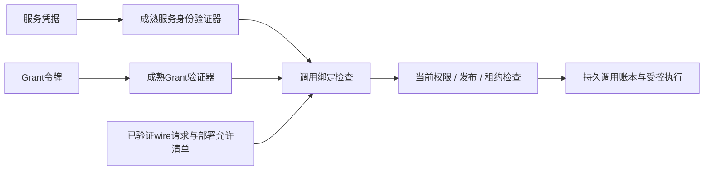

# 远程访问Grant绑定契约 V1

本规范补充[远程模块协议](REMOTE_MODULES.md)的GrantVerifier边界。Schema描述受信验证器的内部结果；首个外部令牌和SDK候选另见[Grant令牌Profile](GRANT_TOKEN_PROFILE.md)。不能把用户提交的相同JSON当作已验证Grant。

## 1. 三层信任与可替换接口



身份验证证明调用服务是谁；Grant验证证明某受信发行方授予限定调用；当前访问闸门决定此刻能否执行和输出。三个模块可各自替换，但任一缺失不能正式调用。服务身份不能冒充原用户，用户令牌不转发到供应商。

GrantVerifier使用受控成熟实现验证签名、受允许算法、issuer/audience、有效期和密钥来源；输出内部Bindings对象，调用者不能自行构造可信标记。部署允许清单提供受信发行方、目标module_instance和调用服务。首个token/SDK选择已在令牌Profile锁定为实现候选；密钥轮换运行配置及验证器适配尚未验证，不能宣布验签通过。

## 2. 必须绑定的字段

| 字段 | 独立期望来源 |
|---|---|
| issuer_id / audience_module_id | 部署信任清单和被调用模块实例 |
| caller_service_id | 服务身份验证结果，不取HTTP请求正文 |
| subject_id / action | 平台验证过的原主体与Scope动作；远程服务自身权限不能替代 |
| method / path | 实际HTTP方法及固定模块路径；不接受用户URL、重定向目标或任意路径归一化 |
| invocation_id | 实际已验证请求context，重试保持原调用身份 |
| request_digest | 完整JSON包络的规范摘要；put使用完整metadata，不省略context/input |
| scope_digest | 完整Scope DTO规范摘要，不只取scope_id |
| profile_digest | 实际请求绑定的不可变配置，模型/检索策略变更需新合法调用 |
| issued_at_ns / not_before_ns / expires_at_ns | 验证器结果及受信当前时钟；纳秒精确int64，不经浮点数转换 |

request摘要采用SHA-256(`akos.grant-request/1`＋NUL＋AKOS-CJSON/1原始已验证JSON)，Scope使用域`akos.grant-scope/1`。先按wire契约拒绝未知字段/非法数值并完成映射，再对收到的精确JSON数字计算规范摘要，不能对有损double对象重序列化。空格及对象键序无影响；中文/换行/数字内容不隐式归一化；重复JSON键拒绝。

本规则已有下述6组Go/Python金标，其中一组使用实际解析wire请求；随后第6节补充17操作各一份局部输入；全部值域与真实调用互操作仍未通过。绑定请求摘要覆盖读/写对象、索引generation/attempt、模型证据等实际input，method/path/action又限制调用方向。put额外依据metadata声明的size/hash核对真实文件流；验签和metadata摘要不能证明字节已接收完整。

## 3. 有效期、重试与实时闸门

首版离线规则不默认容忍时钟偏差：issued≤not_before≤now<expires，now<request_deadline≤scope_expiry，Grant期限不超过请求及Scope期限，并受部署max_lifetime限制。UTC wire时间转换到Unix纳秒时须检查日历及int64表示范围；转换器尚未实现。生产若需clock skew，应单独锁定有界策略、时间源与测试，不能任意延长请求deadline。

同invocation重试保持同一请求字节语义、摘要、动作与原deadline；可以重新获得更短期Grant，但不能凭新Grant修改原请求。相同调用ID不同摘要由持久账本拒绝；签名验证不能独自阻止重放或重复业务提交。控制status/cancel使用自己的调用身份、路径和摘要，目标调用权限单独核验，不能复用原读Grant去取消其它主体任务。

短期Grant不能实现立即撤销。执行前、读取/查询和分批输出按一致性协议检查当前权限/发布；写确认另核对原主体、租约fencing、草稿/代际和取消状态。身份/权限服务不可用时拒绝，不能只因令牌尚未过期放行。已经传出的在途字节遵守既定线性化边界。

## 4. 机器记录和局部验证

[内部Bindings Schema](schemas/access-grant-bindings.v1.schema.json)由build_access_grant.py生成，字段闭集、摘要/路径格式、纳秒整数范围明确。它不是token，也不作为公开请求字段。`check_bindings(claims, expected, now, deadline, scope_expiry, max_lifetime)`检查独立期望、精确时间、动作和摘要。`binding_digest`只计算指定域的规范摘要，不验签或核对整个请求领域语义。

expected和当前时钟若取自同一不可信声明，比较成功毫无授权意义。报告固定`authorized=false`，真实服务不得把此离线检查器直接当Authorizer。5项合成测试覆盖11项绑定、时间边界、float拒绝、未知signature字段、规范键序/域分离/大整数和重复键，见[执行证据](evidence/access-grant-review.json)。

正式通过需要：受控SDK验签与轮换故障测试、错误issuer/audience/algorithm/key拒绝、服务身份与原主体委托核验、17项操作的完整摘要绑定、multipart字节核验、持久重放/幂等账本、当前撤权/撤回及流式输出联调。以上尚未验证；D-03保持开放。

## 5. Go/Python摘要金标

`pkg/modulewire.GrantBindingDigest`使用既有AKOS-CJSON/1和标准库SHA-256，以固定request/scope域产生摘要；它不自研密码算法，不验证令牌或请求领域语义。只接受JSON对象，拒绝未知域、重复键、非法Unicode、多根JSON和超出规范编码预算的输入。Python binding_digest采用相同对象约束。

[6组金标](examples/grant-binding-golden.v1.json)由独立Python参考编码生成，Go测试直接读取并比较规范字节及摘要。包含实际ParseRequest（另经Go DecodeParseRequest核验）、完整Scope与超过double精度的policy_version、中文/emoji及LF/CRLF、精确小数与等价键序。其余合成对象仅验证编码，不宣称满足某个业务操作Schema；金标时间为固定历史样例，不用于真实授权。

Go两项测试另拒绝错误域、非对象、多根、重复字段和非法UTF-8；Python两项检查固定文件生成一致性及对应非法输入。见[执行证据](evidence/grant-digest-review.json)。跨语言一致性只覆盖当前金标，并非所有可能JSON输入的数学证明；完整17操作、UTC纳秒转换、服务身份和验签/密钥轮换仍待验证。

```powershell
python docs/architecture/build_grant_golden.py
& '.tools/go/bin/go.exe' test -count=1 ./pkg/modulewire
```

## 6. 全17操作局部摘要对照

[全操作金标](examples/operation-grant-golden.v1.json)从现有DTO样例挑选每项一个请求，生成器与modules.v1 OpenAPI的operationId集合精确对照，共17项。每项请求经独立Schema检查，保存实际method/path、完整请求/Scope、规范字节、摘要及input变异摘要。

Go测试分别调用17项对应的实际Decode入口，再比较Python参考字节和两个域的摘要；从同一请求context提取Scope后再核对独立Scope金标。input变异故意不满足业务Schema：摘要必须改变，同时Go业务解码必须拒绝。它证明摘要计算不能替代领域校验，不把非法变异当作另一份合法调用。

初版曾沿用共享action占位值；现按[操作策略](REMOTE_OPERATION_POLICY.md)修正所有17项金标，Scope仍是假设输入。Schema/解码通过不证明这些动作适用于实际operation。正式operation→action/资源的授权映射、可信issuer/service和当前权限仍须另验。method/path由操作清单固定且作为Grant独立绑定，不能仅因两个操作请求JSON相同就复用授权。

Go一项含17子场景；Python两项检查库存、固定文件、method/path及Scope提取与input变化，见[执行证据](evidence/operation-grant-review.json)。各操作仍只有所选局部输入，不证明所有值域、真实token或调用服务已通过；D-03保持开放。

```powershell
python docs/architecture/build_operation_grant_golden.py
& '.tools/go/bin/go.exe' test -count=1 -run TestAllOperationGrantBindingsCrossLanguage ./pkg/modulewire
```

原用户业务意图与受控模型/文件/索引子能力见[操作动作策略](REMOTE_OPERATION_POLICY.md)。动作匹配不代替原主体资格或权威父任务证明。
