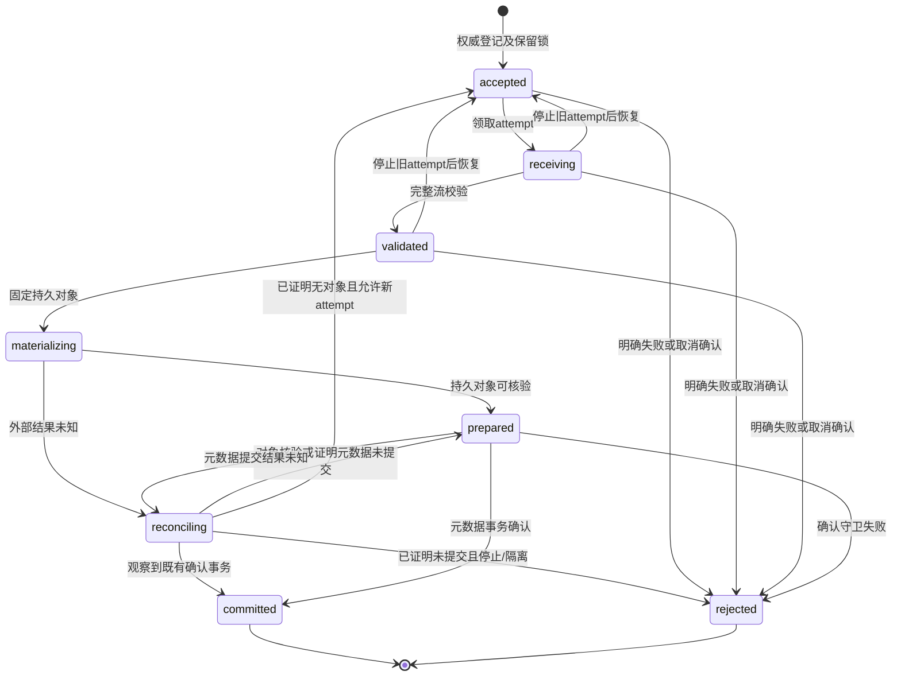

# 上传确认、幂等与恢复协议 V1

本规范细化[逻辑数据模型](DATA_MODEL.md)的上传确认事务，衔接[multipart接收](BLOB_MULTIPART_TRANSPORT.md)与[文件迁移](BLOB_COPY.md)。这是架构设计，持久仓储和确认协调器尚未实现。接收receipt只证明本次字节校验，不是确认凭据，也不是已发布知识。

## 1. 分离三种完成事实

| 完成事实 | 负责模块 | 必要证据 | 对产品的影响 |
|---|---|---|---|
| 接收完成 | 传输适配器 | 正常EOF、长度/摘要、前后访问回调、暂存关闭 | 可以申请持久化，不能读取为正式原件 |
| 对象持久完成 | 文件存储适配器 | 固定对象版本/句柄、原始字节摘要、持久化结果 | 候选对象仍私有，不代表Draft或Blob关联存在 |
| 上传确认 | 知识应用服务＋元数据UnitOfWork | 权限与租约守卫、唯一幂等记录、有效映射及完整提交 | 草稿可引用原件、投递解析任务；仍需编辑和审核才能发布 |

`BlobStore.Put`保留现有端口签名，负责写入并返回持久私有对象的BlobRef；成功不自动修改Draft。应用协调器负责元数据确认。供应商对象名、URL、ETag不得替代平台身份或SHA-256。复合远程实现也必须保持此区分。

传输暂存与BlobStore实现之间需要受控桥接：关闭暂存后重新以只读句柄交付，或由适配器将隔离对象转换为固定不可变对象。转换必须保持同一字节/对象版本，不能凭receipt中的哈希重新打开一个可被替换的任意路径。桥接接口尚未冻结，不能把目前receipt直接当作生产存储提交接口。

## 2. 操作身份与持久记录

上传操作在打开暂存前持久登记；独立于HTTP连接和某次attempt。唯一范围为`space_id＋原请求subject_id＋operation_kind＋idempotency_key`。身份从已认证主体取得，不能信任客户端填入的subject。相同范围、不同语义摘要必须冲突；不同主体/空间即使字节相同也不能共享返回权限。

语义摘要包括目标KB、目标草稿及expected_row_version（或创建草稿意图）、预期原件摘要/大小/类型和不可变处理配置摘要。请求ID、传输deadline、scope令牌、attempt不是业务语义摘要的一部分；重试可以使用新的有效授权和请求ID，但不能改变目标或处理语义。摘要编码沿用平台精确冻结规范，不经浮点数表示整数。

权威UploadOperation至少保存：平台operation_id、上述唯一范围/摘要、原请求主体、目标和配置、状态/row_version、当前attempt及fencing、上传保留锁、候选对象引用及固定存储版本、终态结果/安全错误、取消标记、审计关联。供应商物理位置只进入内部映射仓储。Blob空间归属保存在平台权威记录中，BlobRef本身不携带空间不等于跨空间访问许可。

每次attempt隔离命名空间；失去租约的执行者不能更新权威状态、覆盖获胜对象或删除新attempt对象。仅有数据库fencing无法阻止旧Worker写入外部存储，所以候选对象必须独立且不可变。

## 3. 状态与提交顺序



这些是UploadOperation内部阶段，不新增远程control状态枚举。未确定外部写入停止的取消留在reconciling并设置取消意图；不能宣布rejected后立即删候选。明确失败是当前操作终态，需新幂等键发起新业务命令；允许恢复的连接中断可回到accepted领取新attempt，先隔离旧attempt。

1. 验证身份和当前上传资格，登记accepted与保留锁；正式文件迁移写屏障关闭时拒绝新增操作，不开暂存。
2. 领取有限租约和attempt，执行接收与完整性检查；任何候选都在隔离区域，Close不确认。
3. 将字节物化为持久私有对象。保存prepare观察值；外部超时进入reconciling，依据同一操作/attempt的存储探查恢复，不能盲目再次覆盖对象。
4. 在确认前重新验证原主体当前资格、空间/KB/草稿归属、expected_row_version、deadline/取消、租约fencing、配置与有效存储代际。授权检查线性化点遵循一致性协议；不宣称能追回检查已通过的在途字节。授权服务不可用时不提交。
5. 一个元数据事务写入Blob＋StorageBinding、草稿原件关联/版本变化、唯一解析Job、终态幂等结果、审计/outbox/MigrationJournal，并将操作置为committed。所有更新共同提交或共同回滚。确认不执行外部网络调用；准备好的对象必须先存在且受保留锁保护。
6. 只在已证明事务提交后返回成功。投递解析由outbox恢复，投递失败不撤销已提交事实；解析只处理绑定的原件和草稿版本，不能覆盖后续人工修改。

V1不要求文件系统/对象存储参与数据库分布式事务。采用先持久对象、再原子元数据确认：中间对象是受保护的孤立候选，绝不提前通过产品读取接口暴露。库事务若结果未知，首先用operation_id查询权威提交结果；不能调用Abort删除可能已被引用的对象。

## 4. 故障与重试判定

| 故障位置 | 恢复动作 | 禁止行为 |
|---|---|---|
| 登记前或接收失败 | 无成功结果；关闭暂存，失败清理登记恢复任务 | 返回正式BlobRef或创建解析Job |
| 字节已验证、尚无持久对象 | 恢复同操作，校验暂存身份与字节；缺失则重新接收 | 用可写路径继续确认旧receipt |
| 对象写入超时/进程崩溃 | reconciling，查询同attempt；观察值不足继续隔离 | 将超时当作对象不存在或停止已确认 |
| 对象持久、事务回滚 | 保留候选；可恢复错误继续同操作，终态拒绝按回收闸门清理 | 先删除对象再判断事务是否提交 |
| 事务提交结果未知 | 查询唯一operation及所有关联事实；缺乏可信结果保持未知 | 新建另一个Draft/Job或回显成功 |
| 已提交、HTTP响应丢失 | 当前身份与权限复核后返回既有结果，不重复确认 | 因原响应丢失而重复上传/解析 |
| 重试期间权限已撤销 | 拒绝输出既有结果；保留已提交事实与审计 | 用幂等记录绕过当前权限或自动删除原件 |
| 同键不同摘要 | 返回冲突，保持原记录 | 覆盖原操作或将新目标当原目标执行 |
| 清理失败 | 保存内部候选/错误分类，独立恢复；重试清理需权威保留闸门 | 把物理残留恢复为公开可见 |

终态重试和孤立产物保留使用[保留策略](RETENTION_CONTRACT.md)；未终结的未知操作不能仅因TTL到期删除。清理前检查真实引用、有效attempt、迁移/上传锁、未知提交及墓碑。已提交操作的取消不能撤销事务；后续删除/撤回属于另一个有权限和审计的命令。

## 5. 替换及验收门槛

本地文件与S3兼容实现必须通过同一组证据，不能仅验证Put能成功：

| 验收编号 | 必须取得的运行证据 |
|---|---|
| UPLOAD-01 | 两个并发相同键仅有一个Blob/草稿变更/Job；不同摘要冲突 |
| UPLOAD-02 | Close后修改/替换暂存，或旧attempt迟到写入，不改变获胜对象 |
| UPLOAD-03 | 在登记、流校验、物化、事务前后逐点杀进程，重启后恢复或明确隔离 |
| UPLOAD-04 | 提交成功但响应丢失、提交结果未知，不重复关联和投递；无提前删除 |
| UPLOAD-05 | 接收后撤权、草稿编辑、取消或迁移屏障改变，确认守卫拒绝失效输入 |
| UPLOAD-06 | 对象写入/删除超时仍未知时，不释放保留保护；真实探查恢复结果 |
| UPLOAD-07 | 单次元数据事务故障注入，Blob/映射/Draft/Job/结果/审计/日志无半提交 |
| UPLOAD-08 | 权限撤销后的幂等读取不泄漏结果；跨空间同哈希无共享访问 |
| UPLOAD-09 | 文件实现替换后平台身份和来源不变，原件字节、恢复及回退新增写入完整 |

当前multipart测试仅覆盖接收阶段及模拟访问回调，没有上述确认事务或双实现验收证据。UploadOperation机器记录已有下述局部检查；持久仓储、桥接接口、对象探查和恢复器仍待设计/实现。不能据此关闭D-03/D-04或声明业务闭环完成。

## 6. 机器记录与离线核对

[UploadOperation Schema](schemas/upload-operation.v1.schema.json)由`build_upload_operation.py`生成，所有对象封闭字段，明确创建草稿/替换原件的联合目标、nullable attempt/candidate/result，以及object_write和metadata_commit两类未知结果。内部错误只保存封闭分类码，不接受供应商文案；这些是上传内部分类，不直接扩大远程PublicError枚举，外部投影须使用已有安全错误契约。

`upload_operation_validation.validate_record(record, expected)`与调用者独立提供的身份/目标/内容/配置期望核对。精确整数拒绝float和bool；候选内容与attempt一致，prepared/committed需要候选；只有committed允许结果且必须匹配Blob与草稿版本，只有rejected允许终态错误。reconciling必须标明未知种类，提交未知须有已准备候选。cancel_requested是取消意图，不能单独证明停止，也不使已提交结果自动失效。

schema中的object_version_ref为适配器仓储不透明引用，允许映射到任意供应商版本格式；校验器不按该字符串打开路径或调用网络。accepted恢复时必须清空当前attempt/candidate；旧attempt、候选及清理状态在独立历史库存中保留，不能通过清空字段删除实物。被拒绝的记录可保留候选用于恢复清理。

该校验器不计算业务语义摘要、不验证状态转换/CAS、保留锁/租约、实际字节或事务提交。expected若来自同一不可信记录不能作为独立权威证据。报告固定`ready_for_confirmation=false`，避免Schema通过被误用为提交许可。七项合成测试覆盖八状态、独立期望错配、大整数/非法整数、供应商URL与文案拒绝、候选与结果矛盾及未知提交；见[执行证据](evidence/upload-operation-review.json)。

```powershell
python docs/architecture/build_upload_operation.py
python -m unittest discover -s docs/architecture -p test_upload_operation.py
```

## 7. 状态转换与fencing高水位

记录新增`fencing_high_water`（精确uint64），恢复到accepted时仍保留；新领取attempt必须使用更大的令牌。当前attempt的令牌必须等于高水位。同一attempt推进时不能更换owner、令牌、期限或固定候选对象。本版不实现续租/租约接管；失效attempt停止或隔离并保存历史后才恢复领取。attempt ID全局唯一与历史库存由持久仓储另行验证。

`upload_transition_validation.validate_transition`检查前后记录、独立业务期望、expected_row_version和有界now_seconds。row_version必须加一；hold及audit关联不变；终态不能转换；同状态仅允许一次设置取消意图，不允许偷偷修改候选或延长期限。取消意图单调，禁止继续执行接收、物化和新确认。既有metadata_commit未知若已观察到权威提交，可在取消或租约到期后记录committed，这是恢复事实，不是重新执行提交。

| 转换类别 | 额外守卫 |
|---|---|
| accepted→receiving | 当前上传资格、写闸门、有效租约、新fencing |
| receiving→validated | 实际流完整性观察值、当前资格和租约 |
| validated→materializing | 当前资格、写闸门、有效租约 |
| materializing→prepared | 固定对象及记录的存储代际核验 |
| prepared→committed | 当前草稿/权限/写闸门/租约、对象核验和事务提交观察 |
| materializing/prepared→reconciling | 分别只能标记object_write/metadata_commit未知 |
| reconciling→prepared/rejected/accepted | 若是metadata_commit须先证明未提交；恢复accepted须证明无对象、停止旧attempt并保留历史 |
| reconciling→committed | 仅metadata_commit未知，观察到同一事务结果和固定对象；不得由object_write未知跳过确认 |
| 非终态→rejected | 有attempt时须证明停止/隔离并保留历史；不能因取消意图直接推定停止 |

提交已存在与提交不存在的观察不能同时为真。facts必须完整且布尔值为真实bool，不能用1、字符串或缺省值通过；这是离线输入规范，不是事实来源认证。`object_verified`/`storage_epoch_matches`在既有提交恢复中针对事务绑定的对象和代际；恢复历史事实后，产品输出仍须另行检查当前权限与有效映射。未知的提交absence或对象absence只能由权威探查提供，不能从超时推导。

9项合成转换测试覆盖正常链、恢复提交、CAS输入、终态不可变、fencing跨重置、新令牌、取消、期限、缺少守卫、候选/attempt固定和恢复历史。记录7项加转换9项共16项专项检查，见[执行证据](evidence/upload-transition-review.json)。报告仍固定`ready_for_confirmation=false`；实际CAS事务、守卫来源、唯一attempt库存、字节、杀进程恢复和双存储仍须取得UPLOAD-01至09运行证据。
