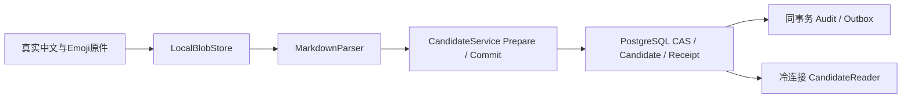

# 文件解析到候选数据库的串联验证

此试验在独立WSL PostgreSQL 16.15实例中执行真实文件存储、MarkdownParser、CandidateService、PostgreSQL候选事务及CandidateReader。初始Document/Draft、权限回调和丢失回执的传输包装器是fixture；数据库事务与文件处理没有用替身代替。

上传使用独立document.upload作用域；创建原件时尚无BlobRef，授权回调校验新建许可，Put验证原件大小与摘要。解析使用独立document.parse作用域和精确原件读取许可，不从解析权推导上传权。主体、委托和策略仍未连接真实IAM。

已实际运行的场景：

- 中文、Emoji、CRLF及空白原文经真实文件读写、解析与SQL存储后保持一致，引用指向原件并保留Unicode码点定位。
- 实际SQL事务提交后，故障包装器丢弃响应并报告未知结果。用同一个PreparedCandidate和新的数据库连接重试，返回原回执，解析器计数仍为1。
- 候选从新的连接可读回，提交主体、候选摘要和回执经过标准读取器核对。
- 数据库中先提交人工编辑，再提交基于旧版本的实际解析输出：人工正文保持不变，迟到原文保存为独立可读候选。
- 两个候选各只有一条审计和outbox记录；原文档publication_epoch仍为0，活动Revision/GenerationSet仍为空。
- 文件夹、数据库服务和私有数据目录清理成功。

传输故障是提交后的受控错误注入，没有实际切断TCP或模拟数据库崩溃。该试验没有创建真实用户、运行HTTP/MCP端点、提交审核或发布，也未验证跨重启PreparedCandidate恢复、任务租约/回执、Office/PDF到数据库链路或生产权限。

证据由check_postgres_wsl.py生成并归档到[evidence/postgres16-wsl-review.json](evidence/postgres16-wsl-review.json)。当前同一套96项检查已在PG15.19/16.15/18.6通过，见[多版本矩阵](POSTGRES_VERSION_MATRIX.md)；这不替代完整业务与生产验收。

2026-10-15补充：上述候选链路随后调用[真实提交仓储](SUBMISSION_TRANSACTION.md)，生成冻结Revision和pending审核请求。前述“未提交审核”的限制仅对应候选阶段；身份、审批决定、发布与产品入口仍未贯通。
