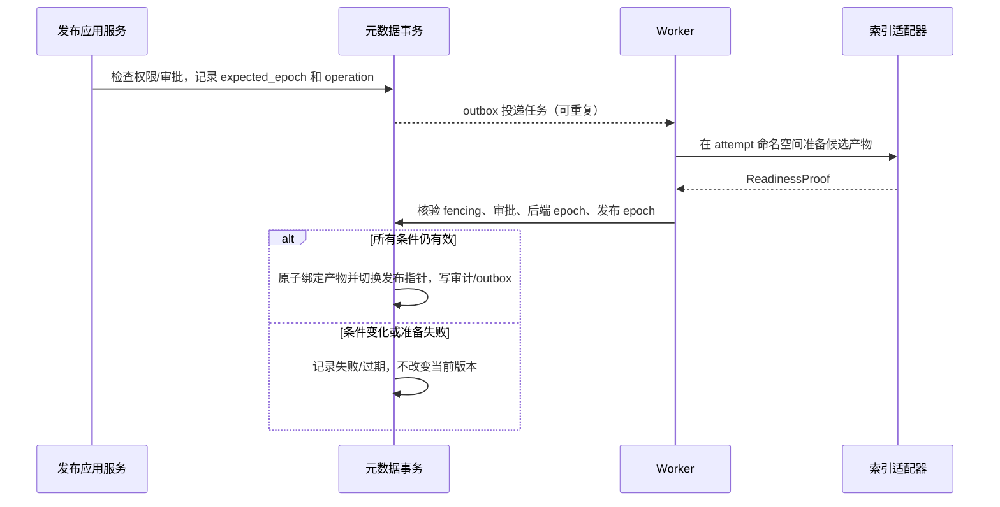

# 发布、查询与迁移一致性协议 V1

本文补充 [详细架构](DESIGN.md) 和 [标准契约](CONTRACTS.md)。这是实现约束与验证设计，尚无运行证明。

## 1. 三类版本分别管理

| 标识 | 作用域 | 何时改变 | 切换点 |
|---|---|---|---|
| Revision | 文档内容 | 正文、表格、修订来源等发生变化 | 审批通过后发布 |
| GenerationSet | 一个 Revision 的各检索通道产物 | 重分块、重建、替换检索通道 | 文档发布或知识库迁移事务 |
| BackendEpoch | 知识库后端方案 | 嵌入规格、后端实例或索引方案迁移 | 知识库迁移维护窗口 |

逻辑 Generation 不要求一个物理索引。适配器可将大量逻辑产物放在同一 collection，通过 space/KB/revision/generation 元数据过滤。每个检索通道必须能唯一定位标准内容，物理合并不能抹掉逻辑隔离。

知识库持有 active_backend_epoch_id。Document 的 active_generation_set_id 必须属于该 epoch。正常新增文档沿用当前 epoch 的索引构建规格；不允许任意文档自行切换嵌入模型后与知识库旧索引混查。

查询策略与索引构建策略分开版本化。QueryProfile 控制召回条数、融合、重排、反思和生成；IndexProfile 控制解析产物、分块、嵌入、通道及存储实例。PipelineProfile 组合二者。纯查询策略变更无需重建；索引策略变更必须准备新产物。跨 KB 查询按各 KB 的 EmbeddingSpec 分组生成查询向量，组内调用，组间按排名融合。

## 2. 发布和撤回的事务边界

同一文档的发布、撤回和删除都递增 publication_epoch；新任务只接受创建时记录的 expected_epoch。撤回后重新发布必须创建显式新操作，不能让撤回前的任务复活。撤回产生文档级历史读取禁用记录，覆盖所有历史引用；未来若需要“只撤回某一旧版”必须定义单独命令，不复用当前撤回语义。

发布提交时同时核验：操作仍有效、未取消、Revision 哈希与批准记录一致、批准未被撤销、审批策略版本仍可接受、原请求主体仍有发布资格、当前 KB 后端 epoch 未变、所有必需产物准备完成。系统 Worker 的服务权限不替代原请求主体资格。权限服务故障返回失败，不因任务已经启动而放行。

状态机由应用层调用领域规则，具体审核引擎只提供审批事实。更换审批引擎后旧批准记录仍可验证；不能导入一个 approval=true 就跳过内容哈希与审批策略检查。

## 3. 请求快照与权限时序

请求固定 QuerySnapshot：主体/委托、授权策略版本、KB 后端 epoch、发布过滤集合摘要和 Profile。生成答案前、读取/检索返回前、流式每个输出批次前执行访问闸门核验。这里的批次是应用控制的有限大小输出单位，不与模型供应商 token 包边界绑定。

权限检查有明确线性化点：检查读到权威授权状态的时刻。撤销提交之后开始的检查必须读到新状态；检查已经通过的在途网络字节不可追回。不得声称能撤销已传给客户端或外部模型的内容。短期 AccessScope 令牌仍需与当前策略版本比较，其 TTL 不能充当立即撤销机制。

V1 内置授权状态与发布状态在同一个元数据存储读取一致快照。外部策略服务若不能提供强一致版本/内省检查，只能作为策略配置来源，不能作为具有“立即撤销”语义的生产授权适配器。缓存以版本优化结果复用，但版本来源必须满足当前检查的可见性要求。

请求快照内不混用发布变化前后的证据。最终复核发现变化时，可在总预算内重查一次；再次变化返回 publication_changed。可选检索分支失败仅在其声明为可选且剩余分支仍满足基础检索契约时降级，需将该失败计入效果与可用性报告。

分页游标绑定主体、作用域摘要、查询摘要和快照版本。跨页期间变化返回 cursor_expired，由客户端重新检索；不能继续用旧游标读取已撤回内容。反馈目标为 request_id 时，需校验该请求归当前主体，或主体有明确的反馈代办权限；request_id 本身不是访问凭证。

## 4. 租约、外部写入和幂等

迁移日志的精确前驱链、提交屏障与目标重放规则见[日志与水位协议](JOURNAL_PROTOCOL.md)。当前仅有合成链离线证据，真实数据库JOURNAL-02仍待验证。

任务租约和 fencing_token 只在元数据事务内分配。Worker 完成任务前用任务状态、租约和 fencing_token 做条件更新。Redis 投递即使重复或丢失也不改变所有权。

仅阻止旧 Worker 提交数据库结果还不够：它可能晚到写入外部索引。为此，每次执行尝试使用独立 attempt_id 命名空间，完成后绑定获胜尝试的物理产物；旧尝试的写入永远不能修改已选中的产物。若后端只能原地覆盖，必须提供可验证的条件写或版本栅栏，否则该后端不符合 IndexWriter 契约。

普通通知事件只包含业务摘要，不能假定它足以完整恢复新写入。回退重放需使用独立 MigrationJournal：记录单调提交水位、操作类型、前后版本、权威变更快照/不可变载荷引用、哈希及删除墓碑，与业务事务一起保存。回退窗口内不回收其引用的原件/内容。幂等键、处理结果和迁移日志均需有明确保留期；窗口过期后的重试返回明确状态，不承诺永久幂等。

## 5. 知识库后端迁移

首版选用暂停相关写入的维护窗口，步骤如下：

1. 将目标 KB 设为 migrating，拒绝新的内容写入/发布命令，停止领取相关构建任务；已有任务停止或到达明确终态。权限撤销和紧急撤回仍可执行并进入迁移日志。
2. 从一致快照取得水位 W、当前发布版本集合和 IndexProfile。在新 BackendEpoch 中重建全部有效版本，旧后端继续提供只读查询。
3. 验证数量、内容哈希、来源、必需过滤、索引规格和查询质量。重放 W 后的撤回/授权变更；不得恢复快照时已有效、但随后已撤回的内容。
4. 进入短切换事务，锁定 KB 的迁移状态，重新核验水位和有效版本集合；同时更新所有受影响 Document 的 GenerationSet 指针与 KB 后端 epoch。V1 要求该事务在选定规模上实测可承受；不可承受时阻止切换，另设计版本化路由映射后再扩大规模。
5. 更新配置绑定并重启受影响服务。启动校验配置与持久化 epoch 一致；失配不接单，不自动回退到旧索引。完成抽样验证后恢复写入，旧后端保留到回退窗口结束。

无内容变化的重建不要求重新人工批准；其准备证明仍绑定原已批准的 Revision 哈希。若解析器输出内容变化，转入新 Revision 审核，不能用迁移绕过审批。

回退分两种：尚未恢复写入时切回旧 epoch；恢复写入后先停写，将 MigrationJournal 的新增/更新/删除/撤回同步至旧实现并验证，再切回。旧实现无法表示新的权威字段或状态时，不允许宣称可回退，应保持新实现、从备份恢复到独立环境或执行经验证的修复迁移。

## 6. 文件与数据库迁移

原件/附件库存、稳定BlobRef、复制清单及映射切换守卫见[文件复制契约](BLOB_COPY.md)。本地字节验证已提供；生产复制、映射事务和回退仍待实现验证。

文件复制按 BlobRef 清单校验长度和 SHA-256。物理位置映射用版本化 StorageBinding 切换，BlobRef 不变。访问原件统一经过应用授权或授权代理；发给浏览器的长效对象 URL 无法满足即时撤回要求，V1 不采用它。解析器使用的内部短效能力在撤回后停止新发放，已传出的字节遵循同样的在途边界。

数据库迁移须暂停全部元数据写入（包括后台任务），保留服务的明确维护状态。导出包含租约、幂等结果、审批、发布、授权、任务、outbox、迁移日志及必要审计，恢复后所有在途租约失效并重新领取。切换时核验唯一约束、隔离级别对应语义、CAS 和 UnitOfWork；驱动能连通不代表迁移成功。

## 7. 补充验收场景

| 编号 | 注入条件 | 预期 |
|---|---|---|
| EPOCH-01 | 两个 KB 使用不同嵌入维度的跨库查询 | 分组嵌入和召回，禁止向错误维度索引发送向量 |
| EPOCH-02 | 后端迁移期间有旧发布任务迟到 | epoch 检查拒绝提交，不能绑定旧产物 |
| FENCE-01 | 旧 Worker 失去租约后仍完成索引写入 | 只污染孤立 attempt；当前获胜产物不变 |
| REVOKE-01 | 流式批次已通过检查时并发撤回 | 在途批次按既定边界处理，撤回后的新检查拒绝 |
| REVOKE-02 | 审批后撤销发布者权限或更改审核规则 | 任务提交失败或要求重新审批，不以 Worker 身份绕过 |
| JOURNAL-01 | 回退时普通 outbox 已消费、存在新原件和删除操作 | MigrationJournal 足以恢复新写入与墓碑，不依赖已消费通知 |
| SOURCE-01 | 编辑后的知识与上传 PDF 表述不同 | 引用标识平台修订，原 PDF 仅作为派生来源 |
| PAGE-01 | 翻页前授权/发布发生变化 | 拒绝过期游标，不返回旧快照内容 |

这些场景应与 [基础验证清单](VALIDATION.md) 一并实现。当前只是可执行的验收定义，不能作为已经通过的测试记录。
