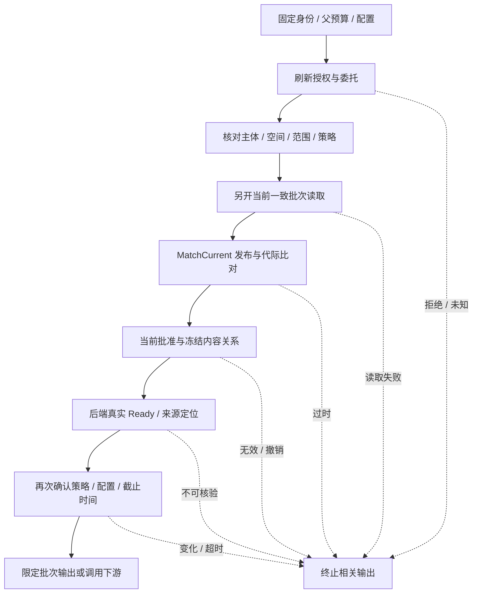

# 当前复核应用编排与输出边界

本设计落实[QueryAuthority.CheckCurrent](QUERY_AUTHORITY.md)，组织已有ObserveCurrent/MatchCurrent和仍缺的真实权威检查。已新增可执行的局部CheckCurrent编排函数，但没有接入真实权威提供者的协调服务。本流程属于知识应用层，REST、MCP、生成、重排、缓存、记忆和图谱使用同一规则。

## 1. 固定操作身份

每次查询保存经过认证的Principal/委托、父Request、空间、原Scope范围/策略版本、配置摘要及准备事实。复核不能用供应商回执或当前客户端参数重新构造这些期望。临时认证凭据轮换可以重新验证，但不能改变原主体、委托目标、租户或操作语义。

当前ScopeID可以刷新，主体/空间/动作仍须与原操作匹配；KB不得扩大。请求需要的证据来源范围必须全部仍可读。策略或配置版本变化时停止旧结果，按原预算重新准备或返回过时状态，不能把旧Grant重贴新版本。

## 2. 必需执行顺序

| 步骤 | 权威来源与校验 | 失败行为 |
|---|---|---|
| 刷新授权 | 身份/权限模块重新验证当前主体、委托和请求动作 | 拒绝或未知均阻止输出，不进入可选路线降级 |
| 身份范围绑定 | 当前Scope与原认证操作比对；模型或后端不能指定新Owner/Subject | 不匹配失败；不能仅比较PolicyVersion数字 |
| 当前批次读取 | 已准入QueryReadUnit建立新观察点，读取完整必要对象 | 缺失、重复、跨空间、部分批次、超预算均失败 |
| 发布/代际比对 | MatchCurrent检查StoreEpoch、发布Epoch、Revision、Generation及配置关系 | 过时只允许有界重新准备，禁止改候选ID后返回 |
| 批准/冻结关系 | 当前权威批准决定及不可变Revision摘要，核对ApprovalID/Revision/ContentHash | 批准缺失、撤销或内容不一致阻止使用；历史允许不能永久缓存 |
| 真实索引/引用 | 固定绑定的索引实现/标准内容仓储核验Ready及定位 | 匹配元数据中的ready字符串不代替真实验证 |
| 最终检查 | 身份策略、配置版本、父deadline与强制审计状态 | 变化即停止；不能为复核新建完整预算 |

审核规则版本与授权策略版本属于不同域，不能因为字段同名就比较为同一个计数。历史审核的有效性遵循已确认的规则迁移/撤销策略；不能自动将当前权限版本解释为批准版本。

## 3. 一致性与待补端口

CurrentDocumentState已增加可选PublicationReview投影，包含FrozenRevisionFact、Approval和ApprovalValidityFact。正式复核调用MatchCurrentReview；缺失投影拒绝，不能使用MatchCurrent成功结果放行。真实仓储须在同一当前读取批次返回全部关系。MetadataRepository能读ApprovalRequest也不等于能读取当前有效批准决定。正式协调服务需接入在同一当前批次观察点内读取这些关系的权威实现，不能读旧Approval后与新Document拼接。

外部权限源、元数据与索引通常不共享事务。应用须记录各域的版本及观察结果，并在索引/内容核验后重新检查策略与配置；任一未知或变化拒绝当前输出。缓存只用于降低读取成本，不能成为权威允许来源。多步骤验证过程中保留原预算，取消时不启动后续检查或下游调用。

若没有证据，仍核验主体/策略/配置及预算，随后返回证据不足；不调用要求非空文档集的ObserveCurrent，也不能绕过身份检查生成无依据行业事实。记忆中的用户偏好与企业事实区分处理，其来源权限仍按记忆契约核验。

## 4. 输出与撤回线性化

首版保证每个待发送批次通过一次完整当前检查。已发送的正文不能追回，检查完成后到网络发送前仍存在并发变化窗口。若需要“撤回提交后所有未发送内容立即阻止”，须独立实现发送与撤回的共同锁/栅栏协议及运行试验；当前设计与局部检查不提供该强保证。

向外部重排/模型/业务工具发送正文也属于输出边界。流式meta不携带受保护正文；正文、引用、最终结果和后续批次各自遵循相应闸门。验证过程中产生的受保护详情不进入公共错误；公共拒绝使用静态代码，审计仅保存允许的关联标识。

## 5. 协调服务验收矩阵

| 门槛 | 必须观察的结果 |
|---|---|
| CHECK-01 身份绑定 | 相同策略版本下换主体/空间/委托或扩大范围仍被拒绝 |
| CHECK-02 当前批次 | 旧快照/落后副本、批准撤销与发布变更在运行试验中阻止旧结果 |
| CHECK-03 独立事实 | 元数据ready但后端不可读、引用越界或内容摘要不符均失败 |
| CHECK-04 检查中变化 | 权限/配置在后端核验期间改变，最终检查不放行 |
| CHECK-05 空证据/预算 | 无证据仍做身份检查；取消/过期/预算用尽不启动下游正文调用 |
| CHECK-06 输出语义 | 模型/重排/缓存及流式各批次用同一闸门；故障不降级成允许 |

这六项是应用级运行验收，尚未执行。已有当前读取和元数据比对单元测试不能关闭这些门槛。正式实现顺序为：当前批准/Revision投影契约 → 权威源实现与批次一致性 → 协调服务 → REST/MCP/模型调用接入 → 并发变化及撤回试验。

## 6. 当前批准投影与局部关系检查

[MatchCurrentReview](../../pkg/queryread/review_current.go)先执行发布/代际比对，再核对冻结Revision归属、ContentHash、BlocksHash格式、HashFormat及批准ID/Revision/ContentHash。批准Decision沿用管理API枚举`approve`，不能将ApprovalRequest状态`approved`当成最终决定。批准须有非零版本、审核策略、决定时间和Actor；Validity必须引用同一Approval及其RowVersion，State须为effective。

应用提供按KB绑定的当前审核规则版本。Validity.ReviewPolicyVersion须匹配可信当前规则；它与历史Approval.PolicyVersion和AccessScope.PolicyVersion独立。历史规则2的批准可在当前审核规则7下判定有效，不能要求三者计数相同。缺少规则为ErrInvalid；缺失投影、撤销、未知状态或关系不一致为ErrStale，错误不携带正文。

两项Go测试覆盖18类不一致/无效投影、缺失投影、三个版本域分离、规则变化与发布变化。合成投影不证明实际内容字节、当前规则来源、真实批准者身份、事务快照、后端Ready或发送权限。新增字段可缺省以保留局部读取兼容，但正式输出复核必需。真实权威仓储和应用协调服务仍待实现，CHECK门槛保持开放。

## 7. 刷新身份与授权范围的局部比对

[MatchRefreshedScope](../../pkg/queryread/refreshed_scope.go)比较独立保存的原Principal/Scope和经过认证的刷新结果：SubjectID、SubjectType、Issuer、ClientID、委托有无及UserID/ClientID必须相同；Space和knowledge.search动作固定。当前权限策略变化返回ErrStale，不能只因新策略允许就使用旧准备结果。ScopeID和已验证的ProofReference可轮换；原Scope过期可由真实认证/授权模块刷新，父请求预算保持不变。

当前KB集合须为原集合的子集，且完整覆盖本次必要来源KB。空必要来源集合用于无证据路径，仍执行主体/策略/期限与非空授权范围校验；空授权范围不表示无限访问。重复/空/未在原范围中的必要来源、主体与Scope不一致、未知主体类型、非法编码、无deadline或取消请求拒绝。当前Scope过期也拒绝。

三项Go测试覆盖12类身份/范围/策略/期限变化、合法凭据引用轮换及范围缩小、无证据路径、必要来源丢失、畸形输入和取消。函数不调用身份/权限提供者，不验证委托ProofReference或服务身份真实性，不提供实时撤销、父请求配置绑定、发送栅栏或策略源证明；调用方必须固定原值并由可信认证/授权模块生成刷新结果。不能用同一可变对象同时充当原值和新值。CHECK-01运行门槛仍开放。

## 8. 局部编排实现与验收边界

[queryread.CheckCurrent](../../pkg/queryread/check_current.go)以CheckOperation保存Request/Principal/Scope和独立准备事实，要求父context及Request均有deadline，取较早期限。复制前拒绝非法UTF-8，避免JSON自动修复改变身份/标识；冻结输入并复制传给提供者的可变范围/委托对象，防止提供者修改原操作后自洽放行。JSON复制限制为4MiB序列化结果，不是提供者内存或CPU的强隔离；提供者必须遵守context及独立返回对象约定。

必需步骤依次为CurrentControl.Refresh → MatchRefreshedScope/配置摘要 → ObserveCurrent新批次 → MatchCurrentReview → CurrentBackend.Verify → 再次CurrentControl.Refresh/身份范围配置核对 → 当前审核规则版本比对及最终预算检查。CurrentControl负责真实认证、当前权限、配置及审核规则来源；CurrentBackend负责实际Ready、冻结内容与来源定位，不能仅检查ready字符串。两个端口目前没有真实实现，也未注册到生产装配。

发布事实与证据都为空时执行两次控制状态检查，不读取文档、不调用后端；仅做文档元数据复核且不输出正文时，允许有发布事实而没有Evidence。返回nil只表示本次检查序列在其观察点通过，不生成回答、不发送正文、不自动发布，不等于可缓存的长期权限凭据。调用方不能用这一结果替代下一输出批次的复核。首次Refresh后和最终Refresh间，授权范围也不得再扩大。历史审核有效性核验仍以所读当前批次为准；期间发布/审核变化的强同步输出保证需要发送/撤回栅栏，当前实现不提供分布式线性化。

四项Go测试覆盖完整调用顺序/参数隔离、四个必需阶段失败即停止、后端核验期间ACL/审核规则/配置/主体变化、空证据、取消及过期父请求零调用。端口错误映射为静态ErrCheck，取消和deadline保留context错误，不暴露内部数据库/凭据详情。忽略context的提供者不能由该函数强制终止，仍属于准入失败。

这些是模拟端口的编排测试，不关闭CHECK-01至CHECK-06真实运行门槛。后续须实现可信控制源、同源当前元数据读取和真实内容/后端验证，再接入REST/MCP/模型/缓存输出点，执行真实并发变更与撤回试验。

## 9. 标准冻结内容读取与双摘要核验

平台增加FrozenContentReader.ReadFrozenContent契约：以经过验证的Request/Scope及平台DocumentID/RevisionID读取akos.freeze/1标准JSON，返回同一ID绑定和最大4MiB Payload。实现可以是元数据仓储、独立标准内容服务或迁移后的新存储；接口不暴露供应商ID或物理路径。提供者必须验证当前权限及文档/版本归属，返回完整、独立且不可变的内容。

[contentverify.VerifyFrozen](../../pkg/contentverify/frozen.go)核对请求与冻结事实的ID绑定，再对实际Payload计算AKOS-CJSON/1规范化BlocksHash与ContentHash，与权威审批绑定的两项摘要及格式同时比较。规范化等价的空白/键顺序不导致内容变更；损坏、截断、错误版本/文档、摘要不同、错误格式或超过4MiB均拒绝。要求有限父context/Request deadline及当前有效Scope，读取前后检查取消/过期，公共错误为静态ErrContent。读取端收到Scope范围副本，不能修改调用方切片。

三项Go测试覆盖真实金标Payload、规范化等价输入、双摘要不符、文档/版本绑定、截断、大小上限、提供者错误、父请求过期零调用及读取期间取消。使用内存读取替身，不证明数据库/对象存储读取权限或一致性。该函数复用canonical.Frozen；冻结内容Schema、结构和审核资格须在提交/批准时独立验证，不能把哈希相等当作重新通过Schema或审核。

此核验只覆盖标准JSON实际内容，不读取BlobRef所指原件/图片/音频字节，不验证索引Ready。CurrentBackend需要组合内容核验、原件校验、索引服务及实际返回证据定位检查；CheckOperation现已携带具体Evidence并传给后端端口；真实位置/摘录核验提供者尚未实现，不能据此证明每条引用已通过真实内容复核。CHECK-03仍开放。

## 10. 待使用证据的冻结绑定

CheckOperation新增Evidence，CurrentBackend.Verify新增证据批次参数（内部首版契约仍未冻结；相关实现须更新签名）。每批最多1000条，连同准备事实总序列化复制结果不超过4MiB。检查在调用任何提供者前绑定Citation.DocumentID/RevisionID到独立保存的PublishedFact；缺失发布事实、重复文档、外来/不同版本、空BlockID、空摘录或无效Rank拒绝。SourceAnchor须为original或revision；original需BlobID且不能混用RevisionBlockID，revision须指向Citation.BlockID且不能混用BlobID。DerivedFrom最多256项且须有BlobID。非法UTF-8在复制前拒绝。

传给后端的是完整冻结副本，含摘录、排序、来源及定位；提供者不得只核验文档后省略Evidence。后端修改收到的摘录或嵌套定位不能修改原操作；端口失败阻止本次检查成功。两项Go测试覆盖完整转交/嵌套副本隔离，以及14类非法证据零提供者调用。

本次仅核验发布关系和来源结构；不验证BlockID实际存在、Blob属于该版本、Locator越界、摘录与标准正文一致、重排/模型结果是否使用这批证据。CurrentBackend应逐条对冻结正文/原件执行这些检查，任一未支持定位必须拒绝或按独立已定义的粗定位契约核验，不可默认允许。REST/MCP和生成/重排调用点必须传入实际待用批次；元数据复核成功不能作为有正文输出的允许凭据。具体后端与输出调用尚未接入，CHECK-03/CHECK-06保持开放。

## 11. 正文证据定位与摘录核验

[contentverify.VerifyTextEvidence](../../pkg/contentverify/text_evidence.go)通过同一readVerifiedFrozen读取并核验实际标准JSON双摘要，再查找Citation.BlockID，拒绝重复BlockID或缺失正文块。证据先固定副本，读取端不能修改引用范围使核验目标漂移。要求证据属于指定Document/Revision、摘录非空且有效UTF-8、有限父context/Request期限，核验期间检查取消和Scope有效期。

首个实现仅支持text块的revision来源，不能混用原件Blob或DerivedFrom定位；也不允许页码、幻灯片、工作表/单元格、段落路径或bbox附在正文字符定位上。exact必须有Characters，以Unicode码点计数的半开区间[start,end)逐字比较摘录；不按UTF-8字节或UTF-16码元计数，不trim、不归一化换行或Unicode。coarse不携带Characters，要求摘录为正文中的连续子串，不承诺唯一位置。

三项Go测试覆盖中文/emoji的码点范围和粗定位、读取期间引用对象变更隔离、10类边界/版本/摘录失败、7类未支持来源/定位/媒体及无限父预算零读取。表格测试只验证未支持类型被拒绝，不能代表表格Schema或字段定位验收。

未支持位置返回静态ErrUnsupportedEvidence，任何必需证据错误都必须阻止相关输出，不得把它解释为可选检索降级。此实现不验证original坐标、表格字段、图片OCR、音频片段或DerivedFrom关系；这些需要可替换的专用核验器及相应能力清单。正文核验尚未挂入真实CurrentBackend，仍无真实仓储/索引提供者或发送栅栏。CHECK-03/CHECK-06和多格式业务验收仍开放。

## 12. 多格式核验的替换边界

CurrentBackend进一步拆分的角色、固定路由、缓存范围、版本迁移/回退和6项EV运行门槛见[可替换证据核验模块](EVIDENCE_VERIFICATION_MODULES.md)。正文局部实现不能宣称支持所有多格式引用；音频引用时间定位字段及专用端口/能力配置仍需先冻结。

## 当前发布关键词候选的接入状态（2026-10-15）

[默认PG Retriever](POSTGRES_KEYWORD_RETRIEVER.md)现已核验查询观察点中的真实索引快照，并在返回候选前另开当前元数据观察点。它不是本章完整CheckCurrent的生产实现：CurrentControl、最终CurrentBackend、正文/原件引用验证及模型/REST/MCP输出接入仍待完成，CHECK六项门槛保持开放。尤其不能把检索期间的索引验证视作稍后输出时仍有效的证明。

## 已发布冻结正文的真实读取提供者（2026-10-15）

[PublishedFrozenReader](PUBLISHED_FROZEN_READER.md)现已实现FrozenContentReader，并实际调用VerifyFrozen通过实库检查，替代仅模拟的正文读取。它检查当前发布/批准、类型化Revision与保存正文及双摘要；不检验原件/媒体字节及Evidence位置，也不检查索引。原生original/coarse候选不能直接传给仅接受revision文本定位的VerifyTextEvidence；相关来源/位置核验与CurrentBackend/Control、模型/API输出接入仍待完成。

## 原生CurrentBackend实库接入（2026-10-16）

[EvidenceBackend](POSTGRES_EVIDENCE_BACKEND.md)已实现真实端口，核验实际关键词快照、冻结正文和原件文本引用，结束前再次观察实际索引。它与Retriever共用实际产物/快照读取器，拒绝物理删除及保留行的逻辑分块删除。CheckCurrent已通过真实DB/文件的组合运行及错误/撤权场景；CurrentControl和原件授权为测试控制源，生产身份、其他格式/定位、正式模块装配和模型/REST/MCP输出仍待完成，六项CHECK门槛不整体关闭。

## AuthenticatedControl编排实现（2026-10-16）

[请求绑定控制器](AUTHENTICATED_CURRENT_CONTROL.md)已接入标准Authenticator/Authorizer和CurrentFactsSource，每次Refresh重新调用，实库正向组合已替代直接回显状态的控制器。测试认证与策略仍为fixture，实际令牌/目录/ACL及配置权威源和最终产品输出尚未接入，六项CHECK门槛保持开放。
