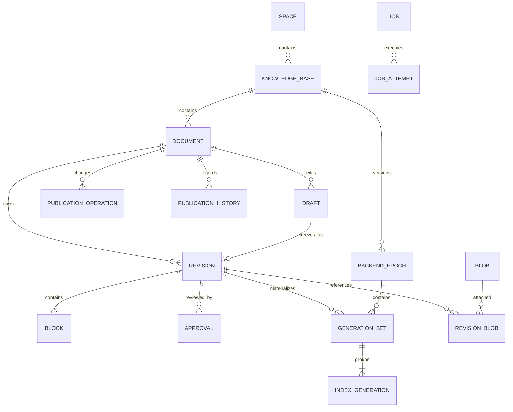

# 逻辑数据模型与仓储边界 V1

本设计约束关系、所有权与事务语义，不绑定 PostgreSQL 表类型、JSONB、序列或厂商向量类型。物理 DDL、索引和容量参数在实现阶段生成并实测。替代数据库必须保持这里的外部标识与不变量。

## 1. 核心关系

图中的一对多表示已完成对象的逻辑关系。创建中的 GenerationSet 可暂时没有通道产物，但不能标记 ready；Revision 至少含一个有效标准 Block。空或无有效内容的解析结果保持草稿诊断，不进入正式审核。

## 2. 数据所有权和逻辑记录

全量元数据迁移的必需记录库存、分段摘要与导入闸门见[导出契约](EXPORT_CONTRACT.md)。清单/包络检查已提供，各类完整payload Schema与真实导入验收仍待完成。

| 记录组 | 所有者 | 主键/唯一性 | 重要约束 |
|---|---|---|---|
| Space、KB | 目录/身份服务 | 平台 id；名称不承担全局唯一 ID | KB.space_id 创建后固定；跨空间迁移首版采用复制并保留来源，禁止原地换 space_id |
| Principal、IdentityBinding | 身份服务 | Principal.id；发行方+外部 subject 唯一 | 更换 OIDC 不改变平台主体 ID；映射冲突必须人工解决 |
| Membership、KBGrant | 授权服务 | space+subject；KB+subject+grant_kind | 作用域和角色变更增加 policy_version；不从缓存反向写授权事实 |
| Document | 文档目录 | id；space+id 复合归属校验 | 活跃 Revision 和 GenerationSet 同时为空或同时有效；指向自己的版本和同 KB epoch |
| Draft、DraftBlock | 文档目录 | Draft.id；Draft+Block.id | row_version 乐观锁；可多个草稿并行，发布仍由 Document epoch 串行化 |
| Revision、Block | 文档目录 | Revision.id；Revision+Block.id | 冻结后只读；来源、排序、结构和校验值参与冻结语义 |
| Blob、StorageBinding | 文件模块 | Blob.id；Blob+binding_version | 原件字节不可原地修改；物理映射可版本化迁移；不跨空间自动共享用户可见 BlobRef |
| RevisionBlob | 文档目录 | Revision+Blob+用途 | 外键必须存在，空间一致；用于原件、图片和其他附件的保留判断 |
| Approval | 发布治理 | id；Revision+审批请求+决策序号 | 绑定 content_hash、policy_version 和 actor；撤销追加事实，不覆盖旧决定 |
| PublicationOperation | 发布治理 | operation_id；主体+幂等键范围 | expected_epoch 固定；已终态操作不能再次提交 |
| PublicationHistory | 发布治理 | document_id+publication_epoch 唯一 | 保存旧/新指针、原因、actor；withdraw/delete 墓碑同样记录 |
| BackendEpoch | 索引管理 | id；KB+epoch_number 唯一 | draft/building/verified/active/retired；当前活动 epoch 每 KB 至多一个 |
| GenerationSet、IndexGeneration | 索引管理 | Set.id；Set+channel 唯一 | channel 集合满足 IndexProfile；各产物引用同 Revision 与 epoch；Proof 对应获胜 attempt |
| BackendBinding | 对应模块的适配映射仓储 | 模块实例+平台资源+代际+绑定用途 | 后端 ID 可变化，但新映射不能改变公开 citation；不假定不同后端 ID 全球唯一 |
| ProfileSnapshot | 装配/配置 | 类型+id+version 唯一；digest | 冻结配置内容，密钥只保存引用/版本；依赖的子配置必须可解析 |
| Job、JobAttempt | 任务服务 | Job.id；Job+attempt_number 唯一 | 幂等业务键唯一；租约条件写；外部产物 attempt 隔离 |
| Outbox、ConsumerReceipt | 事件模块 | event_id；consumer+event_id 唯一 | outbox 重试不改变 event_id；收件记录和消费结果在本地事务提交 |
| IdempotencyRecord | 对应命令服务 | space+subject+action+key 唯一 | 记录规范化请求哈希、结果引用、状态与过期；重用键不同载荷冲突 |
| AuditRecord、MigrationJournal | 治理/迁移 | 记录 id；迁移日志事务水位+事务内序号 | 追加不可变；迁移水位必须对应提交顺序，不能用事务外预分配序号假定连续 |
| Feedback、DraftProposal | 反馈服务 | feedback_id；主体+请求幂等键 | target 必须可访问；建议与草稿显式关联，不隐式发布 |
| MemoryRecord、GraphProjection | 记忆/图谱 | 记录 id+version；投影来源键 | 作用域和来源不可缺失；删除/撤回传播；图投影可重建 |

“同库事务”由 UnitOfWork 传递受限仓储作用域。应用服务可以组合多个模块写命令，但模块不直接跨表查询。仓储实现不能把数据库连接或 SQL 事务暴露成领域对象。

## 3. 草稿、解析与冻结

解析任务针对 Draft 的 BlobRef 工作，输出临时 DocumentBlocks，不要求虚构 Revision ID。解析结果写入 DraftBlock 时比较 draft.row_version 和任务绑定的原件版本。用户已编辑/换附件则结果进入独立候选输出，不能覆盖人工编辑。

标准契约中的 Block.revision_id 只适用于冻结内容；DraftBlock 使用 draft_id 和 row_version。提交时在一个事务中：校验草稿版本/归属、校验有效内容与原件完整性、分配 Revision ID、复制不可变 Block、建立 Blob 关联、计算并保存哈希、标记草稿 submitted、创建审批请求以及 outbox/审计。大体量内容可先生成不可变载荷，事务绑定经过校验的载荷引用，但不得在载荷未持久成功时创建可发布 Revision。

冻结哈希由平台规范化 serializer 定义：UTF-8、稳定字段顺序、显式规范化版本、固定 Block 顺序、显式空值语义；正文保留原始换行/字符，不做会改变引用位置的自动 Unicode 或空白合并。content_hash 覆盖正文/表格结构/来源及附件哈希，排除创建时间、供应商 ID 和派生向量。跨语言 serializer 必须使用同一组测试向量。

精确规则已补齐为 [akos.freeze/1](FROZEN_CONTENT.md)：FrozenBlock去revision_id并明确order，规范数值按精确十进制处理；blocks_hash覆盖规范块数组，content_hash覆盖带格式号/块哈希/附件清单的包络。Revision.HashFormat随不可变记录保存。[原生草稿冻结映射](NATIVE_FROZEN_MAPPING.md)已实现结构及引用校验，并经Go/Python金标对照；原生float64的精度边界单独说明。同步[提交事务](SUBMISSION_TRANSACTION.md)已连接Revision、待审核请求及审计/outbox；真实IAM、审批发布、全量UoW及生产完整性验证仍待完成。

签名或哈希证明内容身份，不能证明内容正确。AI 反思和解析器迁移改变权威内容仍需审核。

## 4. 事务矩阵

| 命令 | 同一个权威事务内完成 | 事务外动作及恢复 |
|---|---|---|
| 上传确认 | Blob 逻辑记录/附件归属、Draft、Job、幂等结果、outbox/审计 | 字节先写 staging，完整验证后再确认；事务失败的孤立字节按保留窗口回收 |
| 编辑草稿 | draft.row_version CAS、DraftBlock 更新、审计 | 可选预览/解析任务独立；迟到结果不覆盖较新 row_version |
| 提交/审批 | 冻结对象或审批决定、状态、幂等结果、outbox/审计 | 通知失败从 outbox 重试，不撤销已经提交的审批事实 |
| 发布 | operation 条件状态、批准/权限核验、活动指针 CAS、历史、Job 状态、outbox/审计/迁移日志 | 外部索引已准备；事务失败保留孤立候选，绝不删除现有活动产物 |
| 撤回/删除 | 墓碑、清空活动指针、epoch 增加、历史、outbox/审计/迁移日志 | 索引清理异步重试；可见性即时由访问闸门拦截 |
| 任务领取/完成 | lease/fencing/attempt 条件写、阶段结果、下阶段 Job/outbox | 外部调用在事务外，attempt 命名空间隔离旧执行者 |
| 授权变更 | Grant/Membership、policy_version、审计/outbox/迁移日志 | 缓存失效通知为优化，不能作为撤销事实来源 |
| 外部审批回调 | 回调 receipt 去重、审批决定、状态、审计/outbox | 验证回调签名与内容哈希后提交；事件发送不放在事务内网络调用 |

UnitOfWork 的隔离实现必须证明 CAS、唯一约束和同事务读写条件。平台不要求所有查询串行化；核心命令使用条件更新/必要锁。数据库替换后须重新跑并发命令测试，不能把名称相同的隔离级别当等价证明。

## 5. 删除、归档与回收

软删除首先阻止新的访问，保留权限可审查的历史与审计。物理删除分离为 PurgeJob：检查无活跃版本、无保留/迁移/恢复引用、无正在执行的合法任务，然后删除派生产物及原件。安全或法定保留规则在部署确认后配置，不在首版硬编码一个通用保留期限。

Blob 的引用计数只是优化，GC 必须复核真实关联与保留锁。上传失败、旧 attempt 和迁移孤立产物使用 grace period，避免并发上传或重试中的数据被误删。外部删除失败保存 tombstone 与重试状态；公开接口不重新暴露它。

审批/审计保留、原件保留、幂等保留、迁移回退窗口和缓存 TTL 是不同参数。配置校验确保回退窗口所需原件/日志至少保留到窗口结束。恢复历史备份时必须补回备份后墓碑和授权变更，或在隔离环境恢复，不能直接把旧授权状态对外上线。

## 6. 可替换仓储的验收条件

1. 标准导出包含权威记录和原件清单，不仅导出数据库表名；ID、冻结哈希、审核历史与公开引用保持不变。
2. 同一个对象的空间归属、FK/唯一性、状态机和 CAS 语义不因数据库替换而变化。
3. 迁移日志水位与已提交事务一致，覆盖同一事务内所有变更；证明乱序提交不会遗漏。
4. 事务失败、进程崩溃、重复执行、租约过期和并发发布能得到定义好的结果。
5. 可验证备份恢复和迁移回退；跨 DB 不支持的新字段必须报告，不得静默丢弃。

PostgreSQL 是首版默认实现；未来数据库适配器的映射、DDL 和运行测试属于后续交付，本文不代表它们已经存在。

## 上传确认细化（2026-10-13）

[上传确认与恢复协议](BLOB_CONFIRMATION.md)补充UploadOperation权威记录、三层完成事实、幂等唯一范围、候选保留与事务未知恢复。它不修改现有BlobStore端口，不证明仓储已实现；后续需冻结机器记录及暂存桥接契约，再执行UPLOAD-01至09故障和双存储验收。

## 部署治理的权威信任记录（2026-10-13）

详见[信任激活协议](KEY_TRUST_ACTIVATION.md)。记录TrustDomain/Head、不可变快照、KeyRetirement与激活操作的归属，禁止低版本回退及受损公钥换kid复活；历史恢复必须核对备份之外的受信控制面锚点。现有仓储/BuildLock尚未包含完整机器绑定，也无持久激活/分发证据，后续须补齐。

## 最终发布与替换旧源（2026-10-15）

[最终发布](FINAL_PUBLICATION.md)补充权威finalization回执，将已完成任务及准备产物与发布历史、有效指针、审计/outbox关联。首次发布不产生旧源清理；替换发布以History的PreviousRevision/PreviousGenerationSet/PreviousEpoch冻结清理目标，不能用新源填充旧计划。当前SQL原型的cleanup_plans.history_action支持withdraw/publish，原撤回专用关系检查保持严格，公共旧源检查另外复用。迁移必须一起保留命令/完成/发布回执、绑定及清理高水位，不能只导出当前有效文档。
