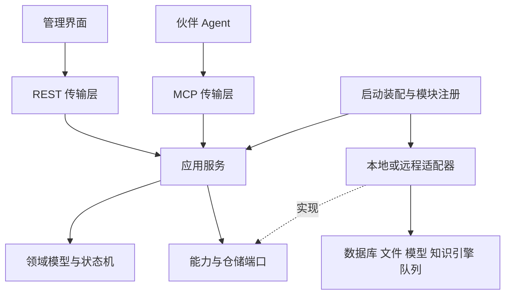

# 模块化架构详细设计 V1

## 1. 设计边界

平台负责知识接入、标准化、版本与审核、授权、证据检索、带引用回答、反馈草稿和 Agent 知识接口。伙伴负责业务流程和业务系统写入。初期的知识 Agent 只执行受控检索、读取与草稿建议；新增业务工具需要独立授权契约。

模块化的稳定部分是业务契约、状态机和安全不变量。解析算法、检索引擎、数据库、模型、UI、认证提供方、审核执行器和任务后端都可替换。改变“什么内容可发布”“谁能读取”等语义属于产品规则变更，需要契约与数据演进，不能作为普通配置切换。

首版不设计运行中热插拔。模块装配在启动时完成，请求固定绑定配置快照；替换后允许重启。可选图谱、记忆和反思默认关闭，缺失时基础检索仍可启动。

## 2. 分层及依赖规则



- 领域层不导入 HTTP、SQL、Redis、WeKnora 或模型 SDK 类型。
- 应用服务只依赖领域对象与端口；API/MCP 不直接访问适配器或数据库。
- 适配器可以依赖厂商 SDK，但不能被应用服务按具体类型识别。
- 装配层是唯一知道具体实现的地方；注册只接受随部署构建的受控工厂。
- 不允许模块 A 直接读模块 B 的表；跨模块读取走查询服务，写入走命令服务。
- 外部模块使用带契约版本的 HTTP/JSON；已有 gRPC 由适配器转换。进程内和远程调用使用相同语义，远程化新增超时与可重试错误，不伪装成本地事务。

当前pkg/cmd静态依赖检查见[依赖边界](DEPENDENCY_BOUNDARIES.md)，已有87个非测试源文件通过；尚不覆盖下面待建设的业务层及前端。

建议代码边界（待实现，不代表已有代码）：

```text
cmd/server/                  业务入口和启动装配
cmd/worker/                  同一应用服务的任务执行入口
pkg/contracts/               无厂商类型的公开契约
internal/domain/             状态机与不变量
internal/application/        ingest/publication/search/read/ask/feedback
internal/ports/              内部仓储与事务端口
internal/adapters/<provider>/ 能力实现与标识转换
internal/bootstrap/          注册、配置、健康检查、关闭
internal/transport/rest/      REST 适配
internal/transport/mcp/       MCP 适配
frontend/                    Vue 客户端
tests/contract/              可复用适配器验收
tests/scenario/              跨模块与故障场景
```

## 3. 模块所有权

| 模块组 | 持有的数据或职责 | 允许依赖的能力 |
|---|---|---|
| 身份与访问 | 主体、成员关系、角色、KB 授权、访问策略版本 | 身份提供方、策略仓储、审计 |
| 文档目录 | 文档、草稿、不可变 Revision、原件引用 | 文件存储、元数据事务、任务投递 |
| 内容处理 | 解析运行、Block、分块产物、失败诊断 | 解析、分块、嵌入、文件读取 |
| 发布治理 | 审批、发布指针、撤回、发布操作记录 | 内容完整性、索引准备、事务、审计 |
| 索引管理 | IndexGeneration、嵌入规格、后端映射 | 索引写入、构建、验证、删除 |
| 查询服务 | 查询编排、证据组合、引用校验 | 授权、发布查询、召回、融合、重排 |
| 回答与反思 | 回答预算、证据充分性、有限查询改写 | 查询服务、生成、反思策略 |
| 反馈与记忆 | 反馈状态、建议草稿；可选用户/任务记忆 | 文档目录、审核、记忆存储 |
| 图谱 | 可重建实体关系投影与证据映射 | 已授权已发布证据、抽取、图谱存储 |
| 基础设施 | 配置快照、模块清单、持久任务、outbox、审计 | 各自仓储、凭据解析、观测出口 |

元数据库替换时，仓储、UnitOfWork、outbox 和审计持久化必须作为同一个事务能力包迁移。表的所有权独立，但不能将需要原子提交的记录随意拆到不同数据库。以后拆服务时须新增协议和补偿设计。

## 4. 权威数据和衍生数据

权威数据包括 Document、冻结的 Revision、原件、经确认的标准内容 Block、审核记录、发布历史、主体/授权、配置快照、反馈、记忆原始记录、任务记录和 BackendBinding。保存文档内容的最终版本应包含 Block，而不只包含原始附件，否则人工编辑无法可靠重建。

Chunk、向量、全文倒排、图谱投影和缓存是衍生数据。每份产物绑定 Revision、内容校验值、PipelineProfile 和 Generation。分块策略变化只创建新的产物代际；正文、表格内容或来源定位变化必须创建新 Revision 并重新审核。

- Draft 可编辑并带乐观锁版本；提交审核时冻结为 Revision，计算内容哈希。
- 修改已提交或已发布 Revision 时复制成新 Draft，旧 Revision 不更新。
- 原件 BlobRef 使用逻辑 ID 与校验值，不把本地路径/S3 URI 当外部标识。
- Citation = document_id + revision_id + block_id + source_anchor。chunk_id 和后端 ID 只用于内部调试。
- 来源锚点包括 PDF 页码/边界框、工作表/单元格区间、幻灯片号、段落路径。没有精确定位时返回明确的粗粒度定位，不编造页码。人工编辑改变原件语义后，引用指向平台修订 Block，原件位置仅作为 derived_from；不能仍把新内容展示为原件逐字引文。
- 历史引用可解析到原版本，但读取仍检查当前权限、删除和撤回。普通检索只返回当前发布版本。历史读取需要显式历史读取权限。
- 原件删除与保留策略由治理模块决定；撤回只是停止可见性，不立即物理删除审计和原件。

## 5. 状态机与发布一致性

三个状态维度独立保存，避免“解析成功”等同“已发布”：

| 维度 | 状态与规则 |
|---|---|
| 内容处理 | queued → running → ready / failed；失败可按同一幂等键重试 |
| 审核 | draft → submitted → approved / rejected；冻结内容变化必须另建草稿 |
| 发布操作 | preparing → ready → committed / failed / superseded；撤回另记独立操作 |

Document 保存 active_revision_id、active_generation_set_id 和 publication_epoch。无发布版本时两指针为空。审批绑定 Revision 哈希和审批策略版本；所有者个人确认、企业 Owner/Admin 审核都通过同一应用命令。

GenerationSet 是单个文档版本的一组通道产物，不是整个知识库的全量索引。IndexGeneration 是不可变逻辑产物，可以与其他文档共用物理 collection，但必须带独立 generation_id 和 revision_id 过滤。知识库级 BackendEpoch 用于模型或引擎迁移，包含各文档的 GenerationSet 映射；文档增量发布与知识库整体迁移使用不同切换机制。详见 [一致性与迁移协议](CONSISTENCY.md)。

发布流程：

1. 事务中创建发布操作，记录 expected_publication_epoch、批准的 Revision 和目标流水线快照，同时写 outbox。
2. Worker 为候选版本准备不可见索引代际；重试不得修改正在使用的代际。
3. 校验必需索引的内容数量、嵌入规格、可搜索性和权限过滤。依赖后端一致性等待完成后，写入准备证明。
4. 短事务中再次检查批准记录、Revision 哈希、权限和删除/撤回状态，用 CAS 比较 publication_epoch。成功后同时切换有效版本与代际集合，追加发布历史、审计和 outbox。
5. CAS 失败时标记 superseded，禁止旧任务覆盖较新发布。准备失败时旧指针不动，孤立产物由 GC 清理。

发布不用跨 PostgreSQL 和搜索引擎的分布式事务。搜索对象的存在不代表发布；平台的发布指针才是最终可见性依据。检索请求先取得发布快照并传入引擎过滤，返回后重新校验当前指针。变化时最多重取一次，否则返回可重试的 publication_changed，不能混合新旧代际。

撤回在平台事务内清空有效指针并递增 epoch，随后异步清理索引。授权/发布检查不可用时拒绝返回内容。流式回答每次输出前校验访问与发布令牌有效性，变化则终止流；已经传给客户端或模型的内容无法追回，语义是撤回提交后新的校验不再放行。部署可用统一访问闸门完成校验，不能只依赖异步缓存失效。

## 6. 权限与隔离

认证产生 Principal，权限服务根据动作产生 AccessScope；客户端只能请求缩小范围，不能自行提交可信 AccessScope。机器 API Key 表示独立服务主体，权限为配置的 KB 范围。代表用户访问必须有经过验证的委托凭证，其权限为用户、服务主体和请求范围的交集。

V1 粒度是空间和知识库。Contributor 可创建/编辑草稿，Owner/Admin 可审核发布和管理授权，Viewer 可读已发布内容；历史读取、原件下载、导出单独授权。个人空间所有者可确认发布自己的内容。跨空间资源 ID 一律在仓储和服务边界核验归属。

必需过滤包含 space_id、允许 KB 集合、有效 Revision/Generation 集合。后端无法准确表达时必须按隔离索引路由或预先解析成允许 ID 集合；不能退化为“取更多再过滤”来掩盖权限过滤缺失。过滤集合超出后端限制时明确失败或使用已验证的分区策略。

缓存键包含主体/授权范围摘要、策略版本、发布 epoch、查询和流水线版本；命中缓存仍经过当前访问闸门。图谱节点、边、记忆条目及其扩展证据也必须带作用域与来源。后端内部检索接口不直接对伙伴开放。

## 7. 查询、反思和反馈

单次查询绑定不可变 PipelineProfile，执行召回 → 基于排名的融合 → 去重 → 重排 → 权限/发布/引用复核。去重保留所有可追溯来源；融合不直接比较不同供应商的原始分数。查询嵌入必须与目标代际的模型修订、维度、距离度量和预处理版本一致。

IndexProfile.index_routes和QueryProfile.retrieval_routes明确每个通道的写入/召回实例。不同路线可以独立替换，但写入与读取必须匹配同一后端代际；复合后端不能重复计作多条独立召回。配置、预算和通道覆盖规则见 [模块装配第8节](MODULE_PROTOCOL.md)。

问答仅使用通过校验的证据。正常请求一次检索；证据不足时最多额外两轮查询改写/补检索，整个问答最长 30 秒。预算由应用层统一分配，适配器不能自带无限重试。达到上限返回 insufficient_evidence 或 deadline_exceeded 和已有合法证据；最终回答不得把建议当已确认事实。

文档文本属于不可信数据，不能直接提升为系统指令或新增工具权限。生成模型没有发布接口。反馈记录用户意见和证据目标，生成建议 Draft；反馈处理状态与内容审核状态独立。拒绝建议不会改动原文。

Memory 接口支持用户/空间/任务范围、有效期和删除；记忆不自动成为企业权威知识。Graph 提供带来源的候选证据，不能绕过查询服务输出无来源事实。V1 不要求上线这两者，但契约与权限测试必须预留。

## 8. 任务、可靠性与运行部署

PostgreSQL 保存任务事实、幂等结果、权威租约/fencing_token 和 outbox；Redis 只负责投递与唤醒，投递器自己的可见性超时不是任务所有权依据。Redis 丢失后可从持久任务恢复。消费者至少一次执行，通过 operation_id + revision_id + stage + profile_digest + generation_id 去重。重复投递返回同一结果；不同发布尝试不能因使用同一 Revision 而误去重。

任务保存状态、attempt、lease_until、fencing_token 和错误。租约过期重新领取时增加 fencing_token；旧 Worker 无权提交结果。指数退避只用于可重试错误；终止错误进入失败/人工恢复队列。长任务支持取消与阶段性进度，上传返回 Job，不阻塞请求等待 OCR。

最小部署包括 Vue 静态资源、Go API、同版本 Go Worker、PostgreSQL、Redis、本地文件卷和外部模型。API/Worker 可先在同一进程运行；独立部署时共用契约与任务仓储。解析器和 WeKnora 可在内部网络单独部署。每个外部调用有 deadline、取消传递、并发上限、断路与响应大小上限。

健康分为存活、就绪和模块健康。启动时核心契约、配置、依赖、凭据引用、健康检查不通过，则不就绪。可选模块失败允许声明降级。运行中模型故障可保留搜索能力，权限/元数据故障禁止知识请求。关闭时先停止接单与投递，再排空/释放租约，逆依赖顺序关闭资源。

观测记录 request_id、operation_id、模块与契约版本、配置摘要、代际、阶段耗时、token/费用、召回规模和降级原因。默认不记录原文、密钥或完整提示词；调试内容需要显式受控开关和保留期限。

## 9. 替换与扩展

无状态模块走契约验证、影子评测、配置切换与重启。有状态模块先在独立命名空间迁移，再校验，再切换；绝不让新实现原地覆盖唯一副本。默认迁移采用维护窗口暂停相关写入，明确屏障水位，避免首版双写复杂性。

迁移记录保存旧/新实现、快照、水位、校验和、数量、权限/引用检查、目标配置和回退期限。切换后开放写入前可直接回退；开放写入后必须重放新增权威事件或执行反向迁移，不能仅改回旧连接串。数据库变更使用兼容期内可读的 schema；破坏性变更延后到回退窗口结束。

新解析器通过注册格式能力加入路由；新检索器通过标准 Candidates 加入融合；新模型通过标准流加入回答；新 UI 通过 OpenAPI 接入。复合引擎必须声明其内部绑定，不能假称内部所有能力都能独立替换。


记忆/图谱的具体作用域、复合来源、TTL/墓碑、撤回/删除传播和替换规则见[生命周期契约](MEMORY_GRAPH_LIFECYCLE.md)。当前Memory/Graph类型仍有明确缺口，不能用接口存在证明扩展验收。
