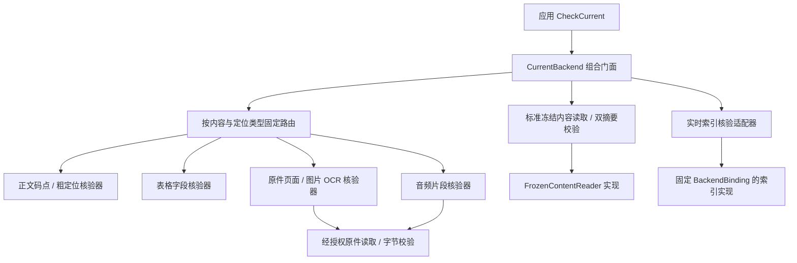

# 可替换证据核验模块设计

本设计细化[当前复核编排](CURRENT_CHECK_FLOW.md)中的CurrentBackend。它是知识应用层的组合门面，不应承担一个不可拆换的“万能核验器”。本文定义拆分和装配规则；除已有FrozenContentReader、正文局部核验和索引Verify端口外，其余角色、路由配置及远程操作尚未实现或注册，不能用本示例替代部署配置校验。

## 1. 职责与替换边界



| 角色 | 权威输入与责任 | 替换要求 |
|---|---|---|
| 冻结内容读取 | Request、Scope、平台Document/Revision ID；返回标准JSON及ID绑定 | 仓储或服务可换；相同冻结版本的规范化双摘要保持相同 |
| 通用内容校验 | 批准绑定的FrozenRevisionFact；独立计算实际JSON双摘要 | 不由解析器或索引回执替代；禁止供应商自行定义摘要格式 |
| 原件读取与校验 | 平台BlobRef、当前Scope；完整读取、长度及SHA-256 | 本地/S3实现分别验证；BlobID保持不变，内部位置可迁移 |
| 索引实时核验 | 固定代际、BackendBinding与批准内容/配置关系 | 对正确实例实际检查可读性与过滤；元数据ready不算通过 |
| 专用证据核验 | 已验证冻结内容、实际待用Evidence及必要原件 | 每种块/定位声明支持能力，可独立替换或增加实现 |
| 核验路由与编排 | 固定Profile、完整Evidence批次及全部必需角色 | 不生成或改变授权；任何条目失败阻止对应输出批次 |

索引已有IndexWriter/CompositeEngine.Verify(ReadinessProof)。调用它们前必须独立校验Proof与当前GenerationSet、内容和Profile关系，并解析经过装配确认的实例绑定；Verify本身缺少Request/Scope参数，不得直接当成已授权的远程调用。远程适配层沿用调用上下文、当前Grant和固定实例，不重新从客户端选择后端。

## 2. 核验请求的标准语义

专用核验端口拟采用`verify_evidence(request) → 全部通过或错误`。拟定请求包含：原Request/父预算、经过验证的Scope、固定Profile版本、平台文档/版本及双摘要、已验证标准内容、原顺序Evidence子批次。原件通过BlobReader依赖读取，索引核验使用独立适配器；不给模块数据库连接、路径、可任意调用的网络客户端或修改发布状态的权限。

这里只提出语义，没有新增Go EvidenceVerifier接口或远程HTTP操作。现有CurrentBackend.Verify已接收完整Evidence，但不能据此声称内部专用模块可通过注册中心替换。正式实现时须同步Go接口、模块清单、工厂类型检查、部署装配、配置归一化及远程Schema，再运行同一套契约检查。

进程内用错误表达“整批成功/失败”，禁止部分成功后静默忽略失败项。若远程传输需要核验回执，必须绑定Invocation、Profile、文档/版本、两项内容摘要和有序证据批次摘要，并校验条目数量和完整顺序。回执不能成为授权凭据或被下一请求复用。证据摘要算法/字段映射须另行冻结并提供金标，本文不假定已经存在该协议。

## 3. 按标准内容与定位路由

路由由平台从经过批准和摘要核验的内容确定，使用`Block.kind × Source.kind × Locator族`。不能只按上传后缀或供应商给出的“支持PDF”决定核验器，也不能由Agent指定更宽松的模块。

| 路由族 | 核验的具体含义 | 当前证据 |
|---|---|---|
| text / revision / exact.characters | Unicode码点半开范围、边界、摘录逐字一致 | VerifyTextEvidence局部实现与测试；真实接入未验 |
| text / revision / coarse | 摘录在冻结正文中连续出现，不承诺唯一位置 | 同上 |
| table / revision / cells | 工作表/单元格或标准表格坐标、合并单元格、选定字段的文本 | 待实现；不能用全文包含代替字段定位 |
| original / page或bbox | Blob属于该版本、原件哈希、页/区域边界与解析来源关联 | 待实现；OCR可信度与原件字节完整性分别核验 |
| image / OCR | 图片Blob、尺寸/区域、OCR对应文本与来源位置 | 待实现；图片caption不自动等于图中事实 |
| audio / segment | Blob、时间范围、转写片段与摘录对应 | 待实现；当前Citation.Locator无音频时间字段，需先扩展版本化契约 |
| revision / derived_from | 当前正文是证据，历史原件是溯源；所有来源分别验证 | 待实现；不能把人工修订称为原件中的精确原文 |

音频的AudioSegment已包含StartMS/EndMS，但Citation缺少相应时间定位。新增路由前必须补齐引用数据模型、Schema、客户端展示和迁移规则，不在现有字段中塞入供应商专有字符串。未支持类型或未知定位必须明确拒绝，不能省掉定位后继续输出。

## 4. 配置与生命周期

配置设计示意（不是可直接执行的现有配置）：

```yaml
verification_profile:
  version: immutable-profile-id
  frozen_reader: content-store-instance
  index_probe: index-verification-adapter
  blob_reader: authorized-blob-instance
  routes:
    - selector: text/revision/exact.characters
      verifier: text-verifier-instance
      required_features: [text.unicode_range, excerpt.exact]
    - selector: table/revision/cells
      verifier: table-verifier-instance
      required_features: [table.merged_cells, excerpt.cell_binding]
```

模块清单与Profile的声明必须分开：提供者声明支持项，平台配置声明必需项。上表特性名称属于待冻结提案，尚未成为现有部署校验规则。启动时拒绝重复/模糊路由、缺失实例、契约不兼容、依赖环或缺少必需特性；声明通过之后仍需真实行为测试。

上传可以保留原件并创建草稿，但正式发布所允许的块/定位组合须有完整核验覆盖。新增解析器产生的来源类型超出Profile覆盖时，发布准备失败、原有效发布继续可用，不删除原件或降低定位精度。业务界面应展示具体未支持原因。

每次请求固定核验Profile；运行中不能从注册中心临时选最新版本。替换核验器需同样本对照、Schema/来源/权限/失败语义检查、配置切换并重启和回退。无状态核验器通常无需内容迁移；改变冻结格式、定位语义或抽取规则时必须创建候选Revision/新索引代际并审核，不能原地改历史引用。

核验缓存属于衍生数据。若缓存键使用双摘要、定位、摘录及核验器版本，只能缓存不可变内容的计算结果，不能缓存当前授权/批准/发布允许。每个输出批次仍执行当前复核；模块不可用、范围未知或类型不支持不得降级成允许。

## 5. 公共替换验收矩阵

| 门槛 | 必须取得的运行证据 |
|---|---|
| EV-01 完整批次 | 多类型混合批次每项均由匹配模块核验；缺失、重复、未知路由和部分失败不输出 |
| EV-02 双实现 | 正文和原件读取分别至少两种实现；同一合法输入结果一致、同一非法输入均拒绝 |
| EV-03 多格式定位 | PDF/Word/表格/图片/音频代表样本的边界、溯源、摘录和媒体字节验证 |
| EV-04 替换兼容 | 换核验器后REST/MCP引用格式与历史平台ID仍可用；语义变化进入版本流程 |
| EV-05 权限与预算 | 当前权限/批准撤销、请求取消、原件被拒绝、实例错误与超时均阻止输出 |
| EV-06 迁移回退 | 存储迁移后哈希一致，原件位置可追溯，回退不恢复已撤回的允许状态 |

六项均未取得完整运行证据。当前已完成的正文局部测试、Go接口和配置示意不能关闭这些门槛。下一实施顺序：专用端口及能力配置冻结 → 路由器/装配检查 → 正文核验适配器 → 原件/表格核验 → 音频定位契约扩展 → 真实后端组合与EV/CHECK验收。
