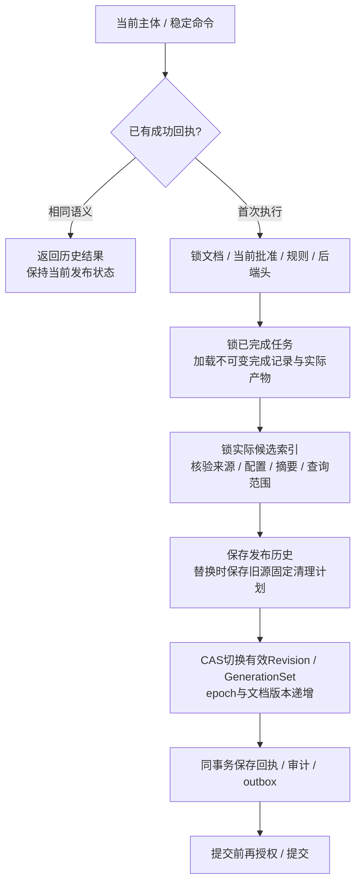

# 准备完成后的原子发布与替换

2026-10-15：实现 `preparation.PublicationStore.Finalize`，默认适配器为 `postgres.PublicationFinalizer`。真实链路现已从文件候选、提交、批准、准备登记、租约、关键词索引准备和任务完成，接到有效发布指针切换；已发布内容的正式检索和产品入口仍待贯通。

## 标准端口与替换边界

| 对象 | 字段 | 语义 |
|---|---|---|
| PublicationRequest | Command | 当前发布主体、已验证范围、稳定幂等键与调用预算 |
| PublicationRequest | OperationID / ExpectedEpoch / ArtifactDigest | 选择已登记操作、期望发布 epoch 与已完成产物 |
| PublicationResult | Operation / History | committed 操作及不可变发布历史 |
| PublicationResult | DocumentRowVersion / CleanupPlanID | 提交后的文档版本及可选旧源清理计划 |

端口使用平台对象。纯函数 `PublicationFacts` 计算发布历史和结果，不能替代权限、实时后端验证或 CAS。默认适配器将文档、审批、配置、完成记录、索引读回、历史、清理、审计与事件放在同一 PostgreSQL 事务内，属于复合实现。不能把独立数据库或远程引擎的多个成功响应视作同一个事务；第二实现、配置工厂及远程引擎 fencing 仍待验证。

最终发布由原发布主体发起，主体类型、发行方、客户及委托用户/客户身份与原操作保持一致；临时委托证明引用不参与身份摘要，但宿主仍必须核验本次有效委托。不能拿过期任务租约冒充当前发布授权。Verify 与具体操作的 AuthorizePublication 为必需依赖，参数副本隔离，提交前再次调用。

## 发布事务



执行要求：

1. 当前操作的原主体、空间、知识库及平台流水线 Profile 绑定正确。
2. 文档未删除，当前 epoch 等于登记和请求的 ExpectedEpoch；审批当前指针、有效审核规则与配置头版本仍匹配。配置 ABA 不能复活旧操作。
3. 当前任务为 completed，实际任务头与不可变完成记录一致，指定 ArtifactDigest 确实属于本操作和该次成功 attempt。
4. 重新读取实际候选索引并核对 Owner、内容计数、快照、来源、配置和受限查询，已有删除屏障或数据不符时拒绝。完成回执中的 Proof 不直接作为现在仍 ready 的证据。
5. 文档先取得排他锁，索引 generation 取得共享锁，均保持到提交，阻止复核后同时换版或删除。文档行版本和 epoch 在 UPDATE 中再次作为 CAS 条件。
6. 发布历史、有效指针、操作回执、审计及事件共同提交；替换旧源时固定清理计划和进度也共同创建。任一失败保留旧发布。

读取已完成内容时，仅为重建来源/投影期望而恢复历史 running 形状；不恢复执行权，不延长旧 Lease，也不改变 completed 任务。最终发布使用当前发布命令的预算及权限。

候选投影保持封存状态，`Published=false` 的历史快照不被原地改写。是否生效以权威文档的 ActiveRevision/ActiveGenerationSet 为准；后续 Retriever 必须按当前获准的有效集合过滤并再次复核，不能只依据供应商布尔标志。当前尚无这条正式检索路径的验收证据。

## 替换和旧源清理

首次发布从 epoch 0 进入 1，无旧源清理。替换时创建新的 generation set，并在历史记录中保留旧 Revision、旧 set 和旧 epoch；清理计划只锁定旧索引与已登记的旧图谱/记忆/缓存依赖。新代际不会被旧任务删除。

`ValidatePublicationCleanup` 将“失效旧发布源”校验复用于 withdraw 和 replacement publish。原 `ValidateWithdrawalCleanup` 保留撤回专用约束；现有清理仓储与领取流程可以读取并处理 replacement 计划，数据库继续检查完整目标覆盖和封存规则。新索引同时登记平台 BindingDefinition，保证之后正常撤回能找到它的固定目标。

本轮实测替换是同一已批准 Revision 的两个独立重建候选：两个 ExpectedEpoch=1 的发布竞争，只有一个进入 epoch 2；旧源清理可领取并实际删除旧索引，新代际仍有原始记录。随后通过既有撤回服务进入 epoch 3。新正文 Revision 的换版、完整后台清理消费者、全部外部依赖和生产保留策略仍需专门验收。

## 幂等与故障恢复

主体身份摘要使用 `akos.publisher-identity/1\0`；最终命令以 `akos.publication-finalize/1\0` 对 AKOS-CJSON/1 包络做 SHA-256，绑定空间、知识库、主体、操作、ExpectedEpoch、ArtifactDigest 和平台 Profile。追踪 ID、新作用域 ID及临时证明不改变语义；同键改变语义被拒绝。命令账本、不可变历史和最终回执相互关联。

提交后丢失响应返回 unknown，原键可由冷连接对账。历史重放仍要求当前主体和具体资源权限，返回原成功响应，不重新切换有效指针。即使随后撤回，也不会因重放旧 publish 而复活来源。新幂等键不能将同一操作再次发布。未知状态不代表确认失败，也不允许擅自创建另一个发布操作。

数据库延迟约束拒绝缺少审计/事件/清理，或回执、当前头、完成产物和历史不一致；直接激活已准备 set 而不保存发布回执也被拒绝。SQL 仍为隔离 schema 原型，未部署生产数据库角色或完整元数据 UoW/migration。

## 运行证据和后续

运行入口：

```powershell
python docs/architecture/check_postgres_wsl.py --major 15 --port 55433
python docs/architecture/check_postgres_wsl.py --major 16 --port 55432
python docs/architecture/check_postgres_wsl.py --major 18 --port 55434
.local/openapi-review-env/Scripts/python.exe docs/architecture/check_finalization_runtime.py
```

覆盖首次发布、历史冷重放、语义冲突、当前权限、替换 CAS 单赢家、失败保留旧发布、旧清理不影响新代际、正常撤回互操作、撤回后重放不复活、实际索引删除/批准撤销/配置变更拒绝、审计/事件回滚、静默漏事件、提交前撤权以及文档/索引写入锁。独立 Python 对历史响应重算命令摘要，核对原生对象与公共字段并执行管理 Schema 校验。

见[最终发布运行记录](evidence/finalization-runtime-review.json)、[多版本矩阵](POSTGRES_VERSION_MATRIX.md)和[总进度](../PROGRESS.md)。身份与规则初始化仍为 fixture，响应丢失由提交后的受控包装器模拟；未验证真实 IAM/RLS、TCP 中断、服务崩溃或生产负载。归档历史不授予当前访问权。

本轮验收：相同458项输入和同一Go探针，在PG15.19/16.15/18.6各通过138项检查，新增16项发布场景；6份实际发布结果、12个公共投影和6个命令摘要通过独立关系、字段映射、Schema与跨语言哈希校验。Go全包测试/vet、227项Python、三份OpenAPI及7组冻结金标通过，原完成/准备/租约/登记/审批对照保持通过。

有状态替换仍须暂停新发布/领取/续租，隔离旧写入者，一致导出原件/版本、批准/规则、有效头、任务/fence、产物/私有映射、绑定/旧源清理、幂等回执、历史/审计/事件和删除屏障。目标重建并验证真实查询及回执后才能配置切换、重启；回退需对账增量与删除，禁止双写活跃租约和丢失已成功但响应未知的发布。目前没有完整迁移/回退工具或运行证据。

下一步贯通有效发布检索与当前证据复核，再连接正式 REST/MCP 和管理界面。真实权限、第二后端替换、向量/图谱/模型接入、持续队列与完整迁移、封存中文 Recall@10 ≥90% 和固定条件性能验收仍开放。
