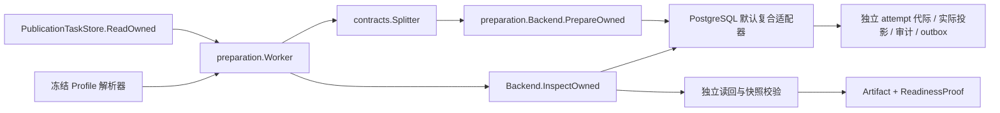

# 已批准内容的实际索引准备与独立读回

2026-10-15：实现文本关键词通道的索引准备。已批准 Revision 经独立分块接口进入持久、按 attempt 隔离的候选代际；后端写入后另开事务读回真实投影，核对来源与摘要，再返回准备产物。此步骤不更新有效发布指针，也不将任务标为完成。

## 模块边界



| 接口 | 输入 / 输出 | 替换约束 |
|---|---|---|
| PublicationTaskStore | 精确当前 Lease → 已批准 Revision、冻结字节、计划 | 当前权限、批准、配置及 fence 语义保持一致 |
| contracts.Splitter | 平台 Block、ChunkPolicy → Chunk | 不得修改批准正文；完整覆盖 Unicode 码点来源，返回稳定平台引用 |
| ResolveProfile | 冻结 BackendSnapshot → 完整 IndexProfile | 校验 ID、版本及完整配置摘要，禁止只按供应商名称取默认值 |
| preparation.Backend | PrepareOwned → Artifact；InspectOwned → 实际 IndexSnapshot | 持久幂等、独立读回、attempt 隔离、租约与写入原子防护 |

`pkg/preparation` 不引用 SQL、供应商或 PostgreSQL 类型。默认 `postgres.PreparationIndex` 复用控制数据库，将当前权威事实、租约锁与索引写入放在同一事务中。这属于**控制与索引共库的复合适配器**，目前仅证明上述端口边界；尚无配置工厂、远程实现或第二后端的替换验收，不能据此宣称完整 IndexWriter 已实现或控制库与索引库可分别切换。

生成的供应商内部句柄可以不同，保存于 BackendBinding。Worker 核对完整产物摘要，并比较除私有 BackendID 以外的平台事实。未来外部引擎必须证明持久写入的 fencing、观察一致性和未知结果恢复；仅在调用前检查租约不满足接口语义。

## 内容、配置与产物承诺

Worker 先从实际 Revision 重建 `akos.freeze/1`，核对 ContentHash、BlocksHash 和规范字节，然后才调用分块器。传给分块器、配置解析器和后端的对象分别复制，避免适配器修改引用改变原始校验基准。

首个实现支持 text Block、characters 分块和单一 keyword 通道；其他通道明确返回能力不足。分块必须属于批准版本，文本逐字匹配来源的 Unicode 码点半开区间，原始 UTF-8 SHA-256 正确；所有正文码点均被覆盖。允许重叠，不规定替换分块器的内部算法或固定步长。限制为 1–1000 块、总分块文本不超过 4MiB。表格、图片、OCR、父子块及向量/图谱流水线仍待接入。

完整 IndexProfile（移除自身 Digest）按 `AKOS-CJSON/1` 编码，以 `akos.index-profile/1\0` 做域隔离 SHA-256，覆盖策略、绑定、路由和配置版本。产物同样去除自身 Digest，使用 `akos.prepared-artifact/1\0`；快照遵循现有 `akos.index.snapshot/1` 格式。编码是平台原生版本化格式，字段变化须明确升级，不能静默改写历史配置。

平台根据 operation + attempt 派生 generation set 和 generation ID。同 attempt 重试沿用同一候选代际，新 attempt 创建独立代际。候选投影始终 `Published=false`，引用保留文档、Revision、Block 及原件位置。标准 ReadinessProof 的 ContentDigest 是批准 Revision 的内容摘要，实际投影另由 SnapshotDigest 承诺，二者不能混用。

## PostgreSQL 写入与读回

1. 检查当前批准、审核规则头、后端头和文档 epoch，并按统一顺序锁定。
2. 锁住任务头，核对当前 worker、attempt、fence、精确 Lease 与数据库时间；锁保持到索引事务提交。
3. 写入 generation set、generation 和真实投影。关键词列由 PostgreSQL 生成 tsvector，并建立 GIN 索引。
4. 从实际表加载 Owner、记录数与投影，核对快照；执行带空间、知识库、Revision、epoch、generation 条件的查询，以及逐项改变这些条件的负例。
5. 产物、审计、outbox 同事务提交；延迟约束拒绝缺失效果或不匹配的任务/代际关系。
6. Worker 经 InspectOwned 另开事务核验已持久产物和实际投影，重新比较来源、Profile、快照及当前租约，最后再做一次 ReadOwned。

查询验证使用全文条件或原文子串回退，只证明候选记录在指定范围中可查询。尚未实现中文分词优化、生产 Retriever、正式发布过滤和高并发检索；不证明 GIN 一定被查询规划器采用，不构成召回率或延迟验收。

提交前重新验证 Worker 和原发布者当前权限，以及租约时间。已封存代际拒绝追加和修改；现有删除流程仍可先登记删除屏障，再移除候选行。删除后的旧 Proof 无法通过实时 InspectOwned。当前身份/策略由 fixture 回调提供，不能替代真实 IAM/RLS。

提交后响应丢失返回未知状态，调用方在同 attempt、同配置和精确当前 Lease 下重试，读取已存产物并验证真实数据；不得直接新建另一份产物。若租约已接管，旧调用拒绝，新持有者使用新命名空间。旧 attempt 的产物保留，自动回收尚未实现；后续[完成对账](PREPARATION_COMPLETION.md)另按稳定完成命令恢复已经提交的历史结果。

## 验收证据

PG15.19、16.15、18.6 使用相同 448 项输入和同一 Go 探针，各通过当前 108 项仓储/应用检查，其中 12 项覆盖本轮准备链路。包括真实写入、冷连接恢复、伪造回声拒绝、恶意分块器修改来源拒绝、封存行防修改、删除后旧证明拒绝、审计/事件回滚、静默漏事件提交拒绝、提交前撤权、写入锁防接管、到期接管隔离及同 attempt 并发幂等。

独立 Python 对三个版本的 6 组真实产物与读回快照重算完整配置/产物/快照摘要、分块哈希和来源关系，并对标准模块 PrepareResult 检查 Schema。样本是当时成功读回的历史事实，其中一组随后故意删除以验证失效；归档 Proof 不能作为现在仍可发布的依据。

```powershell
python docs/architecture/check_postgres_wsl.py --major 15 --port 55433
python docs/architecture/check_postgres_wsl.py --major 16 --port 55432
python docs/architecture/check_postgres_wsl.py --major 18 --port 55434
.local/openapi-review-env/Scripts/python.exe docs/architecture/check_preparation_runtime.py
python docs/architecture/check_architecture.py
```

见[准备运行记录](evidence/preparation-runtime-review.json)、[多版本矩阵](POSTGRES_VERSION_MATRIX.md)和[总进度](../PROGRESS.md)。SQL 仍属于隔离 schema 原型，并非生产 migration 或完整元数据 UoW；响应丢失采用受控包装器，未模拟真实 TCP 中断、数据库崩溃或服务器重启。

## 接下来必须贯通的边界

后续已实现[准备任务完成](PREPARATION_COMPLETION.md)，绑定本次产物、当前租约和实际索引再核验，提供未知提交的同命令历史对账。最终发布仍须再次验证批准、权限、配置、准备代际与期望 epoch，以 CAS 原子更新有效版本并写审计/事件；其后才能接入只检索有效发布内容的查询服务。持续队列、候选回收、完整迁移/回退、真实认证授权、REST/MCP/UI 和封存中文 Recall@10 ≥90% 验收仍开放。

更换有状态准备后端时，须暂停领取和续租、隔离旧写入者，一致导出冻结内容/配置、任务与 fence 高水位、产物、投影、删除屏障、审计及事件；在目标导入或重建，重新验证实际查询和来源后才配置切换并重启。私有绑定由目标适配器转换，原有 artifact 摘要不能在换句柄后原地修改，须保留原记录并登记迁移关系。回退前仍要隔离新写入、核对期间增量和删除状态；不得把旧 Proof 或两端相同的运行租约直接当作切换授权。目前尚无这些迁移工具及演练证据。
