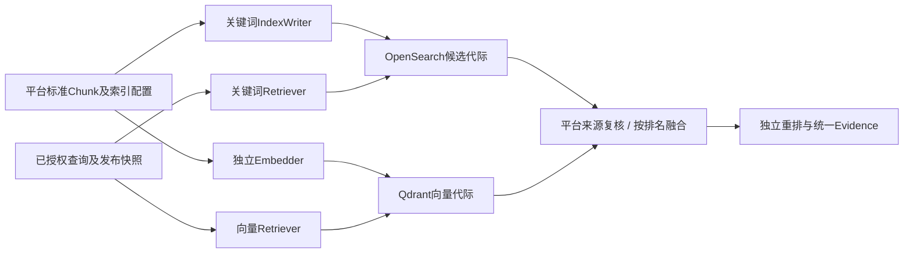

# 中文关键词检索独立适配器设计 V1

本规范补齐[Qdrant独立向量路线](QDRANT_ADAPTER.md)的关键词通道，候选采用OpenSearch＋analysis-smartcn，标准内容、发布与权限仍由平台持有。当前是固定源码调研和适配设计，没有安装或启动引擎。

## 1. 固定兼容基线

沿用已有WeKnora开发Compose中的OpenSearch 3.3.2作为对照基线，解析commit `6564992150e26aaa62d4522a220dfff5188aeb88`。保存LICENSE、SmartCN构建声明/注册类和search REST规格摘要，见[源码核验](evidence/opensearch-keyword-source-review.json)。主项目LICENSE为Apache-2.0，不代表全部镜像、插件、Lucene和字典许可已完整核验。

固定[SmartCN注册类](https://github.com/opensearch-project/OpenSearch/blob/6564992150e26aaa62d4522a220dfff5188aeb88/plugins/analysis-smartcn/src/main/java/org/opensearch/plugin/analysis/smartcn/AnalysisSmartChinesePlugin.java)声明smartcn analyzer、tokenizer及filter入口；[构建文件](https://github.com/opensearch-project/OpenSearch/blob/6564992150e26aaa62d4522a220dfff5188aeb88/plugins/analysis-smartcn/build.gradle)包含Lucene SmartCN依赖。入口存在不证明实际镜像已安装插件、中文分词效果或行业词典支持；必须通过插件清单、版本与_analyze样本验证。

3.3.2是兼容实验基线，不能直接作为生产安全选型承诺；当次官方latest发布元数据另记录于核验清单。上线前按固定发行版维护/安全修复、OCI与插件版本核验，升级生成新候选并重测，不能混用latest文档和旧版行为。

## 2. 与向量通道的分工

OpenSearch先只声明keyword通道，不要求其同时替换嵌入或向量实现。查询/写入布局在PipelineProfile中分别绑定；替换任一路不得静默失去另一路的准备和过滤要求。必需通道失败明确失败；可选通道降级必须记录，不能把单路成功宣称混合验收通过。

正文为已批准标准Chunk检索投影，必要时带经核验的标题/表格文本，不把全文后端当权威编辑器。OpenSearch内部ID和index名称仅保存在BackendBinding，不进入外部citation。Candidate携带平台Chunk、Revision、Generation和来源；后端highlight仅辅助展示，不能猜Block定位或作为原件证据。

## 3. Mapping、分词与过滤

space/kb/revision/generation/attempt/epoch/平台Chunk及摘要使用精确标识字段；正文/标题等使用明确配置的text分析字段。动态mapping关闭，任何新增字段或分词/同义词规则进入IndexProfile版本，重建新代际。不可让ID字段经过中文分析后再做权限过滤。

首轮分词对照固定smartcn与一个明确配置的CJK/字符粒度备选，验证简繁、行业术语、设备型号/编码、单位/小数、中文英文混合及否定词。备选具体analyzer及制品尚未锁定；不声称SmartCN原生支持自定义行业词典。若增词典/同义词或归一化层，单独锁定文件摘要与查询/写入语义，原始内容不修改。

关键词匹配与授权过滤在同一次受控查询中组合。使用精确filter/term语义限制space、epoch和每个获准KB＋Revision＋Generation＋获胜attempt元组，不能分别取并集形成错误组合。查询DSL由适配器从受信范围生成，不接受用户/Agent的任意DSL、脚本、索引通配符或供应商地址。空获准集合直接返回空结果；大集合超限明确失败或使用已验证分区方案。

官方[bool查询文档](https://docs.opensearch.org/latest/query-dsl/compound/bool/)区分过滤与评分条件，作为设计参考；正式3.3.2适配仍须按固定源码/运行行为核验。所有子查询、分页与上下文扩展必须保持过滤；返回后再复核当前发布与权限，不能用搜索后过滤补足后端未实现的限制。

## 4. 代际准备与异常

首个隔离方案采用独立epoch/attempt候选索引，活动代际只读。确认发布由平台CAS选择GenerationSet，不用后端alias修改充当审批批准。只读alias可作为内部映射便利，但每次绑定必须核对固定实际索引与generation，不受外部管理员重指向影响。

批量写入须逐项检查结果，部分失败不能只看HTTP成功；刷新/查询可见性、库存/摘要、analyzer版本与精确过滤分别Verify，再形成准备证明。超时保留操作/attempt库存并探查同一候选，禁止旧Worker覆盖活动索引。配置兼容和Readiness不是实际检索效果的替代证据。

撤回先由平台可见性闸门生效，物理删除在保留/迁移窗口允许后执行。删除明确候选或代际库存，不能用空过滤或通配符删除共享数据；迟到写入残留仍不得恢复可见性。后端原生快照是同引擎运维备份候选，跨实现替换以标准Chunk及来源重建，不把快照当可移植元数据库。

融合默认按排名，不直接相加OpenSearch分数与Qdrant相似度。保留RouteID/RetrieverID/GenerationIDs，重复相同混合列表不能增加贡献；候选全局预算、deadline及重排费用固定。正式分数定义及BM25/其它评分配置由实测锁定，不能仅凭关键词通道标签推定结果可比。

## 5. 共同验收

| 编号 | 必须验证的行为 |
|---|---|
| K-01 | 安装/版本/analyzer实际输出；中文术语、编码、数字/单位/否定词不丢关键信息 |
| K-02 | 草稿/撤回/越权/错误元组混合，过滤在候选选择前生效，ID字段不被分析 |
| K-03 | 批量部分失败、刷新延迟、超时及旧attempt，旧发布保持有效且准备证明准确 |
| K-04 | 独立关键词实现替换，全文重建/来源/公开引用稳定，包含新写入回退 |
| K-05 | 关键词、向量、融合/重排分别及共同用封存中文集评测；Recall@10目标不靠删难题或放宽权限 |
| K-06 | 固定硬件/资料/并发，过滤集合规模、冷热延迟、错误率及完整流水线成本 |

实际比较为DocReader/其它Parser＋独立Embedder＋Qdrant向量＋OpenSearch关键词＋平台融合/重排，对照WeKnora复合组。另一关键词实现、插件/镜像锁、完整许可/SBOM/维护与6项运行试验尚未完成。此候选补齐架构分工，不关闭D-05或90%/性能验收。
