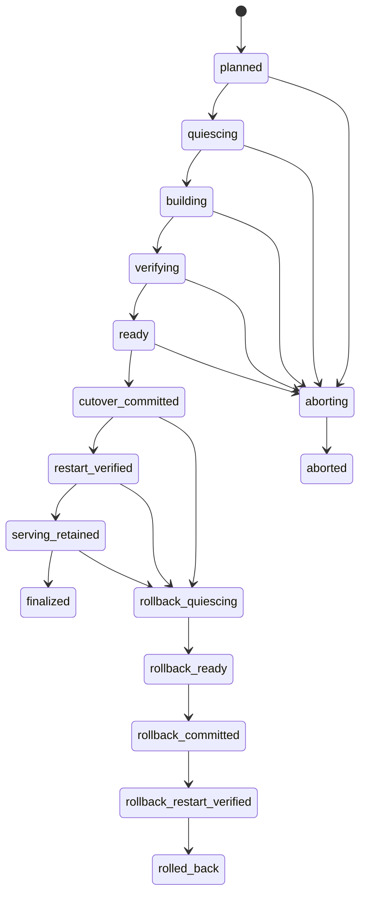

# KB后端迁移状态契约 V1

本规范细化[一致性协议](CONSISTENCY.md)和[日志/水位协议](JOURNAL_PROTOCOL.md)，限定于**同一权威元数据库内的KB后端替换**。数据库和文件存储迁移的状态记录及跨日志流桥接仍需独立契约，不能用本Schema替代。

[迁移记录Schema](schemas/migration-state.v1.schema.json)和离线状态规则已提供。它们不暂停业务、不创建租约、不切换索引、不释放保留锁，也不证明从外部传入的布尔“验证结果”可信。

## 1. 正向流程与取消边界



| 状态 | 业务写入与必须完成的动作 |
|---|---|
| planned | 旧后端继续服务；记录不可变源/目标方案，预留保留锁标识 |
| quiescing | 事务设置KB内容/发布写闸门并创建权威保留锁，停止领取相关任务；等待在途任务明确终态 |
| building | 已核验任务屏障并取得snapshot_cursor；按新epoch/attempt重建，旧后端只读查询 |
| verifying | 验证数量、标准内容/附件哈希、来源、过滤、规格及查询质量；记录有来源的验证报告 |
| ready | 必需产物已验证，完整事务重放到forward_checkpoint；后续授权/紧急撤回仍可能推进日志 |
| cutover_committed | 短事务重新核验最新完整Head、有效集合和当前授权，原子改KB epoch与文档指针；cutover_cursor等于核验的forward_checkpoint |
| restart_verified | 核对重启后的制品、锁、配置、持久化epoch、权限/发布闸门及引用；内容写仍暂停 |
| serving_retained | 恢复内容写入，并在同一事务记录实际恢复时间和回退/保留截止时间；旧后端及日志继续保护 |
| finalized | 回退及重放/恢复保护期限已过、无迁移旧epoch/候选相关未决任务；允许另行评估旧产物清理，不代表删除已执行 |
| aborting / aborted | 只允许切换前取消；停止/隔离候选任务、核对旧配置/epoch、无待处理任务后恢复旧方案写入 |

本流程的写闸门仅暂停KB内容/发布/索引写入；权限撤销与紧急撤回继续走权威事务和迁移日志。切换事务用相同JournalHead锁建立线性化点，后续提交自然使用新活动epoch，不在旧Head与新epoch之间丢失变更。正在进行的读取继续执行当前权限/发布复核，不依赖后台索引清理完成。

切换提交后只能进入专门回退路线，不能标记aborted或清除cutover记录。失败保持最后已确认阶段、写闸门、任务/调用账本和保留锁；人工诊断不改变已经发生的切换事实。不能因重启失败自动把活动epoch改回旧值。

## 2. 回退与保留窗口

rollback_quiescing暂停新内容写入并等待任务屏障；rollback_ready表示旧实现已完成新增/更新/删除/撤回/权限重放和全部产物验证；rollback_committed原子切回源epoch并记录rollback_cutover_cursor；rollback_restart_verified核对旧实现运行身份和持久化事实；rolled_back恢复旧方案写入。仍在运行的回退不会因期限到期自动放弃锁或删除数据。

恢复新方案写入前，回退不需要新增内容重放但仍必须补齐授权/撤回事务，并走上述核验路线。恢复写入后，首次请求回退必须在rollback_until_seconds内；已开始的回退可超过该时间继续受锁保护。过期后的恢复属于另行设计的修复迁移，不冒充已承诺回退成功。

时间字段为可信服务时钟的UTC Unix整数秒，范围至9999年；不从客户端接收。恢复时间不得伪造为开始迁移时间：

```text
rollback_until_seconds >= resumed_at_seconds + policy.rollback_window_seconds
retain_until_seconds >= rollback_until_seconds + policy.replay_budget_seconds + policy.recovery_margin_seconds
```

恢复时间及截止时间首次写入后不可缩短或覆盖。延期需要单独追加保留锁/补充承诺，不能改旧记录；当前离线模型只接受已冻结窗口。观察到服务时钟早于已记录恢复时间时拒绝推进，避免时钟回拨导致期限语义混乱。

aborted和rolled_back不直接释放保留锁：所有有效引用、墓碑、未知外部删除/调用和恢复需要仍按[回收契约](RETENTION_CONTRACT.md)检查。finalized也只允许后续清理任务评估，Schema没有“删光旧数据”的命令。

## 3. 记录、租约与证据绑定

migration_id、space/KB、源/目标epoch、构建锁摘要、目标IndexProfile、journal stream及保留策略/锁标识固定；source与target epoch不能相同。快照、切换水位和窗口一旦确认不能被重试覆盖；forward_checkpoint和rollback_checkpoint只在相应准备/切换阶段推进。游标只比较相等或用日志链验证，不按文本排序。

阶段迁移使用row_version CAS与当前fencing_token，在同一权威事务核验原请求主体的当前授权/作用域及真实保留锁。旧Worker、过期权限、不匹配KB/epoch或不完整产物不能推进。租约接管是独立权威命令：校验旧租约失效，增加fencing和row_version，保留所有业务阶段/已确认水位，再让新Worker使用新快照执行阶段命令；不能为了通过阶段校验把fencing重置。该接管命令尚待实现和单独验证。

源Head、任务屏障、readiness、配置/运行核对报告必须绑定migration_id、space/KB、epoch、配置/制品摘要、水位和获胜attempt，并由受信适配器/仓储验证完整载荷。当前规则函数中的facts是**离线模型观察值**，不是生产Proof DTO；真正的业务API不能接受用户提交actor_authorized=true等参数替代检查。切换涉及的epoch/文档指针/迁移记录/审计/outbox/journal和写闸门保持原子提交。

## 4. 验证边界

```powershell
python docs/architecture/build_migration_state.py
python -m unittest discover -s docs/architecture -p test_migration_state.py
```

离线检查覆盖正向、切换前取消、切换后回退、非法跳步、旧row/fence、来源/权限/保留锁不匹配、证明缺失、窗口缩短/过期、错误时间、提前清理和类型错误。成功固定ready_for_cutover=false。

仍需真实数据库故障注入、授权撤销、租约接管、当前Head并发推进、重启制品/epoch失配及完整迁移回退演练。typed记录payload、原件复制、数据库/文件迁移状态与日志流桥接未完成；D-04及最终运行验收继续保持开放。
