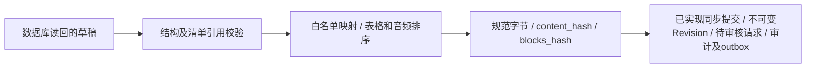

# 原生草稿到冻结内容的映射

2026-10-15：`pkg/document.BuildFrozenContent` 已实现原生 `contracts.Draft` 到 `akos.freeze/1` 规范载荷及双摘要的纯函数映射。纯函数为提交准备独立内容字节；[提交仓储](SUBMISSION_TRANSACTION.md)现已使用它生成并持久化 Revision 和待审核请求。



## 已实现的约束

- 草稿必须处于 draft 状态并具有有效行版本；块归属、顺序和标识不得冲突。
- 文本、表格、图片、音频采用标准字段白名单；可变文档元数据、草稿标识和行版本不进入内容摘要。正文、中文、Emoji、换行、空格、公式原文及精确数字文本保留。
- 原件、衍生来源及媒体引用必须属于附件清单；媒体 BlobRef 与清单逐字段匹配。清单排序，ID 唯一；MIME 按语法及媒体类别检查，保留原始拼写。
- 表格单元格排序并校验跨度、边界及合并区域重叠。稀疏表保留已知结构，不展开巨大空白网格；重叠检查采用坐标压缩与扫描线。
- 音频按开始、结束时间稳定排序，相同时间保留原顺序；允许重叠语音，拒绝超出时长的片段。图片尺寸、来源定位及有限归一化坐标执行结构校验。
- 返回字节独立于输入，排序不修改调用者数据。拒绝非法 UTF-8、结构不一致及超限载荷；原生对象序列化限 8 MiB，最终规范编码沿用 4 MiB 限额。

原生定位坐标仍使用现有 Go `float64`，整数使用原生 `int` / `int64`；映射对已经表示的原生数值编码，**不承诺任意外部十进制词元无损进入 float64**。外部精确十进制的完整传输映射仍须另行验收。

## 当前验证

```powershell
.local/openapi-review-env/Scripts/python.exe docs/architecture/check_frozen_mapping.py
python docs/architecture/check_postgres_wsl.py --major 15 --port 55433
python docs/architecture/check_postgres_wsl.py --major 16 --port 55432
python docs/architecture/check_postgres_wsl.py --major 18 --port 55434
```

Go 原生对象经验证桥映射，独立 Python Schema 和规范编码对照既有 7 组金标，核对规范字节及双摘要；正常验证不改写金标。合并区域检查另与 1000 组独立矩形两两相交判定对照。单元测试覆盖输入所有权、元数据排除、正文变化、无效引用、表格及音频排序。

真实 PostgreSQL 应用链路从读回的已解析草稿生成冻结候选载荷；后续人工编辑及迟到解析不会改变已准备的字节。该项只证明独立内存载荷，未证明数据库中存在不可变 Revision。

证据见 [冻结映射报告](evidence/frozen-mapping-review.json) 和 [多版本矩阵](POSTGRES_VERSION_MATRIX.md)。

## 后续提交事务边界

调用者仍须验证当前身份与资源权限、原件和附件真实字节、来源准确性，绑定草稿行版本及配置。之后在一个权威事务中创建 Revision/Block/Blob 关联、将草稿标记 submitted、创建审批请求、记录审计/outbox 和幂等回执；并验证并发、重放、提交结果未知及重启恢复。

独立[提交仓储](SUBMISSION_TRANSACTION.md)现已实现上述同步提交事务切片，真实数据库测试证明 Revision 持久化与回滚；纯映射本身仍不承担这些职责。批准、发布、真实 IAM、媒体真实性、生产部署及 Recall@10 目标仍未通过。
