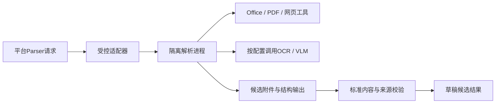

# 解析器部署包与替换边界 V1

本规范衔接[解析字段映射](PARSER_WIRE_MAPPING.md)、[组件准入](COMPONENT_ADMISSION.md)及模块注册协议。它规定解析实现的部署边界，不改变平台DocumentBlocks和来源模型。

## 1. DocReader固定依赖核验

2026-10-13核对WeKnora v0.8.2的固定commit。`docreader/pyproject.toml`有22项直接依赖声明；`uv.lock`包含80个package条目。条目数量不是已安装包数量或完整镜像SBOM：条件依赖、系统库、浏览器、字体和构建工具还需单独核对。[核验摘要](evidence/docreader-dependency-review.json)

| 边界 | 固定源码观察 | 对替换的要求 |
|---|---|---|
| Python解析 | 锁文件含MarkItDown 0.1.3、OpenDataLoader-PDF 2.4.7、pypdfium2 5.8.0等 | 保存实际解析路由及锁摘要；依赖存在不等于该格式已运行通过 |
| 进程通信 | 锁定grpcio/grpcio-tools 1.80.0，Dockerfile暴露gRPC端口 | 适配器转换供应商协议到平台Parser，不把供应商protobuf当业务模型 |
| Office与PDF工具 | Dockerfile安装LibreOffice、Java运行时和antiword | 引擎、字体与语言环境进入制品身份；容器能启动不证明中文排版/表格保真 |
| 网页解析 | 构建安装Playwright WebKit及相关系统依赖 | 网页执行与文件解析隔离，联网由独立接入策略控制 |
| OCR/VLM | Dockerfile注释说明无OCR/VLM，并移除OCR相关依赖 | 不把整个WeKnora支持OCR的能力推定为此容器独立拥有；另接OCR/VLM实现并测试 |
| 锁定范围 | Python使用uv sync --locked；基础镜像tag、系统包与uv安装未完整固定digest/版本 | uv.lock不是完整可复现构建证明，实际镜像及附加资产仍需锁定 |

依据固定[依赖声明](https://github.com/Tencent/WeKnora/blob/3e8b0bfc80b845b2d4b2ed683994748741450a97/docreader/pyproject.toml)、[锁文件](https://github.com/Tencent/WeKnora/blob/3e8b0bfc80b845b2d4b2ed683994748741450a97/docreader/uv.lock)和[Dockerfile](https://github.com/Tencent/WeKnora/blob/3e8b0bfc80b845b2d4b2ed683994748741450a97/docker/Dockerfile.docreader)。本次没有安装这些依赖、构建镜像或执行解析。包名/版本不构成许可或漏洞结论。

## 2. 解析实现作为完整部署包

单次解析绑定不可变PipelineProfile和完整部署包身份：适配器版本、引擎/依赖锁、OCI摘要与CPU架构、字体包/语言设置、OCR/VLM模型规格、输出规范及后处理版本。BuildLock绑定部署配置；供应商parser_version单个字符串不足以复现跨工具链输出。尚未有机器Schema封装完整解析部署包，后续必须与清单/构建锁对照。

能力声明分别列出输入格式、扫描件、表格结构、图片/音频、来源定位及所需外部模型。不满足请求所需能力时明确拒绝或采用经过验收的备用profile；不能静默改用降级解析却报告同等能力。每次输出记录实际使用的route、模型及诊断；safe_message不暴露路径、凭据或原始供应商异常。

解析进程只获单次任务授权的原件读取和候选附件写入能力，不获发布、平台元数据直接写入、活动索引编辑或任意对象删除权限。候选附件遵守上传确认/保留协议，尚未确认的临时路径不能进入正式Block BlobRef。跨空间和旧attempt的临时文件隔离。

## 3. 资源与恢复边界

Office/PDF工具的子进程、浏览器上下文和外部OCR请求纳入同一任务预算：原件大小、解压后字节/条目数、页/表/单元格/图片数量、临时磁盘、内存、并发和总时长。具体数值在样本及硬件试验后锁定，不以无限制参数作为默认。

任务取消停止或隔离整棵进程/子任务；仅gRPC调用返回超时不等于工具停止。输出超过预算、部分页面失败或模型不可用，须返回明确诊断和候选状态，不能自动形成可发布版本。任务事实保存原件摘要、草稿版本、attempt/fencing和配置；恢复仍核对当前草稿，人工编辑后迟到结果进入独立候选，不覆盖当前内容。

模块替换后重解析固定原件形成新候选；比较正文、表格、附件、坐标及诊断。保持原发布Revision不变，内容变化按编辑审核流程产生新版本；不能为兼容新解析器重写历史引用或原始字节。

## 4. 两种实现的共同试验

| 编号 | 试验输入 | 通过条件 |
|---|---|---|
| PARSER-DEPLOY-01 | 原生中文/扫描/旋转/多栏PDF | 区分所需OCR能力，页与区域定位正确，缺页明确失败 |
| PARSER-DEPLOY-02 | Word/PPT/Excel，合并单元格、单位、公式、隐藏sheet | 保留标准内容语义与来源，不把文本化投影当原始表格 |
| PARSER-DEPLOY-03 | 同文件＋两个独立解析实现 | 公共契约通过，差异报告可审核；配置切换后旧引用可读 |
| PARSER-DEPLOY-04 | 超时/取消/子进程卡住/磁盘不足 | 有界结束或隔离，未确认附件不发布，孤立产物可恢复 |
| PARSER-DEPLOY-05 | 解压超限、外部链接、跨空间候选混合 | 预算与作用域拒绝，不能读取非任务原件或绕过网络策略 |
| PARSER-DEPLOY-06 | 解析中草稿编辑、旧attempt迟到、重启 | CAS/fencing保护人工修改，恢复能解释候选与临时对象归属 |

上述是运行门槛，尚未执行。当前只取得固定依赖与已有DTO映射证据；真实DocReader协议映射、解析路由、模型/字体资产、完整许可/SBOM以及第二实现仍待核验，D-03/D-05及正式解析验收保持开放。
