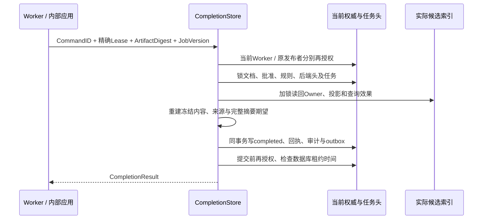

# 索引准备任务完成与未知结果恢复

2026-10-15：在[实际索引准备](INDEX_PREPARATION.md)之后新增 `preparation.CompletionStore`，默认实现为 `postgres.PublicationCompletion`。完成只表示该次准备执行已经成功提交；有效发布指针仍保持不变。最终发布必须重新检查当前批准、权限、配置、索引实际状态并执行 epoch CAS。

## 接口与业务语义

| 标准对象 | 字段 | 含义 |
|---|---|---|
| CompletionRequest | Access | 请求、已验证范围与精确当前 Lease |
| CompletionRequest | CommandID | 稳定完成命令标识；调用追踪 RequestID 可变化 |
| CompletionRequest | ArtifactDigest | 已持久准备产物摘要；不接受调用者自行声明 ready |
| CompletionRequest | ExpectedJobVersion | 执行者观察到的当前任务行版本 |
| CompletionResult | Job / Artifact / CompletedAt | 不可变历史完成响应；不授予新的执行或发布权限 |

端口全部使用平台类型，不含 SQL、驱动或引擎专有类型。`CompleteJob` 只计算状态流转；适配器必须另行验证真实后端效果和当前权威状态。默认实现与准备适配器同控制数据库，作为一组复合事务能力提供，尚无配置工厂或第二实现的替换运行证据，也不是完整 `contracts.TaskRepository`。

`CommandID` 在 space + worker 下唯一，命令摘要绑定 Job、Worker、精确 Lease、Profile、ArtifactDigest 和 ExpectedJobVersion，使用独立版本化域 `akos.publication-completion/1`。同键更换内容冲突；更换 RequestID 不产生新完成记录。每个 Job 只能保存一条成功完成记录。

## 首次完成



首次调用要求任务仍为 running、租约未过期、Worker/attempt/fence/截止时间完全匹配、JobVersion 一致。当前文档 epoch、批准指针、审核规则及后端配置头必须仍匹配冻结计划，配置 ABA 也使旧计划过期。

适配器从持久记录加载指定 Artifact，再读取真实候选代际。它重新冻结批准 Revision，验证实际分块对批准正文的覆盖、来源定位、Profile、内容摘要、快照及查询范围。后端记录不存在、已有删除屏障、数量/摘要不符或模块绑定错误均拒绝完成。不是把上一轮返回的 ReadinessProof 直接复制成任务成功。

通过后任务变为 completed，RowVersion 增一，Progress=1，记录本次 keyword GenerationID，清空 LeaseUntil；attempt/fence 高水位保留。任务头、原产物引用、稳定完成回执、审计与 outbox 原子提交。数据库同时约束完成记录与头/产物的一致性，拒绝静默漏事件，也拒绝仅将任务头改为成功而不保存回执。成功状态不可再 claim、renew 或 ReadOwned。

任务头的排他锁保护完成过程，候选 generation 的共享锁阻止同时删除；控制事实按既定顺序加锁。提交前再次验证两类权限，并用数据库时间检查执行租约；检查期间耗尽租约也会整体回滚。SQL 仍为隔离 schema 原型，不是正式 migration 或完整元数据 UoW。

## 响应丢失、重放与迟到结果

提交响应丢失返回未知状态。调用方保留原 CompletionRequest，在原 CommandID 下对账；不能换一个命令或直接重做整次任务。已提交时，冷连接可在执行租约过期后取回原历史响应，且仍要求新的有效作用域、具体任务 Worker 权限和原发布者当前授权。

历史重放不再要求旧租约当前有效，也不重新把任务变为 running。它不声称索引现在仍存在；索引之后可能删除、配置可能切换或发布可能撤回。因此返回的旧 Artifact/Proof 只能解释那次完成，不能用于跳过最终发布的实时核验。

未成功提交的旧命令不能借此重放：租约已到期、续租后仍提交旧截止时间/旧 JobVersion、或被新 attempt 接管时，首次完成均拒绝。提交已确认回滚的调用可在精确租约仍有效时，以原键重试。旧 attempt 产物清理、自动队列消费及跨进程执行恢复仍待实现。

## 验证与状态范围

真实文件经解析、编辑、提交、批准、登记、领取和索引写入后执行完成事务。实库试验覆盖：

- 成功完成后关闭读取/续租/领取；同命令重放没有重复效果。
- 提交后故意丢失响应，实际等待租约到期，再由冷连接恢复历史响应。
- 同键改变产物、版本或 fence，以及不同完成命令重复完成均拒绝。
- 已准备索引被实际删除、旧租约被续租或接管，以及配置头变化均拒绝旧完成。
- Worker 或原发布者撤权拒绝历史重放；提交前撤权、提交前租约耗尽回滚。
- 审计/事件 SQL 故障整体回滚；事件被触发器静默省略时延迟约束拒绝提交。
- 单独更新任务头为成功被数据库拒绝；两个相同命令并发最终只有一个持久完成结果。
- 完成不切换有效文档/代际和 publication_epoch。

运行命令：

```powershell
python docs/architecture/check_postgres_wsl.py --major 15 --port 55433
python docs/architecture/check_postgres_wsl.py --major 16 --port 55432
python docs/architecture/check_postgres_wsl.py --major 18 --port 55434
.local/openapi-review-env/Scripts/python.exe docs/architecture/check_completion_runtime.py
```

独立校验对实际完成记录重算产物摘要、核对任务与产物的完整标识/版本关系，并对管理 Job 投影检查 Schema；属于内部实际事务和离线 DTO 证据，尚无公开 HTTP/MCP 服务。运行报告见[完成验收证据](evidence/completion-runtime-review.json)与[多版本矩阵](POSTGRES_VERSION_MATRIX.md)。响应丢失使用受控包装器，权限和初始元数据仍为 fixture，未证明 TCP 故障、服务器崩溃恢复或真实 IAM/RLS。

本轮验收：相同453项源码输入与同一Go探针在PG15.19/16.15/18.6各通过122项检查，新增14项完成场景；6组实际完成响应/Job投影通过独立产物绑定与管理Schema校验。Go全包测试/vet、227项Python回归、三份OpenAPI结构检查及7组冻结金标通过，原准备/租约/登记/审批对照保持通过。所有私有实例已停止，目录移除及端口关闭另行核对。独立Schema曾发现状态名差异，已将实现统一为现有公共契约的 `completed` 并重新执行全部检查，未扩展公共枚举。

## 替换、迁移与后续

替换完成适配器必须与任务/准备事务组合一起验证，不能将三个独立服务的成功响应当作原子提交。迁移需暂停投递和续租、隔离旧写入者，一致导出冻结配置/内容、任务与 fence 高水位、产物/私有映射、成功回执、审计/事件和删除屏障；新实现应恢复原命令回执、验证实际数据后才能切换。回退须处理切换期间增量，不能复制同一活跃租约形成双写；不能丢失已经成功但响应未知的完成记录。目前尚无这套迁移工具及演练证据。

下一步是完成记录到最终发布 CAS 的原子闭环及有效发布检索。持续队列、取消/重试、完整 TaskRepository、远程/第二后端、真实身份权限、全量迁移/回退、REST/MCP/UI、封存中文 Recall@10 ≥90% 和性能验收仍开放。

后续已实现[原子最终发布/替换](FINAL_PUBLICATION.md)，在新的当前发布权限下重新核验完成记录与真实索引，以CAS切换有效头并共同写入历史、旧源清理、回执、审计和事件。当前矩阵每版138项；正式有效检索、持续队列及完整产品/迁移验收仍开放。
