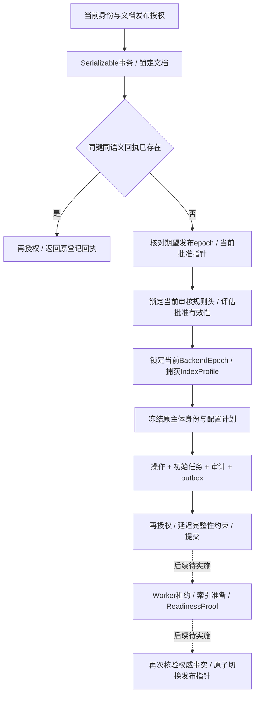

# 有效批准检查与发布准备登记

2026-10-15：已实现 `document.PublicationStarter` 的 PostgreSQL 默认实现 `postgres.PublicationStarts`。它连接实际冻结版本、当前审批决定和知识库配置，原子登记发布准备操作、初始任务、审计与 outbox。实际索引准备、租约接管、ReadinessProof 验证和最终发布指针切换仍待实现。

## 业务契约与当前规则

调用为 `StartPublication(context, PublishRequest) → PublicationStartResult`，请求复用平台契约；结果含 `PublicationOperation` 与 `Job`。业务接口不依赖 SQL 或供应商类型。登记成功返回 `preparing / queued`，GenerationSet 尚为空，也不推进 publication_epoch。

审核规则保存在不可变 `ReviewPolicySnapshot`，由知识库 `review_policy_heads` 指向当前版本。默认规则实现使用明确的“可接受决定策略版本”清单，校验当前批准 ID、请求状态/版本、冻结内容哈希和规则摘要。它分别管理三种版本：

| 版本 | 本轮例子 | 含义 |
|---|---|---|
| ACL PolicyVersion | 1 | 当前主体的资源访问权限 |
| Approval.PolicyVersion | 7 | 人工批准时所用规则 |
| 当前 ReviewPolicyVersion | 9 | 现在判断该历史批准能否被接受的规则 |

规则 8 只接受决定策略 8，因此拒绝旧批准 7；规则 9 明确接受决定策略 7，因此允许同一未撤销批准继续登记。版本号相同本身不能证明有效，旧批准回执也不能替代当前决定指针。

审核规则摘要采用 `akos.review-policy/1`：白名单 `{format, version, accepted_decision_policy_versions}` 经 AKOS-CJSON/1 编码，再计算 SHA-256(`akos.review-policy/1` + NUL + 规范字节)。版本清单要求正整数、升序且唯一。原生配置字段不与公开 REST DTO 混同。

后端采用不可变 `PublicationBackendSnapshot`，包含 BackendEpoch ID、IndexProfile 的 ID/版本/摘要与必需检索通道；知识库后端头记录当前 epoch 及行版本。快照描述待执行配置，不能凭其声明推断索引已经建好或模型/通道可用。

## 原子登记

同一写事务以共享锁保护文档、当前审批请求、审核规则头与后端头；相应写入者不能在登记验证与提交之间改变它们。锁的保护范围只到本次提交，准备任务执行期间仍可能出现撤权、撤销批准、撤回或配置切换；最终发布必须重新校验并执行 epoch CAS。

`publication_intents` 保存不可变计划和首次回执：原主体/委托身份、目标与批准/内容哈希、当前规则及配置头版本、BackendEpoch、IndexProfile 与任务关联。委托证明引用不作为可复用凭据存入计划，Worker 以后必须从可信身份服务取得当前资格。

`publication_queued_jobs` 是不可变初始任务事实，不是完整可运行 TaskRepository。`publication_prepare_outbox` 记录待投递的操作/任务标识；它不包含原件全文，也没有证明真实队列已经收到消息。操作、任务、审计及 outbox 由延迟约束共同提交，缺项不能留下半个登记。

## 幂等与替换边界

唯一范围为 space+subject+action(`publication.start`)+key。语义绑定主体/颁发者/客户端/委托身份、文档、Revision、Approval、expected_epoch 和不可变命令 Profile；期限/请求ID/作用域ID/临时证明引用不参与语义摘要。每次重放仍验证当前主体的发布权限。

已有回执代表当时的准备登记。登记后批准被撤销或 epoch 改变，原键可以返回原回执用于核对，但新键不能跳过当前有效性检查，更不能因此执行最终发布。`ErrPublicationStartUnknown` 要求使用原键核对；`ErrPublicationStartRejected` 只证明本次调用未提交。

PublicationStarter 可整体替换。当前 PostgreSQL 实现把默认审核规则评估、配置读取和登记事务作为复合能力；尚未通过受控模块注册中心分别装配规则提供者，也不能声称每个内部步骤已经可以单独换供应商。复杂行业规则、完整事务/UoW、管理配置变更与迁移日志仍需统一设计和验收。

## 本轮验证范围

实际文件上传、解析、编辑、冻结提交和人工审批 fixture 之后调用发布登记仓储，事务使用真实 PostgreSQL：

- preparing 操作、queued 初始任务、计划绑定、审计/outbox 各一次保存；受控丢失响应后，新数据库连接按原键恢复。
- 撤销的旧批准、当前规则不接受的策略、无权限重放和同键改变 expected_epoch 拒绝。
- 当前规则 9 接受历史决定规则 7，分别保存其版本；后端从 epoch1 切到 epoch2 后，新操作绑定新的配置，旧计划不变。
- 审计/outbox 写入失败整体回滚；事件被静默省略时延迟约束拒绝提交，确认回滚后原键可以重试。
- 提交前撤权回滚；另一个事务对受保护配置/文档执行 FOR UPDATE NOWAIT 被拒绝，证明登记事务内的写入屏障。
- 同键并发只留下一个操作/任务；活动发布指针和 epoch 保持不变。
- 数据库返回的操作/任务验证投影与管理 OpenAPI 对照；审核规则摘要与独立 Python 编码对照。

运行脚本为 `check_postgres_wsl.py` 和 `check_publication_start_runtime.py`；证据见 [发布准备运行记录](evidence/publication-start-runtime-review.json) 与 [多版本矩阵](POSTGRES_VERSION_MATRIX.md)。身份、配置初始化/切换和人工决定仍是 fixture，尚无真实配置管理权限、队列、索引构建、最终发布、已发布检索、全量迁移、生产性能及 Recall@10 证据。

验收记录：相同437项输入和同一Go探针，在PG15.19、16.15、18.6各通过当前83项仓储/应用检查；发布准备新增10项场景。18个实际操作/任务投影通过管理Schema，9个规则摘要通过Go/Python对照，21个审批投影与7组冻结金标保持通过。统一Go测试/vet、227项Python回归及OpenAPI通过；服务停止、临时目录移除和端口关闭已独立核对。

后续进展：[发布准备任务租约](PUBLICATION_TASKS.md)已提供Claim/Renew/ReadOwned；发布登记新增可变任务头并纳入同一事务。初始Job与初始回执保持不可变，后续状态单独保存。持续队列、索引准备、完成与最终发布仍待贯通。
