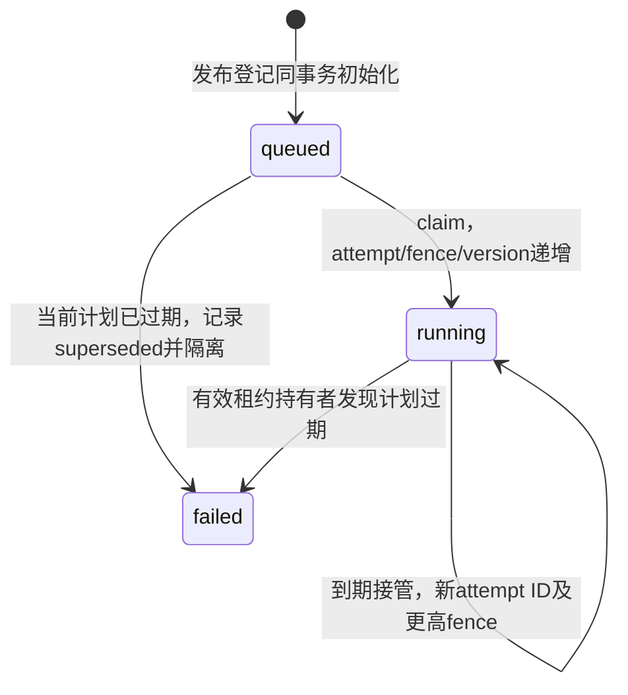

# 发布准备任务的租约与已授权内容读取

后续诊断：[治理时钟前置条件](GOVERNANCE_CLOCK_DIAGNOSTICS.md)已实际捕获4至5秒墙钟步变；当前590项本地检查通过，但本轮完整PG因环境时钟异常失败，不代表此页业务守卫应放宽，也不以旧通过快照代替当前验收。审批/续租稳定性与完整V1保持开放。

2026-10-15：在发布准备登记之后，已实现 `document.PublicationTaskStore` 的 PostgreSQL 默认适配器 `postgres.PublicationTasks`：Claim、Renew 和 ReadOwned。它提供持久租约、同命令回执、到期接管及受控内容读取；尚无持续运行队列、实际索引写入、ReadinessProof、任务完成或最终发布。

## 标准接口与可替换边界

| 操作 | 平台输入 | 平台输出 |
|---|---|---|
| Claim | PublicationClaimRequest：标准 ClaimRequest + 稳定 CommandID | Lease + JobVersion |
| Renew | RequestContext、AccessScope、当前 Lease、时长、CommandID | 同 attempt/fence 的新截止时间 + JobVersion |
| ReadOwned | RequestContext、AccessScope、精确 Lease | 冻结计划、当前 Job、Lease、Revision 与规范内容字节 |

接口不使用 SQL、驱动或供应商类型。默认实现将租约事务、当前权威事实核验与内容读取作为复合能力；替换实现必须提供同样的隔离、幂等、当前授权及失败语义。该接口不冒充完整 TaskRepository：Create 与发布登记共事务，Load/Complete/Cancel/Retry、队列与完整部署装配仍待补齐。

CommandID 是一条 claim/renew 命令的稳定标识。RequestID 只跟踪某次调用，重试可以变化；不能用新追踪号换取新租约。账本按 space+worker+kind+CommandID 唯一，绑定 job、profile、时长及续租时的精确旧 Lease。同键改变语义冲突；真正接管必须使用新 CommandID。

## 租约与状态规则



租约时间以数据库 `clock_timestamp()` 为准。时长为整毫秒，范围 1ms–30s；截止时间裁剪到调用上下文、RequestDeadline 和当前 ScopeExpiresAt。续租仅允许精确匹配的当前持有者，在旧租约到期前延长；不能缩短租约或更换 attempt/fence。更新时同时检查计数上限、状态、行版本和数据库时间。

每次首次领取或到期接管都会生成新的不可推测 attempt ID，并增加 attempt、fencing_token 和 Job.RowVersion。续租只增加行版本，返回新的精确截止时间；旧 Lease 不再适用于 ReadOwned。旧 Worker、旧 attempt、旧截止时间或旧 fence 都不能读取新一次执行的内容。

响应丢失后，原 CommandID 返回首次持久回执，包括可能已经过期的 Lease；回执不代表当前拥有执行权。续租重试甚至可在旧截止时间之后返回已提交的新 Lease，随后仍必须执行 ReadOwned 当前核验。原 claim 回执在接管后不会被改写成新持有者的 Lease。

## 原子持久化与权限

发布登记现在同时创建不可变初始 Job 与可变 `publication_task_heads`，两者职责分开。首次领取、续租及计划过期隔离，每次将 JobHead、命令回执、审计和 outbox 共同提交；延迟约束拒绝缺项，触发器拒绝倒退版本、非法接管、身份绑定改变或静态任务内容被改写。

Worker 必须具有 `publication.prepare` 作用域，并通过具体 Job 的授权回调；它还不能替代原发布者：宿主必须独立验证冻结计划所记录的原主体/委托身份当前仍有发布资格。权限回调接收独立副本，不能借修改参数替换任务目标。每次提交前重新检查这两项权限；失败时回滚，且不返回 Lease 或正文。

新任务变更和 ReadOwned 还按统一顺序锁定文档、当前审批、审核规则头、后端头，检查：

- 文档未删除，publication_epoch 仍等于登记时的期望值。
- 当前批准 ID、内容哈希、审批状态/版本及当前规则仍匹配。
- 审核规则头和后端头的行版本仍等于登记计划；即使配置从 A 切到 B 再回 A，也不能复活旧计划。
- 当前 BackendEpoch 与索引 Profile 绑定没有被切换。

有效的 claim/renew 遇到过期计划时，将任务原子标记 failed/superseded 并增加 fence，清除活动租约；不能直接改绑旧计划。只读调用发现过期则拒绝，不擅自推进任务状态。权限服务失败与业务事实过期分别处理：不能把一时无法授权当作已确认的过期事实。

## 内容读取

ReadOwned 只在精确当前 Lease 仍有效时返回内容。它读取实际已批准 Revision 与规范载荷，检查文档/版本/双摘要，并将原生块重新按 `akos.freeze/1` 冻结，与数据库 bytea 逐字节核对。返回值独立于数据库记录及后续调用，调用者修改它不能改变权威数据。

读取上下文裁剪到租约截止时间，返回前另用数据库时间复核；失败、撤权或过期均清空返回包。该端口是内部受控读取，尚未实现远程流式响应与完整 DataPlaneGrant，不代表已经证明网络发送过程中的权限边界。

## 验证与剩余工作

真实文件经解析、编辑、提交、批准与发布登记后，执行真实 PG 租约事务与内容读取。验证包括冷连接恢复 claim/renew 丢失响应、旧截止时间之后恢复已提交续租、实际等待租约到期后接管、旧回执/旧 fence 拒绝、返回内容无别名、Worker 与原发布者分别撤权、审计/outbox 写入故障、静默漏事件、并发单持有者，以及 backend 切换、policy ABA、批准撤销和 epoch 变化导致的终态隔离。

运行命令：

```powershell
python docs/architecture/check_postgres_wsl.py --major 15 --port 55433
python docs/architecture/check_postgres_wsl.py --major 16 --port 55432
python docs/architecture/check_postgres_wsl.py --major 18 --port 55434
.local/openapi-review-env/Scripts/python.exe docs/architecture/check_publication_tasks_runtime.py
```

证据见 [任务运行记录](evidence/publication-tasks-runtime-review.json) 与 [多版本矩阵](POSTGRES_VERSION_MATRIX.md)。时间等待和事务是实际运行；身份/角色、配置切换与 epoch 修改仍是 fixture，丢失响应是提交后的受控包装器，并未实际切断 TCP 或模拟数据库崩溃。

后续 Worker 必须在私有 attempt 命名空间准备索引，并在外部写入与提交结果时执行当前 fencing 核验；本次“旧租约不能读正文”不能替代外部索引写入隔离。任务完成、结果未知处理、准备产物清理、持续队列、ReadinessProof 和最终发布 CAS 仍须贯通。完整 UoW/迁移、真实 IAM、正式 API/MCP/UI、已发布检索和 Recall@10 仍未验收。

联调修正：queued/failed状态没有租约截止时间，而既有utc_nanos域明确拒绝NULL。新任务列在空值时保留NULL，在非空时再通过严格utc_nanos校验；未放宽原有时间域。隔离运行器现在仅保存失败时的ERROR摘要，排除SQL正文、参数及DETAIL行，便于定位而不记录内容载荷。

补充替换约束：任务存储迁移必须在一致视图导出计划/配置、当前Job、attempt/fence高水位、命令回执及审计/outbox。切换前停止新投递和续租、隔离旧实例；不能重置计数或把同一运行租约复制到两个可写实例。目标须拒绝旧实例/旧令牌，保留稳定命令回执并执行接管及回退演练。当前尚无这套导出、实例隔离与迁移工具，因此只证明接口边界与本地持久重放，不证明跨存储迁移已通过。

附加故障试验篡改将提交的回执fence，验证数据库拒绝回执与任务头不一致；JobHead、回执、审计和事件全部回滚。该约束用于发现替换适配器的编码/结果绑定错误，不能只依赖返回字段形状正确。

本轮验收：同一443项输入与同一Go探针，在PG15.19、16.15、18.6各通过96项当前检查，租约与读取新增13项场景。21个实际任务投影通过管理Schema，12份租约样本通过独立关系核验；原发布准备/审批/冻结对照保持通过。Go全包测试/vet、227项Python回归及OpenAPI通过；测试服务已停止、私有目录移除且端口关闭。

后续进展：[关键词索引准备](INDEX_PREPARATION.md)已使用ReadOwned，增加prepare_index/inspect_index两种宿主授权动作，和读取一样要求精确有效租约；默认复合适配器以同一数据库事务锁保护整个写入，另开事务检查实际持久投影。该项的108项矩阵更新了运行记录，不改变本文原有96项阶段记录的范围。任务完成、持续队列和最终发布仍未实现。

后续已实现[准备任务完成](PREPARATION_COMPLETION.md)，新增complete宿主授权动作；首次完成要求精确当前租约，历史成功回执允许在执行租约到期后由当前获准主体对账，明确区分历史结果与当前执行权。当前多版本矩阵更新至每版122项；持续队列、取消/重试、最终发布及完整TaskRepository仍待贯通。
