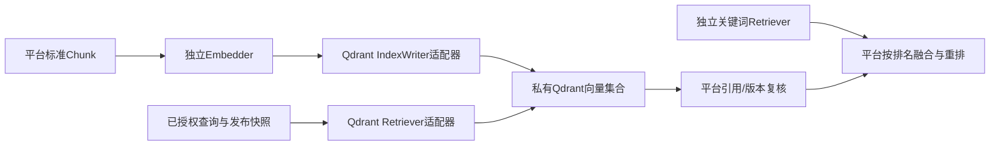

# Qdrant独立向量适配器设计 V1

本规范为WeKnora复合路线增加独立检索对照，复用平台Embedder、IndexWriter、Retriever及标准内容。它是源码/API核验和适配设计，尚无Qdrant运行适配器。

## 1. 固定源码与能力入口

v1.16.2解析到commit `d2834de0b51be23a7b22b023e424cbb9456d0e75`，LICENSE和版本目录OpenAPI的摘要见[核验清单](evidence/qdrant-v1.16.2-source-review.json)。LICENSE为Apache-2.0；该结论仅针对此文件，不代表镜像及全部依赖许可已审查。版本目录OpenAPI的info标记v1.16.x，实际v1.16.2服务与所用字段仍需运行核验。[固定LICENSE](https://github.com/qdrant/qdrant/blob/d2834de0b51be23a7b22b023e424cbb9456d0e75/LICENSE)

| 标准端口职责 | 固定API入口 | 验收尚缺什么 |
|---|---|---|
| 索引写入 | PUT collections/{collection}/points，wait/ordering参数 | 实际字节/数量、可搜索性、迟到写入隔离 |
| 向量召回 | POST collections/{collection}/points/query，filter/query/using等字段 | 必需过滤、规格/分数、截止时间及来源核验 |
| 候选/代际删除 | POST collections/{collection}/points/delete，按ID或FilterSelector | 精确作用域、未知结果恢复、保留锁及墓碑 |
| 内容对照 | POST collections/{collection}/points/scroll，filter及分页 | 固定库存、漏项/重复/中途写入与完整遍历 |
| 过滤索引 | PUT collections/{collection}/index | 配置与实际过滤规模表现 |
| 原生快照 | collections/{collection}/snapshots及recover | 同引擎备份可用性、版本/集群兼容与恢复权限 |

入口来自固定[OpenAPI](https://github.com/qdrant/qdrant/blob/d2834de0b51be23a7b22b023e424cbb9456d0e75/docs/redoc/v1.16.x/openapi.json)。API字段存在不证明平台前置权限过滤、事务、可替换性或Recall目标已通过。

## 2. 精细替换与数据边界

Qdrant先只声明vector通道。稀疏向量/全文过滤字段的存在不能自动视为平台中文关键词召回器或BM25方案通过验收；首轮关键词实现单独选择并对照。嵌入和查询向量由平台独立模型端口生成，固定EmbeddingSpec、距离与预处理；禁止适配器自动换模型或维度。

平台保存原件、Revision、标准Block/Chunk、权限、发布及映射。Qdrant向量和payload是可重建衍生数据。point_id不能直接承担平台Chunk ID或citation语义：适配器分配引擎接受的ID并持久保存BackendBinding，绑定epoch、Generation、attempt、Chunk和来源摘要；不通过拼接供应商标识产生公开引用。

payload最少保存space/KB/Revision/Generation/attempt/epoch、Chunk标识和内容摘要。返回文本可从平台标准Chunk读取；若携带投影正文，须与权威内容/投影摘要对照。缺失映射、跨版本、错摘要或额外未知point拒绝形成Evidence。

## 3. 代际、过滤与准备

首轮隔离方案：一个存储epoch及EmbeddingSpec对应一个collection；每次attempt使用不复用的point ID集合和固定payload，不能覆盖活动attempt。候选由平台GenerationSet选定，不使用共享collection alias当发布批准。后端索引参数变化同样进入配置摘要及新候选代际。

过滤由受信发布快照及映射生成，不接受用户原样Qdrant filter。语义必须同时限定space、epoch及每个获准的`KB＋Revision＋Generation＋获胜attempt`组合，避免把多个集合分别求并集后形成错误组合。空集合不发后端请求，直接返回空结果；过大集合明确失败或使用经验证的分区方案，不能去掉过滤继续查询。

实现可选预计算point ID允许集合或嵌套布尔条件，但两条路径必须分别通过同一非法组合/越权/候选测试。使用prefetch、多向量或其它子查询时，每一路都要证明获准范围在候选选择前生效；未验证的查询形态不开放。返回后再验证当前权限与发布状态。

Prepare等待写入结果并记录每批point库存；wait或completed只能说明后端操作状态，不能直接产生发布ReadinessProof。Verify独立核对集合规格、库存/摘要/映射、可搜索性和恶意范围过滤；成功后由平台事务选定GenerationSet。新旧attempt并存时旧Worker可继续写自己的孤立ID，但永远不能覆盖或删除获胜对象。

Qdrant字段索引优化不是权限引擎；私有服务认证与平台授权分开。只给适配器服务访问，用户和Agent仍经统一应用服务，不对外共享后端API Key或原生检索入口。

## 4. 故障、删除与替换

超时/断连不能推断未写入。调用账本保留operation/attempt和批次库存，探查同一ID/摘要后恢复；反复upsert相同ID仅能用于同一隔离attempt且完全相同内容，不代表自动具备平台幂等或租约隔离。未证明旧写入停止时不能把删除完成当成永久无残留。

删除先依据平台撤回/保留事实关闭可见性，再按明确库存删除候选或代际。使用过滤删除须核对空间、epoch、attempt及目标集合；不能以空条件清空共享collection。后台迟到写入残留继续被发布过滤排除并进入恢复清理，不能恢复正式读取。

原生快照只作为同引擎运维备份候选。切换到其它向量引擎按平台标准Chunk、EmbeddingSpec及映射清单重新准备验证；向量可复用时也需核对精度和完整规格。模型改变则重新嵌入。回退保留旧代际并重放窗口内新增内容与撤回，不将原生快照误称跨引擎可移植导出。

## 5. 与复合路线的统一对照

| 试验 | 共同输入 | 必须取得的证据 |
|---|---|---|
| Q-01 | 同Chunk及已知向量，含不同规格 | 写入/读取字段完整，错维度/距离拒绝，来源一致 |
| Q-02 | 越权space/KB、草稿、撤回、新旧attempt、错误组合 | 获准范围在候选选择前生效，空集合不查询 |
| Q-03 | 写入/删除超时、旧Worker迟到、重启 | 未知结果可解释，旧发布保持有效，无跨attempt覆盖 |
| Q-04 | 大过滤集合、分页库存及混合数据 | 无漏项/错配，超限不放宽权限，规模与性能可复现 |
| Q-05 | 独立引擎↔另一实现/WeKnora复合组 | 平台API、文档/版本/citation保持一致，迁移与新写入回退可验 |
| Q-06 | 封存中文评测集和同硬件/并发 | vector及混合流水线分别报告召回/延迟/成本，不能把向量单路当完整OS |

与WeKnora比较的是完整流水线：Qdrant＋独立解析/嵌入/关键词/融合/重排，对照WeKnora复合能力。成本须计入配套服务和适配治理，不把单个向量服务的成本当完整平台成本。所有试验尚未执行；许可证/镜像依赖、维护支持、正式适配器和第二独立检索实现仍待验证，D-05及运行替换验收保持开放。

配套中文关键词通道的进一步设计见[OpenSearch独立适配器](KEYWORD_ADAPTER.md)。向量、关键词、融合和重排分别替换，使用同一封存资料/权限/来源和预算对照；暂无运行或组合召回证据。
