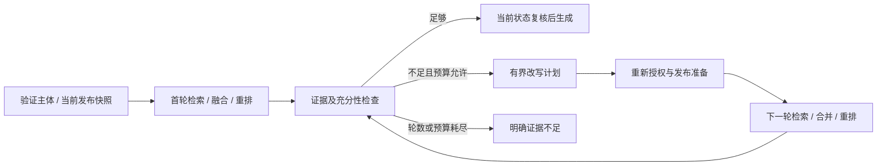

# 有限反思、反馈草稿与可替换编排

本规范细化[标准契约](CONTRACTS.md)和[验收方案](VALIDATION.md)的REFLECT-01。平台保留Assess/Refine/Propose接口，策略与权限由自有查询应用控制；替换模型、LangGraph或其他编排实现时，上层REST/MCP和知识发布规则保持一致。当前是设计交付，完整反思应用与真实模型验证尚未完成。

## 1. 三项能力的职责

| Reflector方法 | 平台允许的结果与限制 |
|---|---|
| Assess | 给定获准证据的充分性判断及诊断；模型判断不是授权、来源真实性或回答正确率证明 |
| Refine | 有界查询计划；只调整查询文本及筛选已获准路线，不能新增KB、主体、工具或发布对象 |
| Propose | 目标文档的修改建议；经当前编辑授权与版本核对后转新草稿，不能批准或发布 |

对应Go类型为ReflectionRequest、Assessment、QueryPlan/PlannedQuery、DraftProposal。它们不携带供应商图节点/会话/数据库类型。编排框架只在适配器内部使用，所有额外模型、检索和工具调用都必须服从平台预算与端口。

## 2. 查询反思的执行顺序

普通问答默认一次检索；仅在证据不足且ReflectionPolicy启用时追加，最多两轮、全请求总预算30秒。每轮记录原始问题、实际查询、配置版本、路线及降级状态；不能通过建立新RequestID重置反思计数。

每轮都执行当前授权/发布准备，新增文本不带来额外权限。检测策略必须区分“成功但没有证据”与“必需路线失败”，后者按检索错误规则处理，不把它包装为继续反思的机会。权限/发布/身份失败立即停止。

预算耗尽、重复改写或没有新合法证据时结束，返回证据不足及可理解原因。图谱路径和记忆内容可以作为可选输入，但进入回答的事实仍须可追溯到当前获准知识；它们不能自行产生新的发布证据。

## 3. 多查询计划与预算共享

QueryPlan是列表，不能默认每个子查询都获得完整路线预算。拟定平台MaxPlanQueries范围1–4、默认2，输出超过上限、空查询、未知/重复路线或无限制RouteIDs均拒绝。该字段已加入ReflectionPolicy与部署Schema，纯规划器执行上限；完整反思运行仍未接入。

同一反思轮内，所有计划查询、路线与KB子请求共享该轮候选/调用/并发预算；先在计划阶段分配，再调用检索。超过预算明确失败或使用已经版本化的准入策略，不能静默丢弃所选KB/困难子问题以提高召回指标。

同一路线的不同查询结果先按受控合并策略形成一份全局列表，保留query/KB/原rank追踪；不能把每个改写当作新RouteID重复加权。跨轮候选也不直接当作新的独立路线投票。去重键仍使用平台KB/版本/来源位置，供应商分数不直接跨不同查询比较。

完整合并/重排后选最终证据，重新检查当前状态。需要复杂多跳时可以安排多个有界子查询，但必须记录完整证据链和实际覆盖；不能用模型回答当作缺失的知识证据。该多查询执行/合并尚未实现，现有跨KB Merge不能直接证明它。

## 4. 输出和模型调用边界

首版交互问答先完成证据侧反思，再开始对外生成流。已经发送的文本无法追回，不能在后续Assess发现问题时假称用户从未看到它。若需要回答草稿自检，必须使用显式缓冲模式，在输出前完成检查，并单独验收首字延迟/费用。

已输出后的纠错使用明确补充或用户反馈流程，不无提示覆盖历史回答。纠错建议可以成为DraftProposal；不能自动发布知识或把模型自评记入权威答案标签。

整个请求共用deadline和计量预算，排队、改写、评估、检索、重排与生成均计入。现有ExecutionBudget只能描述部分限额，仍需实际模型调用计数/usage/费用契约；没有可核验计量能力的适配器不能声称满足成本上限。供应商内部反复调用不能隐藏在一次Reflector方法里。

输入文件、网页、模型输出和改写文本都按数据处理。Reflector不获取任意外部工具执行权限，不能因文档中的指令改变主体、禁用检查、调用发送消息/发布工具或保存秘密。工作流运行入口与部署管理权限不通过Refine开放。

## 5. 建议采纳与知识审核

Propose只返回建议，不写权威仓储。应用先确认目标Document确实属于获准任务/反馈范围，重新核验编辑权限、当前有效Revision和Document/Draft版本，再以CAS和幂等键建立或更新草稿。不同内容的重复采纳请求冲突，不能覆盖较新的人工修改。

BaseRevisionID过时、来源不可读或目标已撤回时，不把建议直接叠到新版本；返回明确过时状态，用户可重新生成或进入新的审核准备。建议Block使用平台来源/原件引用，厂商内部chunk/doc ID不进入知识版本。

采纳仍走提交、冻结内容哈希、审核与发布全流程。Agent主体只能有明确授予的草稿/反馈能力，不借管理员身份自动批准。长期记忆保存另走Memory授权与删除/来源契约，不能作为绕过审核的知识沉淀通道。

## 6. 替换与验证

替换Reflector或其内部编排实现时，固定相同输入证据、配置版本、获准路线及预算，比较计划合法性、最终证据Recall、回答/引用质量、调用数、延迟和费用。供应商自报“支持反思”不是公共契约通过；流程编排替换也不能改变发布权威归属。

| 门槛 | 所需运行证据 |
|---|---|
| REFLECTION-01 预算终止 | 两轮/30秒上限，多子查询共享预算，重复改写/无新证据终止；每次真实调用可计量 |
| REFLECTION-02 权限与来源 | 改写/图谱/记忆及恶意文件指令不能扩权限或触发未授权工具；每轮当前状态复核 |
| REFLECTION-03 证据和输出 | 无证据明确不足，多跳完整链；流式与缓冲自检边界符合说明，引用受支持 |
| REFLECTION-04 草稿治理 | 采纳幂等/CAS、过时版本、人工并发编辑、审批/发布隔离，Agent不自动批准 |
| REFLECTION-05 替换对照 | 至少两个模型/编排实现通过同一端口测试、质量和预算比较，REST/MCP保持兼容 |
| REFLECTION-06 效果评测 | 同一封存中文集反思前后最终Recall/准确性/成本对照；不移除困难题或接受自评作真值 |

这些门槛尚未执行。现有Reflector端口与检索/流式子集不证明完整闭环；MaxPlanQueries、跨查询合并、计量和采纳事务仍待实现，REFLECT-01及整体保持开放。

## 7. 多查询预算规划与配置

ReflectionPolicy新增MaxPlanQueries，对应部署reflection.max_plan_queries必需整数1–4，示例默认2。它是未冻结V1草案增量，旧配置必须明确升级，不能让Refine通过默认无限制列表绕开预算。

`pkg/retrievalplan.BuildRefinement`从已核验QueryProfile/库存及QueryPlan生成本轮调用候选。验证反思启用、轮数/时间/查询数策略、文本UTF-8/非空/≤16000码点，未知/重复路线及同文本同路线集合的重复计划拒绝。每条必需路线至少被一个计划选择，可选路线未选择与服务失败分别处理。

每路线先按查询变体分配原candidate_limit，再按该变体全部目标KB分配；每个实际调用至少1候选，覆盖不了所选KB就拒绝，不静默丢弃。所有变体共用MaxCalls/MaxParallel与本轮全局候选预算，输出保留query index/text与单一路线身份。这里不调用模型、不授权、不执行或合并，不消费实际30秒/轮数账本。

4项Go检查覆盖两变体多KB的预算和副本、必需/未知/重复/过量计划、KB配额/全局扇出、禁用反思/空文本；1项Python检查覆盖部署字段缺失/非法上限。全部194项Python回归、全Go测试及vet通过，见[证据](evidence/refinement-plan-review.json)。多查询执行/同路线合并、真正计量、当前权限/发布及反馈事务尚未通过，REFLECT-01保持开放。

## 8. 同路线多改写合并

`pkg/retrievalplan.MergeRefinement`对完整成功的RefinementResult按query index分组，每组先复用跨KB Merge，再按query index轮询交错形成一份原RouteID的全局排名。分区原rank、KB/epoch、query index及全局rank记录于内部Origins，不增加公开引用字段。不同查询的供应商分数不参与跨组比较。

校验查询索引/文本、路线/实例/required、子配额总和与完整结果库存；缺失、重复、未知查询或混用后端均零输出失败。同路线所有改写共用16MiB序列化预算及排名位数余量。它仍不是执行器；全轮跨路线费用/字节/时间汇总和可选失败处理须在实际调度层完成，不能以本函数单路线检查代替。

结果随后必须经过原Fuser：同一路线同来源的重复候选只贡献一次，冲突正文拒绝。Origins与原始列表关联供内部追踪，融合后的最终候选需要应用保存对应关联；当前未实现持久观测。源文、发布/权限/代际真实性仍在合并外核验，不能直接将MergeRefinement结果作为用户可见证据。

6项Go检查覆盖稳定顺序/追踪/副本、实际RRF单路线票数、非法/部分结果、取消/显式空路线、跨变体字节预算及跨查询冲突正文被Fuser拒绝。全Go测试和vet通过，见[证据](evidence/refinement-merge-review.json)。数据为合成检索结果，不证明真实模型、当前授权、反思循环、预算计量或效果，REFLECTION与整体保持开放。

## 9. 整轮多查询调度

`pkg/retrievalplan.ExecuteRefinement`接入规划与合并，复用从基础Execute提取的私有dispatch工作池；两条执行路径共享取消/join、单原因传输错误分类、候选副本校验及整轮16MiB序列化预算，降级工作不返还成本。调用数/并发/候选总量在预检时绑定Plan限制。

RefinementPlan保留MaxPlanQueries，执行前检查索引范围和同query index跨路线文本一致，非法计划零调用。每个子调用交付query index/text与原Call；受控应用负责新向量/Scope/发布及Grant准备。可选路线任一改写分区不可用时整条路线所有改写结果丢弃，降级记录包含实际失败query index/目标；必需失败、契约错误、取消或超额均零输出。成功路线继续MergeRefinement。

6项Go检查覆盖共享两worker/10调用/查询元数据、可选跨变体整路线丢弃、必需失败/非法计划、取消排队变体、跨路线/变体总字节预算及MaxPlanQueries/跨路线文本预检。全Go回归及vet通过，既有基础执行检查继续通过，见[证据](evidence/refinement-execution-review.json)。

本次只运行一轮受控SearchFunc，不调用真正Reflector或后端；不能证明完整30秒/额外两轮计数、模型/嵌入调用费用、授权真实性或效果。忽略context的回调仍可能阻止join/返回，真实适配器须验证取消释放。完整反思循环、计量及业务闭环仍待实现，REFLECTION与整体保持开放。

## 10. 请求内有限反思循环

`pkg/reflection.Run`使用Reflector.Assess/Refine、RoundSearch和必需EvidenceGate执行证据侧循环，不调用Propose/Generator或发布接口。初始轮一次，最多追加两轮，取配置与调用者MaxExtraRounds的较小值；原请求/父context/Scope/预算deadline和策略≤30秒共同收窄，不能扩调用者预算。

RoundSearch负责每轮权威准备及BuildRefinement/ExecuteRefinement的真正组合，仍不可绕过必需路线与配额检查。EvidenceGate在检索前、模型输入前、模型返回后及结果返回边界核对当前状态，失败返回静态ErrAuthority和零证据；它是必需的受控服务回调，提供一个返回nil的函数不构成真实授权证明。

重复计划（路线集排序后比较）、没有新增来源/正文证据、轮数耗尽终止为insufficient；模型认为充分只在非空证据且Gate通过时返回sufficient。禁用反思仅返回retrieved，不自称完成充分性评测。模型入参/结果复制并限制4MiB，查询≤16000码点、证据≤1000项，未知/重复/超量改写拒绝。循环状态请求内保存，不证明重启/重复调用的持久预算或幂等。

9项Go检查覆盖一轮追加后充分、两轮封顶、重复/无新证据、授权失败不触及模型、截止/非法计划、输入隔离/禁用、Refine期间撤回、调用者零追加预算及策略时间收窄。全Go测试和vet通过，见[证据](evidence/reflection-loop-review.json)。合作取消仍依赖适配器，纯JSON处理非硬抢占；真实模型/检索/当前授权、跨调用账本、usage/费用及最终生成效果未验，REFLECTION与整体保持开放。

RoundSearch/EvidenceGate的实际权威、嵌入、投影与融合接入细则见[反思应用绑定](REFLECTION_PIPELINE_BINDING.md)。已有回调测试不构成真实闭环证据。
