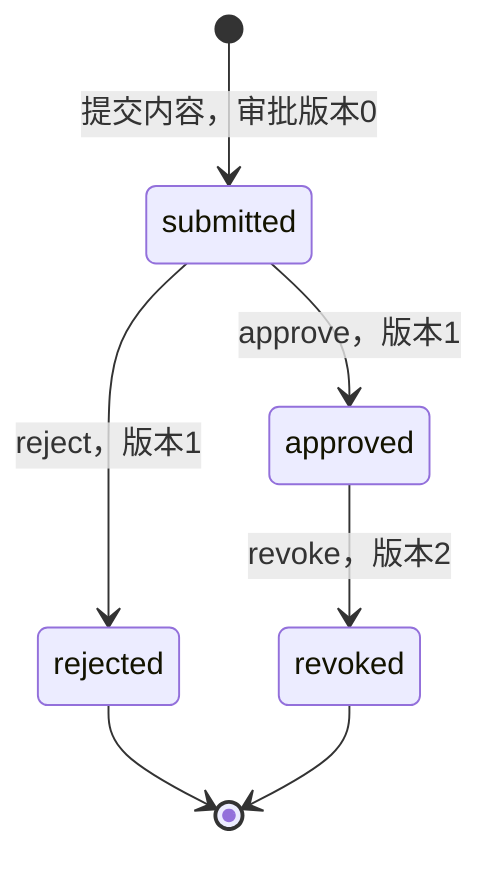

# 审批决定事务与当前决定

后续诊断：[治理时钟前置条件](GOVERNANCE_CLOCK_DIAGNOSTICS.md)已实际捕获4至5秒墙钟步变；当前590项本地检查通过，但本轮完整PG因环境时钟异常失败，不代表此页业务守卫应放宽，也不以旧通过快照代替当前验收。审批/续租稳定性与完整V1保持开放。

2026-10-15：`document.ReviewRepository` 已有 PostgreSQL 默认实现 `postgres.Reviews`，承接实际提交的不可变 Revision，持久化批准、拒绝和撤销批准。当前仍未接入正式管理接口、真实 IAM、有效批准策略服务或发布链路。

## 契约修正与模块边界

复核管理 OpenAPI 发现上一轮提交实现的内部待审状态 `pending`、初始版本 1 与既有契约不一致。现已修正为 **ApprovalRequest.state=submitted、row_version=0**；首次批准/拒绝后为 1，随后撤销批准为 2。没有修改 OpenAPI 来迁就实现。该 SQL 仍是从空库初始化的隔离验证原型；本次不证明旧生产库的数据升级迁移。

接口为 `DecideReview(context, ReviewCommand) → Approval`，复用平台 `ApprovalDecisionRequest` 并增加已解析的 DocumentID。接口不包含 SQL、驱动或供应商类型；其他实现可以提供独立审批工作流，但必须兼容平台请求/结果、归属、当前授权、内容绑定、CAS、幂等及原子审计规则。默认实现的状态机是单次人工审批；多级审批需要单独的工作流能力设计与契约验证。

宿主注入当前作用域检查、具体文档/版本授权、不可变 ProfileDigest 和独立审核策略版本。授权回调必须核对 Owner/Admin 或个人空间所有者，并确认明确的人类决定；服务主体还必须具有可信的人类委托。普通 Agent 不能只凭自身服务身份批准。当前真实运行测试的身份/角色/人类意图仍由 fixture 提供，不能当作真实授权实现。

## 默认状态机与数据



默认实现不允许覆盖已拒绝决定，也不允许把撤销的旧版本直接重新批准。修改与恢复应创建新草稿、内容版本及审批请求。不同审批实现若改变这些流程，须明确能力和状态语义，不能偷偷复用当前实现的验收结果。

- `review_decisions`：不可变决定，保存平台 ID、Revision/内容哈希、主体、决定、原因、策略版本、审批请求版本及时间。撤销是新记录，旧批准不改写。
- `approval_requests.current_decision_id`：与当前审批版本一起更新，明确哪条决定是当前决定；完整外键防止跨文档或跨版本指向。
- `review_receipts`：按 space+subject+action(`revision.approve`)+key 唯一保存首次结果，跨 KB 不能复用该动作的同键。语义摘要绑定委托身份、目标、决定、原因、期望版本、Profile 与审核策略；期限/请求ID/作用域ID/证明引用等可轮换信息不进入摘要。
- `review_audit` / `review_outbox`：与决定、当前指针及回执同事务写入；事件区分批准、拒绝与撤销批准。

ApprovalRequest.PolicyVersion 随当前决定记录所用审核策略，原提交所绑定的策略仍保存在不可变提交账本。Approval.PolicyVersion 是作出该条决定时的规则版本；ACL PolicyVersion、用来判断历史批准是否仍有效的 ReviewPolicyVersion 分别具有独立含义。

## 事务与重试

```text
冻结内部命令 → 验证当前身份/具体资源
    → Serializable事务 → 锁定有效文档 → 查幂等回执
    → 锁定审批请求、核对不可变版本/内容哈希与当前决定
    → 检查状态机与期望审批版本
    → 插入不可变决定 + CAS当前请求/指针
    → 保存回执 + 审计 + outbox → 再授权 → 提交及延迟约束
```

SQL 状态守卫拒绝倒退版本、重置请求或改写原提交身份/来源元数据；延迟约束要求当前指针、决定、回执、审计和对应事件全部匹配。写入异常、撤权或并发冲突不能产生半个批准。数据库提交响应不确定时返回空结果及 `ErrReviewUnknown`，使用原键、目标、语义及配置重新核对；`ErrReviewRejected` 只表明本次调用未提交，不证明同键从未由其他调用完成。

重放在版本冲突检查前返回首次持久结果，但每次重新授权。**回执是历史事实，不是当前有效批准。** 撤销后重放原 approve 的键，返回原记录用于核对，不会把当前决定指针改回旧批准。后续发布/知识读取必须在当前事务视图核对有效批准、策略与发布状态，不能单凭 Approval.Decision=approve 放行。

## 已运行的验证

真实文件上传、解析、候选持久化、编辑与提交之后执行审批仓储；数据库操作和事务没有使用替身。身份、角色、初始文档及人类编辑/决定仍是 fixture。

- 批准与拒绝生成各自决定，绑定冻结内容哈希，并推进正确审批版本；撤销追加记录，旧决定不可修改。
- 实际提交后受控丢失响应，新的数据库连接按原键恢复首次结果；变更原因、无权重放及错误文档拒绝。
- 撤销后重放历史批准不重新激活；已拒绝或撤销的请求不能静默重批。
- 审计/outbox 写入失败整体回滚；事件被静默省略时，延迟约束阻止提交，确认回滚后可用原键重试。
- 提交前撤销审核权限回滚；批准与拒绝并发争用版本 0，只形成一个决定；没有改变活动版本或发布 epoch。
- 实际数据库读出的 7 个请求/决定投影，在 PG15/16/18 上分别与管理 OpenAPI 的独立 JSON Schema 对照，覆盖全部四种请求状态和三种决定。投影生成器仅用于验证，并非正式传输适配器。

```powershell
python docs/architecture/check_postgres_wsl.py --major 15 --port 55433
python docs/architecture/check_postgres_wsl.py --major 16 --port 55432
python docs/architecture/check_postgres_wsl.py --major 18 --port 55434
.local/openapi-review-env/Scripts/python.exe docs/architecture/check_review_runtime.py
```

当前报告见 [审批运行与Schema证据](evidence/review-runtime-review.json) 和 [数据库多版本矩阵](POSTGRES_VERSION_MATRIX.md)。不代表真实 TCP 中断/崩溃恢复、当前策略有效性服务、完整 QueryReadUnit、已发布内容撤回、全量 UoW/迁移日志、真实 IAM/RLS、管理界面/REST/MCP 或召回性能已通过。

本轮验收：同一431项源码/契约输入与同一Go探针，在PG15.19、16.15、18.6各通过73项当前仓储/应用检查；审批新增9项场景，另有21个真实投影通过独立Schema。统一Go测试/vet、227项Python回归、OpenAPI与7组冻结金标通过。私有服务停止、目录移除及端口关闭已独立核对。

后续进展：默认规则已在[发布准备登记](PUBLICATION_START.md)中读取当前规则头、核对当前批准并执行有效性检查。完整QueryReadUnit、正式管理接口、实际索引准备及最终发布依然开放。
