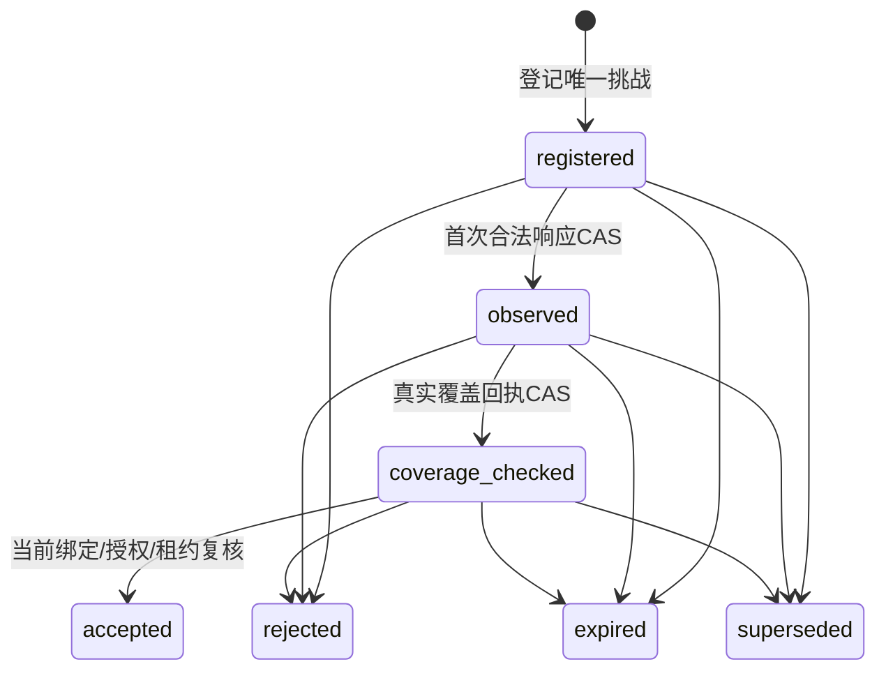

# 数据源探测一次性接收与恢复协议

本规范细化[启动核对](STORE_STARTUP_GATE.md)的探测账本。它管理控制器对响应的接收，不替代端点的Grant执行账本、服务认证或数据覆盖验证。现有Bound校验可以重复通过同一匹配响应，尚没有持久的一次性接收保证。已有设计及Go记录/端口/局部转换检查，真实账本仓储、事务和运行协调器未实现。

## 1. 数据归属与唯一键

账本属于部署控制域，不能使用KB AccessScope访问。它必须与独立当前绑定/控制器版本核对协作；若与被恢复元数据库一起回滚，旧已消费响应可能重新被接收。恢复目标与版本锚点须来自备份之外的可信控制面。

ProbeAttempt主键为(control_domain_id, probe_id)，invocation_id在同一控制域内唯一。记录包括check_id、request_id、完整绑定引用、请求摘要、期望绑定摘要/版本、端点、创建/截止时间、状态、row_version及控制器fencing_token。首次登记row_version=1，所有后续变化CAS推进；不得重用Probe或Invocation身份。

ObservationID本身不作为挑战唯一键，也不要求不同模块生成同一命名方式。接收后记录完整观测的规范摘要、经过核验的实际服务/端点身份和接收时间。覆盖回执另外记录其摘要及本次probe/观测关联。正文和秘密不进入普通审计日志。

请求、观测和回执摘要须有固定域及版本化精确输入；目前尚无这三项摘要契约/机器记录。不能只对ObservationID或verification_reference做哈希，也不能用供应商签名字符串替代平台绑定摘要。

## 2. 状态机与条件

accepted/rejected/expired/superseded是终态，不转回registered，也不通过修改deadline复活。accepted只表示这项本次数据源检查完成，不代表全应用ready。新的尝试分配新Probe/Invocation，关联原尝试用于审计。

registered→observed要求真实服务认证、完整绑定校验、当前部署授权/期望、有效deadline和当前控制器租约成立。覆盖结果未到达时不跳过observed。observed→coverage_checked必须由已经认证的覆盖验证器完成真实链检查，并绑定同一观测摘要。

最终accepted还需独立控制面确认绑定没有变化，所需读写端点集合全部完成本次检查，以及当前fencing token仍有效。集合作为CheckAttempt的不可变库存登记；不能接收新端点来凑数量或把其他Check的成功结果拼入。任意强制失败阻止本Check通过。

## 3. 原子接收与重复响应

签名/服务身份、绑定结构、响应摘要及覆盖网络读取在短事务外完成。进入账本事务后重新检查当前版本、状态、deadline、租约与期望，再以CAS写入接收事实。状态、观测/回执引用、部署审计、outbox及规定恢复日志必须共同提交；网络调用不放入事务。

| 当前账本与响应 | 处理 |
|---|---|
| registered，首次合法响应 | CAS保存观测并转observed |
| 已observed或更后状态，同Probe且同观测摘要 | 返回已有接收结果，不再次转换状态、计数或写重复审计 |
| 同Probe，不同观测摘要/端点/绑定 | conflict并记录受控诊断，不覆盖首次接收 |
| Probe不存在、错域、错Invocation | 拒绝；不根据响应自动登记挑战 |
| rejected/expired/superseded | 拒绝新接收，不重新计算窗口复活 |

相同摘要重试只说明已有结果可查询，仍要检查当前操作者是否有读取该控制记录的权限；返回旧接收状态不等于批准新的业务调用。验证器回执也按同一probe/观测和回执摘要处理重复与冲突。

原子CAS保证同一有效记录只发生一次接收转换，而不是承诺网络响应只投递一次。持久唯一约束和事务语义必须在实际仓储验证，多线程内存字典不能作为跨进程证明。

## 4. 控制器接管和提交未知

每个Check有有界租约及单调fencing_token。接管者先CAS取得新token，旧控制器即使持有仍有效的Scope/响应也不能提交状态。观察、覆盖和最终接收事务均核对token，不仅在创建Probe时核对。

外部探测是只读操作，但旧控制器的迟到响应仍须经账本拒绝或返回已保存结果。仅取消旧进程不能证明它不再提交。当前任务租约接口属于知识任务，不能直接把控制域伪装为SpaceID复用；需独立控制面租约契约或已确认的适配。

提交返回超时/断连时，不自动重发接收写。先从权威账本读取Probe/Check及row_version/摘要：已提交相同结果则返回持久结果；未提交且仍registered时可按原CAS重试；状态/摘要/租约不符则冲突或停止。读结果未知时保持失败，不把内存回调执行过当作已经消费。

进程重启从持久状态恢复，过期尝试终止；需要继续外部调用时按允许策略建立新尝试。不得只扫描缓存或恢复旧配置后宣布账本状态可信。

## 5. 保留与恢复边界

账本保留时间必须覆盖Probe有效期、允许时钟策略、传输迟到窗口、Check恢复和受支持的回退窗口；配置不满足关系时拒绝装配。当前Bound时间校验没有默认偏移，不能用宽松时钟配置无提示扩大有效期。

清理只能处理已经过期且满足所有保留约束的记录，配合终态/高水位策略防止旧身份重新登记。控制器必须永不复用Probe/Invocation ID；不能把清理行当作获得可重用身份的许可。永久审计需求另遵守部署保留策略，不承诺所有结果永久保存。

控制面备份恢复必须核对独立绑定/租约锚点及受支持的账本恢复点。无法恢复消费状态时，旧Check与身份全部失效，重新分配挑战，不继续接受原响应。RPO和控制面可用性仍需实际验证，不能仅靠本状态机证明零丢失。

## 6. 验收门槛

| 门槛 | 所需运行证据 |
|---|---|
| PROBE-LEDGER-01 并发一次接收 | 多进程争用同Probe，只有一次CAS及一次审计/outbox，冲突响应不能覆盖 |
| PROBE-LEDGER-02 身份与期限 | 未登记/错域/旧调用/超期/终态响应拒绝，相同摘要只能查询已接收结果 |
| PROBE-LEDGER-03 接管栅栏 | 控制器接管后旧token的观测/覆盖/最终接收均不能提交 |
| PROBE-LEDGER-04 提交未知恢复 | 实际断连/超时分别覆盖提交与未提交，持久核对后无重复接收或漏计 |
| PROBE-LEDGER-05 保留恢复 | 清理、进程重启、备份/回退与独立锚点核对，旧ID不复活 |
| PROBE-LEDGER-06 Check集成 | 所有获准端点及当前控制面/部署授权核对完成才推进本Check，全应用仍受其他必需门控制 |

先定义记录、摘要、CAS仓储/事务和控制面租约，再验证真实数据库，最后接入启动协调器。以上门槛均未执行；现有绑定/Schema/codec检查不证明持久一次性接收，START-STORE及整体保持开放。

## 7. Go账本状态与事务端口

[store_probe_ledger.go](../../pkg/contracts/store_probe_ledger.go)新增StoreProbeAttempt、ProbeControlLease、ProbeAdvanceExpectation及StoreProbeLedgerRepository/Unit。接口声明唯一挑战创建、Attempt/Lease CAS和部署审计/outbox/journal的共同事务，回调句柄不能逃逸；当前没有数据库实现或原子性运行证据。

ValidateProbeAttempt核对给定记录形状与阶段所需摘要；ValidateProbeAttemptAdvance固定完整Binding/请求摘要、row_version+1及已接收摘要不可变，拒绝终态回转与跳阶段。更新必须匹配给定当前租约token/控制器和有效期；更换控制器必须推进token。普通成功/拒绝路径要求绑定当前且未超期；expired/superseded分别要求截止或绑定已变，并保持原接收摘要，不补入伪造成功结果。

5项Go检查覆盖阶段顺序/终态、跳阶段/请求或摘要修改、旧token与合法接管、租约到期、截止/绑定变化及uint64溢出/缺证据。全Go测试和vet通过，见[证据](evidence/store-probe-ledger-ports-review.json)。构建测试中的变量声明错误已修正，不作为功能缺陷证据。

给定Expectation并非真实控制面读取，摘要有效格式不证明响应/覆盖真实；本检查不执行CAS、不认证租约或授权，也不验证整个Check端点库存已经完成。完整Check记录、共同接收、摘要契约、Schema及真实持久并发/恢复尚未实现；accepted只可由后续协调器完成额外强制检查后提交。PROBE-LEDGER与整体保持开放。

## 8. Check库存与集体接收候选

[store_probe_check.go](../../pkg/contracts/store_probe_check.go)新增StoreProbeCheck和按role规范排序的ProbeCheckMember库存，登记唯一Probe/Invocation及固定端点，至少含metadata_uow/query_read_unit。Check的registered表示库存已固定、尚未集体接收，不要求各Probe仍处registered。仓储声明增加Check创建/读取/CAS，依旧尚无真实实现。

PrepareProbeCheckAcceptance检查整个库存恰好覆盖，拒绝混入其他Check/域/绑定/端点，以及缺失、多余、重复、已接收或尚未覆盖的成员。独立给定当前绑定、Check/Probe截止与租约/fencing必须成立；每个Probe的coverage_checked→accepted沿前述转换验证。成功返回Check及全部Probe的CAS候选，复制成员切片，失败返回零候选，不能只接收已通过的一部分。

后续协调器必须在同一真实事务重新读取当前事实，逐Probe CAS、Check CAS并写审计/outbox/journal；任一失败全量回滚。重复调用这个纯准备函数不消费账本，候选State=accepted不是已持久接收，Check accepted也不直接代表全应用ready。摘要内容、真实覆盖和授权仍由强制验证阶段提供。

5项Go检查覆盖集体候选/版本推进/副本、顺序无关，缺/多/重复/跨Check、未完成覆盖/错端点与摘要、旧租约/合法接管/绑定变化/截止及终态库存。全Go测试和vet通过，见[证据](evidence/store-probe-check-review.json)。无真实CAS、事务回滚、多进程争用或Schema/摘要来源证明，PROBE-LEDGER-01/06和整体保持开放。
