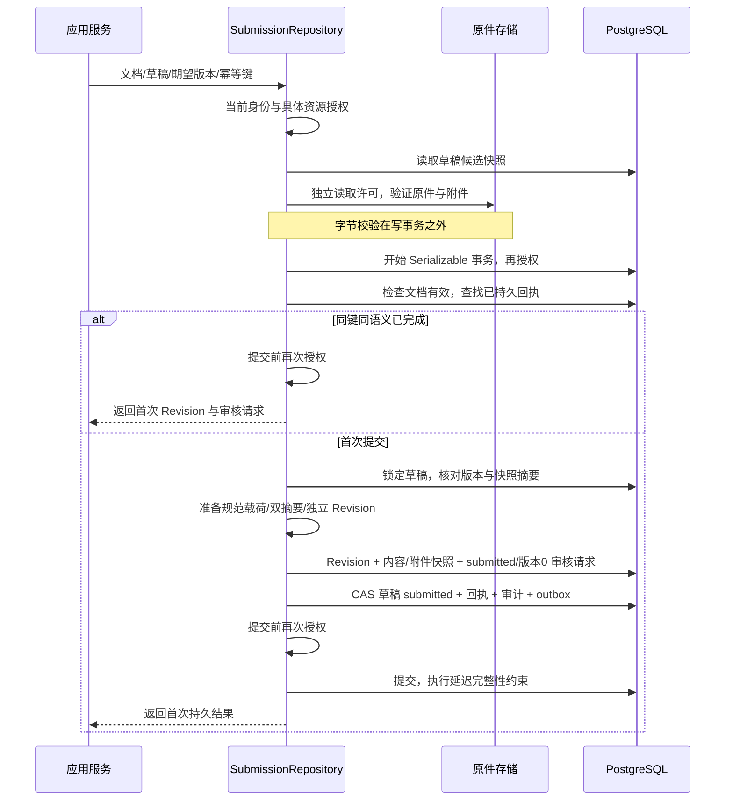

# 草稿提交审核事务

2026-10-15：已实现 `document.SubmissionRepository` 的 PostgreSQL 默认实现 `postgres.Submissions`，连接真实解析/编辑草稿与不可变 Revision、待审核请求。它是同步提交能力，不代表批准、发布或完整 Metadata UnitOfWork 已完成。

## 替换边界

应用通过 `SubmitDraft(context, SubmissionCommand) → SubmitResult` 调用，命令复用平台 `SubmitRequest`，补充已解析的 DocumentID；结果复用平台 Revision 和 ApprovalRequestID。接口不引用 SQL、数据库驱动或供应商类型。其他仓储实现必须遵守相同原子性、当前授权、幂等、不可变内容和错误语义。

默认实现由宿主注入数据库、当前作用域检查、具体文档/草稿授权、原件及附件完整性检查，以及不可变 `ProfileDigest` 和独立 `ReviewPolicyVersion`。这些是可信宿主配置，不能由客户端声明代替验证。审核策略版本与 ACL PolicyVersion 含义不同。

尚未注册为完整 `metadata_uow` 模块，也没有将其接入正式 REST/MCP 路由；后续需统一生产仓储、迁移日志、部署配置和应用服务装配。

## 处理流程

外部文件读取不持有写事务。提交时不仅核对期望行版本，还对照校验前草稿载荷摘要；读取之后发生编辑、换原件，甚至错误写入者漏增版本，都不能提交未经校验的内容。原件仍依赖存储模块的不可变 ID/摘要语义；当前验证不声称支持对任意第三方文件修改进行跨系统分布式事务锁定。

Revision 保存原生类型的块/附件快照、来源、父版本、创建主体/时间及 `hash_format`、`blocks_hash`、`content_hash`。精确规范字节使用 bytea 保存，避免 jsonb 重编码改变哈希。表格、音频和附件按冻结规则排序，返回 Revision 与已提交草稿不共享可变内容。

SQL 触发器禁止修改或删除 Revision 身份、冻结内容、提交回执及审计；已提交草稿也禁止继续改写，后续编辑应创建新草稿。延迟约束要求提交同时具备内容、已提交草稿、审核关联、审计与对应 outbox，缺项不能提交。它不把 submitted/版本0 审核请求变成批准，也不修改活动版本、索引代际或发布 epoch。

## 幂等与错误语义

提交专用账本的唯一范围为 `space + subject + action(document.submit) + key`，跨知识库也不能复用同一主体的同键做另一件事。语义摘要绑定主体/颁发者/客户端/委托身份、目标、期望版本、Profile 和审核策略版本；请求 ID、作用域 ID、期限和可轮换的委托证明引用不进入语义摘要。原有配置版本须保留以支持按原绑定重试。

重放在期望版本冲突检查之前读取首次结果，但仍执行当前授权，拒绝把历史回执当作读取许可。相同键变更语义会冲突；新连接可恢复首次结果，不再创建 Revision、审核请求或重复审计/outbox。

- `ErrSubmissionRejected`：本次调用没有提交副作用；不能据此推断同键的其他调用从未成功。
- `ErrSubmissionUnknown`：驱动提交结果不确定，返回空结果，按原主体、键、目标及配置重新核对。实现对提交错误保守分类；即使延迟约束事实上回滚，也不能直接凭此错误伪造成功或随意更换键。

当前账本不自动清理。保留期、墓碑、过期键的机器状态以及跨模块迁移仍需实现，不能把局部持久重放当作完整保留策略。

## 验证范围

真实文件经上传、Markdown 解析、候选事务和人工编辑 fixture 后，实际调用提交仓储；原件从本地存储独立读取并核对大小/SHA。数据库事务不使用替身。场景覆盖：

- 不可变 Revision、submitted/版本0 待审核、submitted 草稿、独立配置版本及各一条审计/outbox。
- 提交后受控丢弃响应，新数据库连接恢复原结果；变更语义及撤权后的重放拒绝。
- 数据库拒绝 Revision 修改/删除；提交未改变活动版本与发布 epoch。
- 审计或 outbox 写入异常整体回滚；outbox 被静默省略时，延迟提交约束拒绝，并能在确认回滚后重试原键。
- 提交前撤权回滚；不同键并发提交同一草稿只形成一个版本。
- SQL 唯一约束验证跨知识库幂等键范围；单元测试检查外部字节校验不持有事务，以及校验与加锁之间同版本内容被替换时拒绝提交。

运行命令与多版本原始报告见 [PostgreSQL 验收矩阵](POSTGRES_VERSION_MATRIX.md)。受控丢失响应并未实际切断 TCP，也不证明数据库崩溃/跨进程任务恢复。身份、授权策略与初始业务元数据仍是 fixture；没有证明真实 IAM/RLS、审批决定、原子发布、全量迁移回退、生产性能或召回率目标。

验收结果：PG15.19、16.15、18.6使用相同425项输入及同一Go探针二进制，各通过64项当前仓储/应用检查；提交新增9项场景。统一Go测试/vet、227项Python测试、OpenAPI及7组冻结金标通过。私有实例停止、目录移除及端口关闭已独立复核。[提交验收记录](evidence/submission-transaction-review.json)与原始多版本报告共同保存验证范围。

契约复核修正：待审请求状态与初始版本已按既有管理OpenAPI统一为submitted/0。其后的[审批决定事务](REVIEW_TRANSACTION.md)已经实现；当前策略有效性及发布仍待接入。旧版64项证据对应当时的实现，当前验收以最新多版本矩阵为准。
