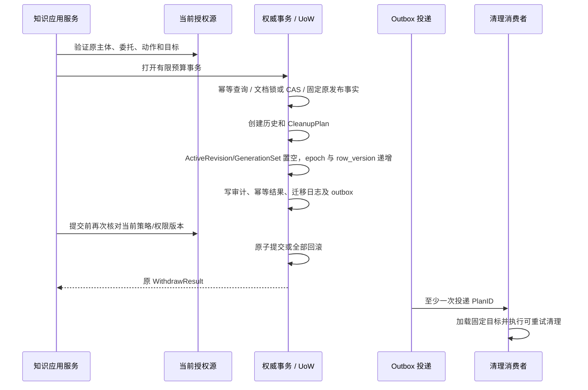

# 权威撤回事务与派生清理设计

本设计落实[一致性规范](CONSISTENCY.md)的文档级撤回。当前Blob/内存索引删除只清理衍生或原件数据，不改变Document的权威发布状态。本文件为实施规格；历史/计划仓储、发布头 CAS/outbox、命令预留及撤回专用审计已有隔离 SQL 原型和 Go 实库探针，见 [存储进展](POSTGRES_WITHDRAW_STORAGE.md)。完整 UoW、应用服务、真实授权及事件消费者尚未实现。

## 1. 当前契约缺口

| 现有契约 | 缺口与必须补齐的语义 |
|---|---|
| WithdrawRequest/Result | 已有ExpectedEpoch/HistoryID，但尚无提交后的历史结果读取端口，不能从当前Document推算旧操作结果 |
| PublicationOperation | 有版本/代际/actor/state，缺少撤回reason、发生时间、新PublicationEpoch及明确历史记录模型 |
| TransactionRepositories | 已有Metadata/Audit/Outbox/Idempotency/Journal，但没有PublicationHistory的load/append仓储；无法将历史与撤回原子提交 |
| EventPayload | resource_ids/revision/state/digest只是通知摘要，不能承载完整固定清理目标或替代MigrationJournal |
| Job | 现有Job针对单Revision/Generation，尚无跨索引/图谱/记忆/缓存清理聚合事实与目标结果状态 |
| 当前读取 | 可比对ActiveRevision/PublicationEpoch；历史读取还必须执行文档级撤回禁用策略，不能只判断Revision存在 |

新增契约须同步Go、管理OpenAPI、导出模型、仓储准入和公共契约测试；未补齐时不能创建一个接口齐全但实际方法为空的PublicationService提供者。

## 2. 事务内固定事实

拟补两个平台模型，供应商标识仍只在BackendBinding中：

- **PublicationHistory**：HistoryID、OperationID、Space/KB/DocumentID、动作、前后PublicationEpoch、旧Revision/GenerationSetID、actor及经验证委托、reason、OccurredAt、命令摘要。不可变，读取受当前权限与撤回策略约束。
- **CleanupPlan**：PlanID、OperationID、HistoryID、原PublicationEpoch、固定Revision/GenerationSet及所有GenerationID/BackendEpoch/配置摘要、图谱/记忆/缓存源依赖、状态和RowVersion。完整目标由权威仓储提供，不能从Agent或消费者当前查询结果推断。

派生来源依赖须记录文档、版本和形成时的PublicationEpoch或等价冻结来源事实。Citation的静态Document/Revision/位置本身不表达形成时的发布epoch；图谱已有按publication_epoch清理的语义，记忆和缓存依赖模型仍需补齐，不能假定只靠现有Citation就能区分撤回前后的派生结果。

## 3. 命令绑定与幂等

输入由认证传输层提供已验证Principal，Authorizer处理当前`publication.withdraw`业务动作，对应管理接口权限kb.publish；业务动作与RBAC权限名不混作同一个枚举。主体、委托、space及目标KB由可信对象关系确定，不采用客户端填写的角色或供应商回执。

幂等唯一键为space＋主体/委托语义＋动作＋Idempotency-Key；命令摘要绑定DocumentID、ExpectedEpoch、reason及固定业务配置，临时RequestID/ScopeID/deadline/令牌不进入语义。具体规范化映射和域隔离摘要须与金标一起冻结，本文不定义已存在的机器协议。

相同键/摘要已提交时，先验证当前身份与读取原操作结果的权限，再从PublicationHistory返回原WithdrawResult。不能返回后来重新发布或再次撤回产生的新epoch；不能再次创建事件、历史或CleanupPlan。同键不同摘要返回conflict。pending/未知提交结果先查权威操作记录，不直接重做命令。

## 4. 原子提交顺序

事务必须校验Document属于指定space/KB、未删除、ExpectedEpoch等于当前PublicationEpoch，并检查uint64 epoch/row_version溢出。冻结原有效Revision/GenerationSet和所有目标后，才推进状态。历史引用禁用事实与当前发布状态同事务更新；只清空ActiveRevision仍不足以定义完整历史读取规则。

新命令针对从未发布或已经撤回的Document返回明确状态/冲突；既有已提交幂等命令则按历史重放。撤回后重新发布必须显式新操作、新publication_epoch；已清理或标记删除的Generation不得直接复用，要准备新代际。

SaveDocument的行CAS、PublicationEpoch条件、History/CleanupPlan/Audit/Idempotency/Journal/Outbox均必须处于同一UoW，任一步失败全部回滚。外部授权源不与数据库共享事务：首版保证提交前最后一次授权观察有效，不声明跨系统即时撤销线性化；更强保证需要权威策略epoch/fence参与提交并独立验收。

事务内不调用文件、索引、图谱、记忆、模型或外部队列；不存在“先删除引擎内容，再保存撤回”的补偿路线。提交后投递失败只使清理滞后，权威查询/历史读取已经拒绝原允许状态。

## 5. 清理与重新发布的隔离

Outbox事件引用持久化PlanID，事件水位/聚合版本绑定新Document状态；消费者加载计划并验证space/Document/历史/操作/目标关系。每个目标单独记录pending/running/succeeded/failed/unknown及版本、attempt/fencing。消费者处理回执不因“事件已经读过”而提前记成功。

目标标识包括固定BackendEpoch与Generation，不执行“删除当前文档所有索引”。新发布使用另一代际，迟到的旧清理不能删除它。清理旧publication来源的图谱/记忆/缓存必须保持epoch区分；同一Revision后来重新发布也不能直接把旧的来源派生记录重新标为有效。

重复事件/任务幂等；结果未知先向该目标适配器查询或按其已验证幂等协议重试，不改目标或创建新清理语义。部分目标失败保留详细内部状态并继续有界重试；前台可以报告“已撤回，清理未完成”，不能把物理清理失败改为Document重新可读。

内存索引现有删除标记重启会丢失，且未知Generation没有本地所属证明时拒绝删除。生产消费者需使用权威Generation登记和持久化fencing，覆盖“撤回事件先到、旧构建任务后到”的场景；不能只靠当前进程中已存在的记录证明安全。

## 6. 实施与运行验收

| 门槛 | 必须观察的结果 |
|---|---|
| WTX-01 原子性 | 每个历史/计划/审计/幂等/日志/outbox失败点均回滚Document；不产生部分撤回 |
| WTX-02 CAS 与并发 | 两个ExpectedEpoch相同的不同命令仅一个成功；发布与撤回竞争不覆盖新状态；溢出拒绝 |
| WTX-03 历史幂等 | 同键重放返回原epoch/HistoryID，即使之后已重新发布；无重复历史/计划/事件 |
| WTX-04 当前权限 | 错主体/空间/委托、策略变化、超期/取消及历史读取均执行当前规则 |
| WTX-05 事件与隔离 | 重复/乱序/部分失败不恢复访问；旧清理不删除新代际；先撤回后旧构建不复活 |
| WTX-06 崩溃与迁移 | 提交前/后进程退出及投递重启能对账；备份/迁移/回退重放撤回、历史和计划，不恢复旧允许 |

六项均未运行，Blob/内存索引的局部删除测试不能关闭这些门槛。下一实施顺序：历史/清理计划/来源依赖模型与摘要契约 → PostgreSQL事务仓储、唯一约束/CAS/outbox → 撤回应用服务 → 清理消费者与持久化fencing → 当前读取/REST/MCP接入 → WTX、CHECK及迁移验收。

## 7. Go契约草案与关系检查

[publication_history.go](../../pkg/contracts/publication_history.go)已定义PublicationHistory、CleanupPlan及两个load/append仓储接口，并加入TransactionRepositories。事务服务撤回操作必须要求这两个端口非空；旧提供者只实现UnitOfWork方法并不代表具备撤回支持。正式准入需新增对应业务特性、迁移模型与公共契约测试，当前尚未实现。

PublicationHistory区分前后epoch与版本/代际，保留Operation/命令摘要、actor/委托及reason/time；管理API仍只输出已审查字段，不直接序列化内部Go对象。CleanupPlan保留撤回前epoch，不使用当前新epoch。目标有模块、ProfileDigest和不可变BindingReference；graph/memory/cache的具体资源配置由冻结目标定义表达，不采用“当前模块全部数据”作为清理范围。

ValidatePublicationHistory检查ID、UTC非零时间、actor对应、版本/代际成对、epoch逐一递增和溢出及publish/withdraw/delete关系。ValidateWithdrawalCleanup检查计划与独立历史的归属、旧版本/epoch、目标唯一与种类；withdraw不允许blob目标，原件回收属于另外的保留/删除操作。ValidateCleanupGenerations另核对索引渠道完整覆盖、真实代际/epoch/KB/revision/Profile和实例关系；须与前两个检查组合，不把独立调用当成完整验证。

三项Go测试覆盖合法首发/撤回、7类历史不符、9类计划不符及5类覆盖错误。检查输入必须来自权威事务；匹配的history/plan供应商响应不是来源证明。BindingReference对应的持久化定义/读取端口、SQL实现、历史DTO映射、导出/迁移/模型版本、业务特性与部署装配尚待补齐，WTX门槛仍未关闭。

部分数据库关系已有[SQL原型与真实数据库验证](POSTGRES_WITHDRAW_STORAGE.md)，不代表Go UoW、完整授权/审计或WTX故障点已实现。
